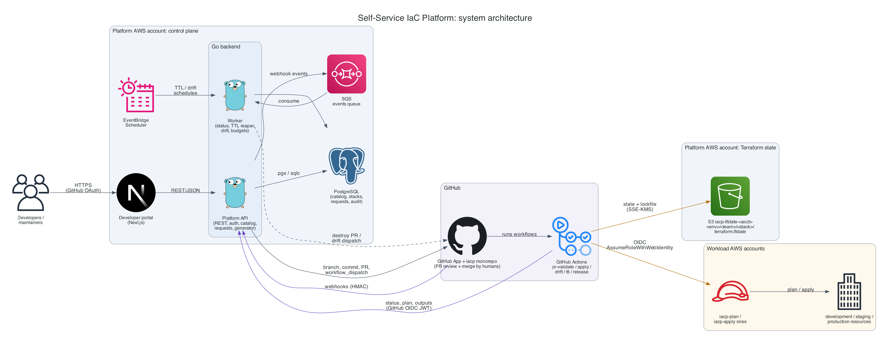
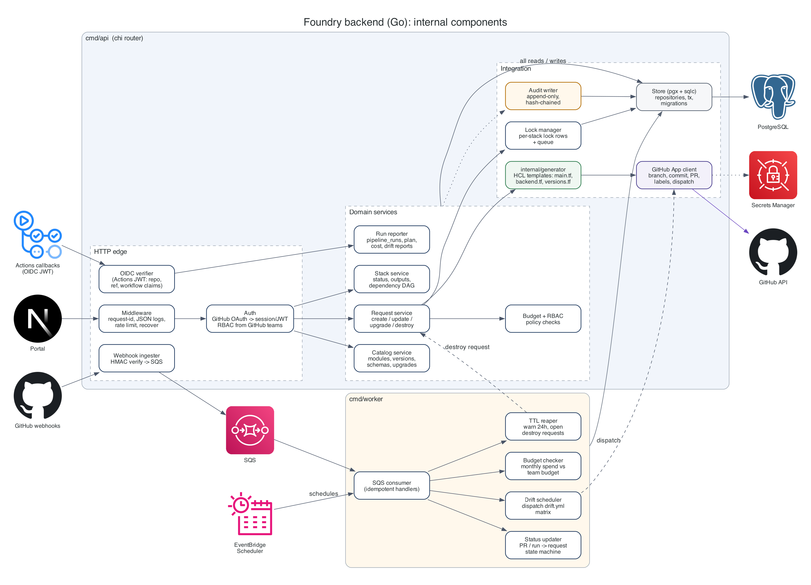
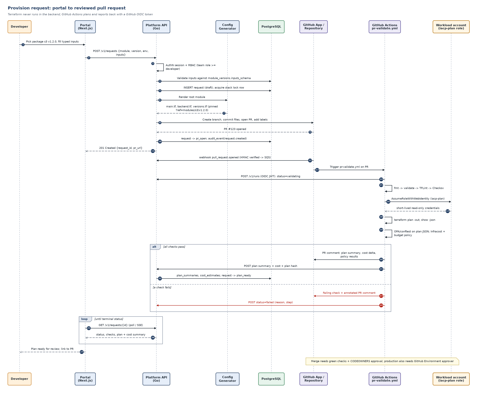
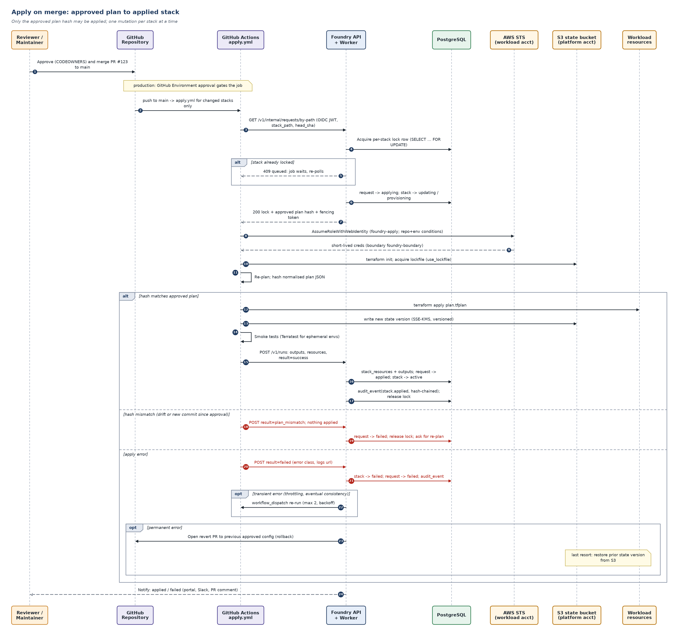
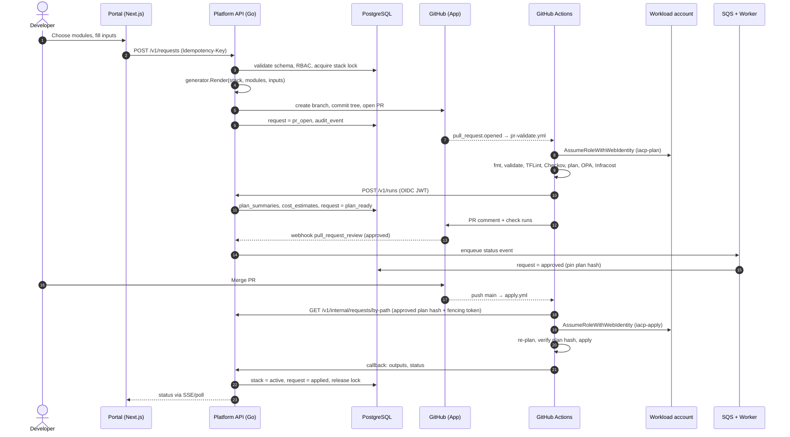

# 01 — System Architecture

> Purpose: describe the platform's components, how they interact end-to-end, how Terraform configuration is generated, and the key design trade-offs.

## Contents

1. [High-level architecture](#1-high-level-architecture)
2. [Component responsibilities](#2-component-responsibilities)
3. [Control plane vs. execution plane](#3-control-plane-vs-execution-plane)
4. [End-to-end request flow](#4-end-to-end-request-flow)
5. [Configuration generation](#5-configuration-generation)
6. [Concurrency and locking](#6-concurrency-and-locking)
7. [Failure handling](#7-failure-handling)
8. [Scalability](#8-scalability)
9. [Key trade-offs](#9-key-trade-offs)

Related: [00-problem-analysis.md](00-problem-analysis.md) · [02-aws-infrastructure.md](02-aws-infrastructure.md) · [03-data-model-and-api.md](03-data-model-and-api.md) · [04-module-registry.md](04-module-registry.md) · [05-automation-pipeline.md](05-automation-pipeline.md) · [06-lifecycle-management.md](06-lifecycle-management.md) · [07-security-and-policy.md](07-security-and-policy.md)

---

## 1. High-level architecture

The Self-Service IaC Platform is a **package manager for cloud infrastructure** plus a **PR-driven deployment and lifecycle platform**. Developers pick versioned Terraform modules ("packages") in the portal, fill typed inputs, and the platform opens a pull request in the `iacp` monorepo. GitHub Actions validates, scans, policy-checks, costs and plans the change; after review and merge it applies.



Three planes:

| Plane | Lives in | Responsibilities |
|---|---|---|
| **Experience** | Next.js portal (`portal/`) | Catalog browsing, typed forms, request/stack status, plans, costs, drift, audit views. |
| **Control** | Go API + worker (`backend/`), PostgreSQL, SQS, EventBridge Scheduler — AWS `platform` account | Identity/RBAC, catalog, request orchestration, config generation, GitHub App integration, locks, budgets, audit, scheduling (drift/TTL). Never holds AWS write credentials for workload accounts. |
| **Execution** | GitHub Actions in the monorepo; workload accounts `development` / `staging` / `production` | `terraform fmt/validate/plan/apply`, TFLint, Checkov, OPA/conftest, Infracost, Terratest. Authenticates via GitHub OIDC to per-account `iacp-plan` / `iacp-apply` roles. |

The portal renders catalog and request pages on the server, calling the API directly. Browser-side calls (the request form) go through the portal's same-origin route `/api/iacp/v1/...`, which forwards only an allow-list of user routes (`/v1/catalog/*`, `/v1/requests*`) to the API and rejects cross-site POSTs. Until GitHub OAuth (WBS 4.4) lands, the portal uses the API's dev auth mode through its `AuthProvider` seam ([portal/README.md](../portal/README.md)).

The backend's internal structure:



## 2. Component responsibilities

| Component | Package (`backend/internal/…`) | Responsibilities | Talks to |
|---|---|---|---|
| **API gateway / router** | `httpapi` | chi router, middleware (request ID, auth, RBAC, rate limit, idempotency keys, JSON logging), OpenAPI-validated handlers. | All services |
| **Auth** | `auth` | GitHub OAuth login, session JWT (15 min access + 8 h refresh, HttpOnly cookie), team/role sync from GitHub teams, OIDC token verification for Actions callbacks. | GitHub OAuth, Postgres |
| **Catalog service** | `catalog` | Modules, versions, manifests (`module.yaml`), JSON Schema for inputs, deprecations, upgrade paths, changelog. Indexed by `module-release.yml`. | Postgres |
| **Request service** | `requests` | Lifecycle of change requests (create/update/upgrade/destroy): validation, lock acquisition, state machine, queueing, approvals view. | Catalog, Generator, GitHub, Locks, Audit |
| **Config generator** | `generator` | Deterministically renders `main.tf`, `backend.tf`, `versions.tf`, `providers.tf`, `iacp.deps.auto.tfvars.json`, `iacp.stack.json` for a stack from templates + request + catalog. Pure function, no I/O. | — |
| **GitHub integration** | `github` | GitHub App installation token minting; branch, tree/commit, PR, labels, comments, `workflow_dispatch`; CODEOWNERS-aware reviewers. | GitHub REST/GraphQL |
| **Webhook ingester** | `webhooks` | Verifies `X-Hub-Signature-256`, de-dupes on `X-GitHub-Delivery`, maps `pull_request`, `workflow_run`, `check_run`, `pull_request_review` to internal events, enqueues to SQS. Returns 202 in < 100 ms. | SQS |
| **Run reporter** | `callbacks` | `POST /v1/runs` (plus `GET /v1/internal/requests/by-path`, `GET /v1/internal/budget-context`, `POST /v1/drift`): receives plan summary, cost estimate, policy results, apply outputs and drift results from Actions jobs authenticated by GitHub OIDC JWT. | Postgres, Locks, Audit |
| **Worker** | `worker` | Consumes SQS: status transitions, lock release + next-in-queue dispatch, TTL reaper, drift scheduler fan-out, budget checks, notifications, retries. | Postgres, GitHub, SQS, Scheduler |
| **Locks** | `locks` | Per-stack platform lock row with lease + fencing token; FIFO wait queue. | Postgres |
| **Budgets** | `budgets` | Per-team monthly budgets, consumption from cost estimates + CUR, override records. Exposes budget context to OPA via the plan pipeline. | Postgres |
| **Audit writer** | `audit` | Append-only, hash-chained `audit_events`; daily chain-head anchor to S3 object-lock bucket. | Postgres, S3 |
| **Notifier** | `notify` | Slack/email for request and stack events. | Slack, SES |

## 3. Control plane vs. execution plane

**Terraform never runs inside the backend.** The backend orchestrates via the GitHub API and observes via webhooks and authenticated callbacks.

Why:

1. **Blast radius.** If the backend ran Terraform it would need standing write access to every workload account. Instead, write credentials exist only as 1-hour STS sessions minted for an Actions job whose OIDC token proves `repo=<org>/iacp`, `ref=refs/heads/main` and (for prod) `environment=production`. A compromised API can open a PR — which still faces checks, CODEOWNERS and environment approval — but cannot apply.
2. **Review is the control.** Applying from merged `main` means the code that ran is exactly the code reviewed. There is no side channel where the platform applies something not in git.
3. **Elastic, isolated compute.** Each plan/apply gets a fresh ephemeral runner; no shared Terraform plugin cache poisoning, no long-running worker pool to scale or patch.
4. **Transparency and portability.** Engineers can read every log in Actions; in break-glass, the generated root module is plain Terraform runnable locally.
5. **Operational simplicity.** The backend stays a stateless CRUD + orchestration service with predictable latency.

Costs of this choice: dependence on GitHub availability, Actions minute cost, and asynchronous status (mitigated by webhooks + callbacks + reconciliation polling every 5 min for in-flight runs).

## 4. End-to-end request flow

### 4.1 Provision request (PR phase)



1. Developer submits `POST /v1/requests` with `Idempotency-Key`; API validates inputs against the module version's JSON Schema and RBAC (`developer` on team; `maintainer` needed to *approve* prod).
2. Request service acquires the stack lock (or enqueues the request as `queued` behind the holder) and records `draft`.
3. Generator renders files; GitHub integration creates branch `iacp/req-<short-id>`, commits the tree in one commit (Git Data API), opens a PR with labels `iacp`, `env:<env>`, `team:<team>`, `stack:<stack>` and a body containing request ID and module changelog excerpts. Request → `pr_open`.
4. `pull_request.opened` → `pr-validate.yml` starts; `workflow_run.in_progress` webhook → request `validating`.
5. Pipeline: `fmt → validate → TFLint → Checkov → plan (iacp-plan role) → conftest (OPA) → Infracost + budget policy`. Each step reports to `POST /v1/runs` with the job's GitHub OIDC JWT. Plan JSON SHA-256 is recorded as the **approved plan hash candidate**.
6. All checks green → request `plan_ready`; PR comment shows resource changes, cost delta, policy results.
7. Reviewer approval (CODEOWNERS; prod also needs Environment approval at apply time) → `pull_request_review.submitted` → request `approved`, plan hash pinned. GitHub Apps cannot be code owners, so where the platform itself approves — non-prod TTL-expiry destroy PRs — the review is submitted by a separate machine user, `iacp-approver` (member of `@acme/self-service-iac-platform-approvers`), whose token is used only by the worker. Production is never auto-approved.

### 4.2 Apply on merge



1. Merge to `main` → `apply.yml` computes changed stack directories (`git diff --name-only` on `environments/**`) and runs one job per stack with `concurrency: stack-<env>-<team>-<stack>`. If the push touches two stacks that depend on each other (per `iacp.stack.json`), the workflow refuses to run (dependent stacks must arrive as separate, ordered requests — see §6).
2. Job calls `GET /v1/internal/requests/by-path` (OIDC JWT): the API confirms the per-stack lock row for this merge and returns the approved plan hash and fencing token. It then assumes `iacp-apply` (prod job uses `environment: production` → manual approval gate).
3. Re-plan with `-out=tfplan`; compute SHA-256 of normalised `terraform show -json tfplan` (`resource_changes` only, sorted). Mismatch with approved hash → abort, request `failed` with reason `plan_mismatch`, new PR comment asks for re-review.
4. `terraform apply tfplan`; request `applying` → on success outputs (`terraform output -json`, sensitive values redacted) posted to API; stack `active`, request `applied`; lock released; next queued request for the stack is dispatched.
5. Ephemeral environments run Terratest/smoke tests post-apply.

### 4.3 Mermaid view of the main flow



## 5. Configuration generation

### 5.1 Design

- **Input:** `StackSpec` = stack identity (env, team, stack name, account, region), list of module instances `{name, module, version, inputs}`, dependency edges, tags.
- **Templates:** Go `text/template` files embedded with `embed.FS` in `backend/internal/generator/templates/` (`main.tf.tmpl`, `backend.tf.tmpl`, `versions.tf.tmpl`, `providers.tf.tmpl`). Values are emitted via `hclwrite` (from `hashicorp/hcl/v2`) rather than string concatenation to guarantee correct quoting/escaping.
- **Determinism rules:**
  - Module instances sorted by instance name; input keys sorted lexicographically; maps sorted.
  - No timestamps, random IDs or usernames in files; stack metadata lives in `iacp.stack.json` (sorted keys; stack identity, request ID, fencing token, module refs + resolved SHAs, `depends_on`).
  - Output passed through `hclwrite.Format` — equivalent to `terraform fmt`.
  - Module `source` always pinned to an immutable tag; tag → commit SHA verified at generation and recorded in `iacp.stack.json`.
  - Golden-file tests: `generator_test.go` renders fixtures and compares byte-for-byte.
- **Validation before render:** inputs validated against `module_versions.inputs_schema` (JSON Schema 2020-12) using `santhosh-tekuri/jsonschema`; platform-reserved inputs (`tags`, `name_prefix`, `kms_key_arn` where injected) cannot be overridden.
- **Dependency injection:** upstream stack outputs referenced by the user (e.g. a Lambda consuming a queue from another stack) are resolved from `stacks.outputs` at generation time and written to `iacp.deps.auto.tfvars.json`, which Terraform loads automatically; `main.tf` references them as `var.deps_<stack>_<output>` (declared in a generated `variables.tf`). No `terraform_remote_state`. When an upstream's outputs change, the platform opens a follow-up update request downstream.
- **Generated layout** (per stack):

```
environments/development/payments/order-events/
├── iacp.stack.json            # stack identity, request id, fencing token, module refs + SHAs, depends_on
├── backend.tf
├── versions.tf
├── providers.tf
├── main.tf
├── outputs.tf
├── variables.tf                  # always (standard module structure); declares deps_* variables when the stack has upstream dependencies
├── iacp.deps.auto.tfvars.json # upstream stack outputs injected by the platform
└── .terraform.lock.hcl           # provider lockfile (multi-platform hashes)
```

Each file starts with `# Code generated by the platform. DO NOT EDIT.` and CODEOWNERS assigns `environments/**` to `@<org>/iacp-bot` + the owning team so hand edits are visible in review (and the PR check `generated-drift` fails if a file differs from re-render).

### 5.2 Example: S3 + SQS + Lambda stack

`versions.tf`

```hcl
# Code generated by the platform. DO NOT EDIT.
terraform {
  required_version = "= 1.10.5"

  required_providers {
    aws = {
      source  = "hashicorp/aws"
      version = "~> 5.80"
    }
  }
}
```

`backend.tf`

```hcl
# Code generated by the platform. DO NOT EDIT.
terraform {
  backend "s3" {
    bucket       = "iacp-tfstate-111111111111"
    key          = "development/payments/order-events/terraform.tfstate"
    region       = "us-east-1"
    encrypt      = true
    kms_key_id   = "arn:aws:kms:us-east-1:111111111111:alias/iacp-tfstate"
    use_lockfile = true
  }
}
```

`providers.tf`

```hcl
# Code generated by the platform. DO NOT EDIT.
provider "aws" {
  region              = "us-east-1"
  allowed_account_ids = ["222222222222"] # development workload account

  default_tags {
    tags = {
      cost-center        = "cc-4102"
      "iacp:environment" = "development"
      "iacp:managed-by"  = "iacp"
      "iacp:stack"       = "order-events"
      "iacp:team"        = "payments"
    }
  }
}
```

> Credential chain: the Actions job exchanges its OIDC token directly for the workload account's `iacp-plan` or `iacp-apply` role (`aws-actions/configure-aws-credentials`), so the provider needs no `assume_role` block. The state bucket and its KMS key in the `platform` account grant those roles access cross-account, scoped to their environment's key prefix. `allowed_account_ids` is a guard against running with the wrong credentials. See [02-aws-infrastructure.md](02-aws-infrastructure.md#5-github-oidc-and-pipeline-roles).

`main.tf`

```hcl
# Code generated by the platform. DO NOT EDIT.
# Stack: development/payments/order-events

module "events_bucket" {
  source = "git::https://github.com/acme/self-service-iac-platform.git//modules/s3?ref=modules/s3/v1.2.0"

  name               = "payments-order-events-dev"
  force_destroy      = false
  lifecycle_rules    = [{ id = "expire-raw", prefix = "raw/", expiration_days = 30 }]
  versioning_enabled = true
}

module "orders_queue" {
  source = "git::https://github.com/acme/self-service-iac-platform.git//modules/sqs?ref=modules/sqs/v1.3.0"

  dlq_max_receive_count      = 5
  message_retention_seconds  = 345600
  name                       = "payments-order-events-dev"
  visibility_timeout_seconds = 60
}

module "order_processor" {
  source = "git::https://github.com/acme/self-service-iac-platform.git//modules/lambda?ref=modules/lambda/v2.0.1"

  environment_variables = {
    BUCKET_NAME = module.events_bucket.bucket_name
    QUEUE_URL   = module.orders_queue.queue_url
  }
  handler       = "bootstrap"
  memory_size   = 256
  name          = "payments-order-processor-dev"
  runtime       = "provided.al2023"
  sqs_event_source = {
    batch_size = 10
    queue_arn  = module.orders_queue.queue_arn
  }
  s3_write_bucket_arns = [module.events_bucket.bucket_arn]
  timeout              = 30
}
```

`outputs.tf`

```hcl
# Code generated by the platform. DO NOT EDIT.
output "events_bucket" {
  value = {
    bucket_arn  = module.events_bucket.bucket_arn
    bucket_name = module.events_bucket.bucket_name
  }
}

output "orders_queue" {
  value = {
    dlq_arn   = module.orders_queue.dlq_arn
    queue_arn = module.orders_queue.queue_arn
    queue_url = module.orders_queue.queue_url
  }
}

output "order_processor" {
  value = {
    function_arn  = module.order_processor.function_arn
    function_name = module.order_processor.function_name
    role_arn      = module.order_processor.role_arn
  }
}
```

`iacp.stack.json` (metadata; not read by Terraform)

```json
{
  "depends_on": [],
  "environment": "development",
  "fencing_token": 48213,
  "modules": {
    "events_bucket":   { "ref": "modules/s3/v1.2.0",     "sha": "4e1c9a7b2d8f0e3a5c6b7d8e9f0a1b2c3d4e5f60" },
    "order_processor": { "ref": "modules/lambda/v2.0.1", "sha": "8b7c6d5e4f3a2b1c0d9e8f7a6b5c4d3e2f1a0b9c" },
    "orders_queue":    { "ref": "modules/sqs/v1.3.0",    "sha": "9c1d4e5f6a7b8c9d0e1f2a3b4c5d6e7f8a9b0c1d" }
  },
  "request_id": "req-7k3p9x",
  "stack": "order-events",
  "team": "payments"
}
```

When a stack depends on another stack (say `payments/order-api` consumes this stack's queue), the downstream stack gets `iacp.deps.auto.tfvars.json`, rendered from the upstream's recorded outputs:

```json
{
  "deps_order_events_orders_queue_arn": "arn:aws:sqs:us-east-1:222222222222:payments-order-events-dev",
  "deps_order_events_orders_queue_url": "https://sqs.us-east-1.amazonaws.com/222222222222/payments-order-events-dev"
}
```

Intra-stack wiring (`module.orders_queue.queue_arn`) is expressed in the request as a **reference input** (`{"$ref": "orders_queue.queue_arn"}`), which the generator renders as a Terraform expression after validating the referenced output exists in the target module's manifest.

## 6. Concurrency and locking

Two independent layers:

| Layer | Mechanism | Protects against |
|---|---|---|
| **Platform lock** | Row in `locks` (one per stack) with `holder_request_id`, `lease_expires_at`, monotonically increasing `fencing_token`. Acquired with `INSERT … ON CONFLICT DO NOTHING` / conditional `UPDATE` in one transaction. Waiters recorded in `requests` with status `draft` + `queued_behind`. | Two requests generating conflicting PRs against the same stack; apply ordering. |
| **Terraform state lock** | S3 native lockfile (`use_lockfile = true`) — `<key>.tflock` object created with conditional write. | Two Terraform processes writing state concurrently (incl. drift plans, break-glass). |
| **CI concurrency** | `concurrency: group: stack-${env}-${team}-${stack}`, `cancel-in-progress: false` in both workflows. | Duplicate runs for the same stack from re-pushes. |

Rules:

- A stack lock is held from PR creation until the request reaches a terminal state (`applied`, `failed`, `rejected`, `cancelled`). Queued requests are processed FIFO.
- Lease: 24 h, renewed by any pipeline callback. The worker's reaper releases expired leases and marks the holder `failed(lock_expired)` if its PR is closed/stale.
- Every callback carries the fencing token from `iacp.stack.json`; stale tokens are rejected (`409 stale_fencing_token`).
- PR plans and drift plans run with `-lock=false` (read-only role, no state writes); only `apply.yml` (and audited break-glass) takes the S3 lockfile. Nightly drift (02:00 UTC) skips stacks whose platform lock is held.
- Cross-stack ordering: when one portal action affects several dependent stacks, the backend splits it into **sequential requests ordered topologically** (Kahn's algorithm over `stack_dependencies`); request *n+1* is opened only after request *n* is `applied`, so its generated `iacp.deps.auto.tfvars.json` carries the fresh upstream outputs. `apply.yml` refuses a single push that touches two dependent stacks. Independent stacks in one push apply in parallel up to `max-parallel: 10`.

## 7. Failure handling

| Failure | Detection | Handling |
|---|---|---|
| GitHub API error / rate limit during PR creation | HTTP 5xx / 403 with `x-ratelimit-remaining: 0` | Worker retries with exponential backoff + jitter (max 6 attempts, 30 min); request remains `draft`; idempotent via branch name + `Idempotency-Key`. |
| Webhook lost | Missing transition after expected window | Reconciler polls `GET /repos/.../actions/runs?head_sha=` for in-flight requests every 5 min. |
| Webhook duplicated | `X-GitHub-Delivery` seen | Dropped (unique index on `webhook_deliveries.delivery_id`, 7-day TTL). |
| Pipeline validation failure (lint/policy/budget) | Callback `status=failed` | Request `failed` with structured findings; lock released; user edits inputs → new request. |
| Plan hash mismatch at apply | `apply.yml` comparison | Abort before apply; request `failed(plan_mismatch)`; PR comment; maintainer re-opens via "Re-plan". |
| Transient apply error (throttling, eventual consistency, `RequestLimitExceeded`, provider 5xx) | Exit code + log classifier regexes | Auto-retry at most 2× with exponential backoff (1 min, then 5 min) via `workflow_dispatch` of `apply.yml` for that stack. |
| Non-transient apply error | Retries exhausted / classifier | Stack `failed`, request `failed`, page owning team; options: fix-forward request, or **rollback** = an update request that re-renders the last applied config (state versions in S3 as last resort, see [06-lifecycle-management.md](06-lifecycle-management.md)). |
| Runner died mid-apply | Job `cancelled`/timeout, state lock lingering | S3 lockfile left; worker detects, notifies maintainers; `force-unlock` only via audited admin action that dispatches a workflow. |
| Callback cannot reach API | Job step fails | Steps retry 5× with backoff; job artifacts (plan JSON, cost JSON) uploaded so reconciler can backfill via GitHub API. |
| Database unavailable | Health checks | API returns 503; webhooks still accepted (SQS buffer); worker resumes on recovery. |

## 8. Scalability

- **API/worker:** stateless ECS Fargate services; API scales on ALB request count per target (target 500 rpm/task, min 2, max 10); worker scales on SQS `ApproximateNumberOfMessagesVisible` (1 task per 100 msgs, min 1, max 8).
- **Database:** RDS Postgres `db.t4g.medium` Multi-AZ handles the 5 000-stack target easily (row counts in the low millions; audit events ~ 2 M/yr). Read replica added only if reporting queries contend.
- **GitHub API:** GitHub App rate limit scales with installation (≥ 5 000 req/h; 15 000 on Enterprise Cloud). Each request costs ~12 calls; at 500 requests/day this is < 10 % of budget. Conditional requests (`ETag`) for polling.
- **Actions:** per-stack jobs; org concurrency limit (e.g. 500 on Enterprise) far above 50 concurrent target. Provider plugin cache via `actions/cache` keyed on `.terraform.lock.hcl`.
- **Monorepo growth:** path-filtered triggers; `apply.yml` computes changed stacks only; sparse checkout of `modules/` + target stack directory. At > 20 000 stacks, consider sharding `environments/` per business unit into separate repos (generator already parameterises the repo).
- **Drift:** nightly at 02:00 UTC; matrix chunked into batches of 200 stacks per workflow run (`plan -detailed-exitcode -lock=false`), dispatched by the worker in staggered waves to spread load.
- **TTL:** an hourly reaper tick (EventBridge Scheduler → SQS → worker) warns owners 24 h ahead and opens destroy requests at expiry; in non-prod these TTL destroy PRs are auto-approved by the `iacp-approver` machine user (production never auto-approves).

## 9. Key trade-offs

| Decision | Alternative | Why we chose it | What we give up |
|---|---|---|---|
| Execute in GitHub Actions | Run Terraform in backend workers | No standing write creds; reviewed code = applied code; zero runner ops. | Latency (~30–60 s job startup); GitHub dependency. |
| Monorepo for modules + generated stacks | Repo per team / per stack | Atomic module + consumer changes, single policy set, simple CODEOWNERS, one GitHub App installation. | CI fan-out; repo size; coarse-grained repo permissions (mitigated by CODEOWNERS + branch protection). |
| Generated plain HCL | Terragrunt / CDKTF / dynamic workspaces | Readable, reviewable, portable, break-glass friendly. | Some duplication across stacks (acceptable: it's generated). |
| Platform-injected outputs instead of `terraform_remote_state` | Remote state data sources | No cross-stack state read permissions; explicit dependency in PR; deterministic. | Downstream needs a follow-up PR when upstream outputs change (automated). |
| Postgres lock + S3 lockfile | DynamoDB lock table | `use_lockfile` removes DynamoDB; Postgres lock gives queueing semantics Terraform lacks. | Two locks to reason about (documented above). |
| Apply after merge | Apply before merge (Atlantis style) | `main` always reflects deployed state; simpler mental model. | Failed apply leaves `main` ahead of reality until fix/revert — handled by `failed` stack state and revert-PR rollback. |
| Plan-hash verification | Trust re-plan | Ensures what was reviewed is what applies. | Occasional false mismatch on non-deterministic providers → re-review. |
