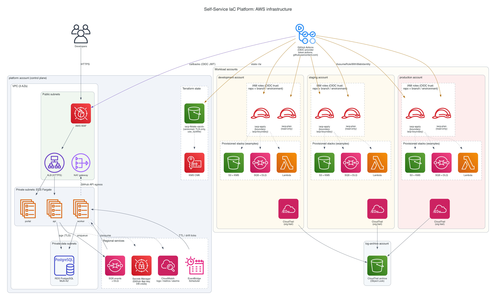

# 02 — AWS Infrastructure

> Purpose: define the AWS accounts, the platform account's network and services, the Terraform state backend, GitHub OIDC roles, logging, observability, DR, cost and local development setup for the platform.

## Contents

1. [Account layout](#1-account-layout)
2. [Platform account network](#2-platform-account-network)
3. [Platform services](#3-platform-services)
4. [Terraform state backend](#4-terraform-state-backend)
5. [GitHub OIDC and pipeline roles](#5-github-oidc-and-pipeline-roles)
6. [Permission boundary](#6-permission-boundary)
7. [CloudTrail and log archive](#7-cloudtrail-and-log-archive)
8. [Observability](#8-observability)
9. [Disaster recovery and backup](#9-disaster-recovery-and-backup)
10. [Platform cost estimate](#10-platform-cost-estimate)
11. [Local setup with LocalStack](#11-local-setup-with-localstack)

Related: [01-system-architecture.md](01-system-architecture.md) · [05-automation-pipeline.md](05-automation-pipeline.md) · [07-security-and-policy.md](07-security-and-policy.md)

Account IDs used in examples: `platform` = 111111111111, `development` = 222222222222, `staging` = 333333333333, `production` = 444444444444, `log-archive` = 555555555555, `security` (audit/tooling) = 666666666666. GitHub org `acme`, repo `acme/self-service-iac-platform`. Home region `us-east-1`.

---

## 1. Account layout



```
AWS Organization (management account — no workloads)
├── OU: Security
│   ├── log-archive   (555555555555)  CloudTrail archive bucket (all accounts' trails), Config, VPC flow logs — S3 Object Lock
│   └── security      (666666666666)  GuardDuty/Security Hub delegated admin, Access Analyzer
├── OU: Platform
│   └── platform      (111111111111)  the platform control plane + Terraform state bucket
└── OU: Workloads
    ├── development   (222222222222)
    ├── staging       (333333333333)
    └── production    (444444444444)
```

| Account | Hosts | Who can write |
|---|---|---|
| `platform` | ECS Fargate (api, worker, portal), ALB + WAF, RDS Postgres Multi-AZ, SQS, EventBridge Scheduler, Secrets Manager, KMS, CloudWatch, `iacp-tfstate-111111111111` bucket, audit anchor bucket | Platform team via its own Terraform pipeline (`platform/` stack, separate from tenant stacks) |
| `development` / `staging` / `production` | Team resources provisioned by the platform stacks | `iacp-apply` (via Actions OIDC) only; humans read-only; `iacp-breakglass` with MFA + alert |
| `log-archive` | Org CloudTrail, Config snapshots, ALB/WAF logs | Nobody (write-only service principals; Object Lock compliance mode) |

**Service control policies** (attached to Workloads OU):

- Deny leaving org, disabling CloudTrail/Config/GuardDuty, deleting flow logs.
- Deny regions outside `us-east-1`, `us-west-2` (except global services).
- Deny `iam:CreateUser`, `iam:CreateAccessKey` for all principals except `iacp-breakglass`.
- Deny IAM role creation without `iacp-boundary` attached for principals matching `iacp-apply`.
- Deny `s3:PutBucketPublicAccessBlock` with any setting other than all-true (account-level BPA locked).

## 2. Platform account network

VPC `iacp-platform` — `10.40.0.0/16`, three AZs.

| Tier | AZ a | AZ b | AZ c | Contents | Routing |
|---|---|---|---|---|---|
| Public | 10.40.0.0/24 | 10.40.1.0/24 | 10.40.2.0/24 | ALB, NAT gateways | IGW |
| Private-app | 10.40.16.0/20 | 10.40.32.0/20 | 10.40.48.0/20 | ECS Fargate tasks (api, worker, portal) | NAT (1 per AZ in prod; 1 shared in non-prod platform env) |
| Private-data | 10.40.64.0/24 | 10.40.65.0/24 | 10.40.66.0/24 | RDS Postgres | No internet route |
| Reserved | 10.40.128.0/17 | | | future (runners, endpoints) | |

**VPC endpoints** (interface unless stated): `s3` (gateway), `sqs`, `secretsmanager`, `kms`, `logs`, `ecr.api`, `ecr.dkr`, `sts`, `scheduler`, `monitoring`. Reduces NAT traffic and keeps AWS API calls private.

**Security groups**

| SG | Inbound | Outbound |
|---|---|---|
| `sg-alb` | 443 from `0.0.0.0/0` (WAF in front); 80 → redirect | `sg-app` on 8080, 3000 |
| `sg-app` | 8080 (api), 3000 (portal) from `sg-alb` | 5432 to `sg-db`; 443 to endpoints and NAT (GitHub API, Slack) |
| `sg-db` | 5432 from `sg-app` | none |

**Edge**

- Route 53: `iacp.acme.internal` (portal) and `api.iacp.acme.internal` with ACM certificate. Public DNS name is used because GitHub webhooks and Actions callbacks must reach the API; portal paths are restricted to corporate egress IPs/SSO at WAF.
- ALB listener rules: `/v1/webhooks/github` and `/v1/internal/*` → api target group (WAF rule set allows GitHub hook IP ranges from `api.github.com/meta` for webhooks; callbacks authenticated by OIDC JWT, not IP); `/v1/*` → api; `/*` → portal.
- **AWS WAF** web ACL: `AWSManagedRulesCommonRuleSet`, `KnownBadInputsRuleSet`, `AmazonIpReputationList`, rate-based rule 2 000 req/5 min per IP, body size limit 1 MB, geo-allow list; IP set rule restricting non-webhook paths to corporate CIDRs + VPN.

## 3. Platform services

| Service | Configuration |
|---|---|
| **ECS cluster** `iacp` (Fargate, Container Insights on) | `api`: 0.5 vCPU / 1 GB, min 2 max 10, ARM64. `worker`: 0.5 vCPU / 1 GB, min 1 max 8. `portal`: 0.25 vCPU / 0.5 GB, min 2 max 6. Images in ECR with immutable tags + scan on push; deployment circuit breaker with rollback. |
| **RDS PostgreSQL 16** | `db.t4g.medium` Multi-AZ, 100 GB gp3, storage autoscaling to 500 GB, encrypted with CMK `alias/iacp-rds`, IAM auth enabled, `rds.force_ssl=1`, PITR 35 days, Performance Insights 7 days, deletion protection. |
| **SQS** | `iacp-events` (standard, visibility 120 s, maxReceive 5 → `iacp-events-dlq`, retention 14 d), `iacp-github-outbound` (retries of GitHub writes), SSE-KMS. |
| **EventBridge Scheduler** | `iacp-drift-nightly` (`cron(0 2 * * ? *)`, timezone UTC → SQS `drift.schedule`; worker dispatches `drift.yml` batches), `iacp-ttl-reaper` (`rate(1 hour)` → SQS `ttl.tick`; worker warns at T−24 h and opens destroy requests at expiry), `iacp-budget-daily`, `iacp-audit-anchor` (`cron(15 0 * * ? *)`). All schedules use a dedicated role `iacp-scheduler` with `sqs:SendMessage` only. |
| **Secrets Manager** | `iacp/github-app/private-key`, `iacp/github-app/webhook-secret`, `iacp/oauth/client-secret`, `iacp/jwt/signing-key` (rotated 90 d, dual-key validation), `iacp/slack/webhook`. RDS master password managed by RDS (`manage_master_user_password`). |
| **KMS CMKs** | `alias/iacp-tfstate`, `alias/iacp-rds`, `alias/iacp-app` (SQS, Secrets, logs), `alias/iacp-audit`. Automatic rotation on. |
| **S3 buckets** | `iacp-tfstate-111111111111`, `iacp-plan-artifacts-111111111111` (plan JSON/cost JSON, 90 d lifecycle), `iacp-audit-anchor-111111111111` (Object Lock compliance 7 y). |

Task roles: `iacp-api-task` (SQS send, Secrets read of specific ARNs, S3 read plan artifacts, `rds-db:connect` as `iacp_app`), `iacp-worker-task` (SQS consume/send, audit anchor `PutObject`). **Neither has any permission in workload accounts.**

## 4. Terraform state backend

- Bucket `iacp-tfstate-111111111111` in `platform`, region `us-east-1`.
- Key layout: `<env>/<team>/<stack>/terraform.tfstate` (+ `.tflock` sibling from `use_lockfile`).
- Versioning enabled; noncurrent versions retained 90 days (lifecycle → Glacier IR after 30 d).
- Block Public Access (all four), Object Ownership `BucketOwnerEnforced` (ACLs disabled).
- Default encryption SSE-KMS with `alias/iacp-tfstate`, bucket key enabled.
- Replication to `iacp-tfstate-dr-111111111111` in `us-west-2` (see §9).
- Access logs → `log-archive`.

### 4.1 Bucket policy

Each environment's roles can only touch their own key prefix. `iacp-plan` is read-only (PR and drift plans run with `-lock=false`); `iacp-apply` gets read/write including the `.tflock` lockfile.

```json
{
  "Version": "2012-10-17",
  "Statement": [
    {
      "Sid": "DenyInsecureTransport",
      "Effect": "Deny",
      "Principal": "*",
      "Action": "s3:*",
      "Resource": [
        "arn:aws:s3:::iacp-tfstate-111111111111",
        "arn:aws:s3:::iacp-tfstate-111111111111/*"
      ],
      "Condition": { "Bool": { "aws:SecureTransport": "false" } }
    },
    {
      "Sid": "DenyUnencryptedOrWrongKey",
      "Effect": "Deny",
      "Principal": "*",
      "Action": "s3:PutObject",
      "Resource": "arn:aws:s3:::iacp-tfstate-111111111111/*",
      "Condition": {
        "StringNotEqualsIfExists": {
          "s3:x-amz-server-side-encryption-aws-kms-key-id": "arn:aws:kms:us-east-1:111111111111:key/7f3c0d2e-5a1b-4c8d-9e2f-0a1b2c3d4e5f"
        }
      }
    },
    {
      "Sid": "DenyOutsideOrg",
      "Effect": "Deny",
      "Principal": "*",
      "Action": "s3:*",
      "Resource": [
        "arn:aws:s3:::iacp-tfstate-111111111111",
        "arn:aws:s3:::iacp-tfstate-111111111111/*"
      ],
      "Condition": { "StringNotEquals": { "aws:PrincipalOrgID": "o-acme12345" } }
    },
    {
      "Sid": "ListOwnEnvPrefix",
      "Effect": "Allow",
      "Principal": {
        "AWS": [
          "arn:aws:iam::222222222222:role/iacp-plan",
          "arn:aws:iam::222222222222:role/iacp-apply"
        ]
      },
      "Action": "s3:ListBucket",
      "Resource": "arn:aws:s3:::iacp-tfstate-111111111111",
      "Condition": { "StringLike": { "s3:prefix": ["development/*"] } }
    },
    {
      "Sid": "DevPlanRead",
      "Effect": "Allow",
      "Principal": { "AWS": "arn:aws:iam::222222222222:role/iacp-plan" },
      "Action": ["s3:GetObject"],
      "Resource": "arn:aws:s3:::iacp-tfstate-111111111111/development/*"
    },
    {
      "Sid": "DevApplyReadWrite",
      "Effect": "Allow",
      "Principal": { "AWS": "arn:aws:iam::222222222222:role/iacp-apply" },
      "Action": ["s3:GetObject", "s3:PutObject", "s3:DeleteObject"],
      "Resource": "arn:aws:s3:::iacp-tfstate-111111111111/development/*"
    }
  ]
}
```

The `ListOwnEnvPrefix`, `DevPlanRead` and `DevApplyReadWrite` statements are repeated for staging (`333333333333`, prefix `staging/*`) and production (`444444444444`, prefix `production/*`); the policy is generated by the platform's own Terraform from an `environments` map.

`s3:DeleteObject` on `*.tfstate` for the apply role is needed only for `terraform state rm`-style operations; a further guard denies `DeleteObject` on keys ending `terraform.tfstate` except to the platform admin role, since versioning retains prior versions regardless.

### 4.2 KMS key policy outline (`alias/iacp-tfstate`)

| Statement | Principal | Actions | Conditions |
|---|---|---|---|
| Root/admin | `arn:aws:iam::111111111111:root` (delegation) + `iacp-kms-admin` role | `kms:*` admin actions **excluding** `Decrypt`/`Encrypt` for the admin role | — |
| State read | `iacp-plan` roles in 222…/333…/444… | `kms:Decrypt`, `kms:DescribeKey` | `kms:ViaService = s3.us-east-1.amazonaws.com`; `kms:EncryptionContext:aws:s3:arn` like `arn:aws:s3:::iacp-tfstate-111111111111/<env>/*` matching role's env |
| State write | `iacp-apply` roles | `kms:Decrypt`, `kms:Encrypt`, `kms:GenerateDataKey*`, `kms:DescribeKey` | same `ViaService` + per-env encryption-context condition |
| Replication | `iacp-s3-replication` role | `kms:Decrypt` | `ViaService` s3 |
| Deny | `*` | `kms:ScheduleKeyDeletion`, `kms:DisableKey` | unless `aws:PrincipalArn` = break-glass admin and MFA present |

Humans have **no** decrypt permission on state by default. Platform engineers needing to read state use an audited `state-read` workflow (`workflow_dispatch`) that prints a redacted summary.

### 4.3 Generated `backend.tf`

```hcl
# Code generated by the platform. DO NOT EDIT.
terraform {
  backend "s3" {
    bucket       = "iacp-tfstate-111111111111"
    key          = "production/payments/order-events/terraform.tfstate"
    region       = "us-east-1"
    encrypt      = true
    kms_key_id   = "arn:aws:kms:us-east-1:111111111111:alias/iacp-tfstate"
    use_lockfile = true   # S3 native locking (Terraform >= 1.10; CI pins 1.10.5); no DynamoDB table
  }
}
```

## 5. GitHub OIDC and pipeline roles

Each workload account (and `platform`, for module tests in a sandbox role) has the IAM OIDC provider:

```hcl
resource "aws_iam_openid_connect_provider" "github" {
  url            = "https://token.actions.githubusercontent.com"
  client_id_list = ["sts.amazonaws.com"]
  # AWS validates GitHub's certificate chain via its trusted CA library;
  # thumbprint retained for older API compatibility.
  thumbprint_list = ["6938fd4d98bab03faadb97b34396831e3780aea1"]
}
```

The repo is configured with a **customised OIDC `sub` claim** template including `repo`, `context` (ref or environment) and `job_workflow_ref`, so trust can bind to the specific workflow file:

```json
{ "use_default": false, "include_claim_keys": ["repo", "context", "job_workflow_ref"] }
```

Resulting `sub` examples:

- PR plan: `repo:acme/self-service-iac-platform:pull_request:job_workflow_ref:acme/self-service-iac-platform/.github/workflows/pr-validate.yml@refs/pull/812/merge`
- Dev/staging apply: `repo:acme/self-service-iac-platform:environment:staging:job_workflow_ref:acme/self-service-iac-platform/.github/workflows/apply.yml@refs/heads/main`

### 5.1 `iacp-plan` trust policy (per workload account)

Allowed from pull requests and from the drift workflow on `main`. Read-only — safe for untrusted PR branches *within the repo* (fork PRs do not receive OIDC tokens with `id-token: write` in this repo's settings; forking is disabled for the private repo).

```json
{
  "Version": "2012-10-17",
  "Statement": [
    {
      "Sid": "GitHubActionsPlan",
      "Effect": "Allow",
      "Principal": {
        "Federated": "arn:aws:iam::333333333333:oidc-provider/token.actions.githubusercontent.com"
      },
      "Action": "sts:AssumeRoleWithWebIdentity",
      "Condition": {
        "StringEquals": {
          "token.actions.githubusercontent.com:aud": "sts.amazonaws.com",
          "token.actions.githubusercontent.com:repository_owner_id": "12345678",
          "token.actions.githubusercontent.com:repository_id": "87654321"
        },
        "StringLike": {
          "token.actions.githubusercontent.com:sub": [
            "repo:acme/self-service-iac-platform:pull_request:job_workflow_ref:acme/self-service-iac-platform/.github/workflows/pr-validate.yml@*",
            "repo:acme/self-service-iac-platform:ref:refs/heads/main:job_workflow_ref:acme/self-service-iac-platform/.github/workflows/drift.yml@refs/heads/main"
          ]
        }
      }
    }
  ]
}
```

Using immutable `repository_id`/`repository_owner_id` claims defends against repo rename/recreation attacks.

Permissions: `ReadOnlyAccess` minus data-plane reads (explicit deny on `s3:GetObject` for non-state buckets, `dynamodb:GetItem/Scan/Query`, `secretsmanager:GetSecretValue`, `ssm:GetParameter*` with `WithDecryption`, `kms:Decrypt` except via S3 for state), plus state prefix read (granted on the bucket side, §4.1); no lockfile write because plans run with `-lock=false`. Session duration 1 h.

### 5.2 `iacp-apply` trust policy

Only from `apply.yml` on `main` (dev/staging), or bound to the `production` GitHub Environment for the production account (environment requires maintainer approval and only allows deployments from `main`).

Production account (444444444444):

```json
{
  "Version": "2012-10-17",
  "Statement": [
    {
      "Sid": "GitHubActionsApplyProduction",
      "Effect": "Allow",
      "Principal": {
        "Federated": "arn:aws:iam::444444444444:oidc-provider/token.actions.githubusercontent.com"
      },
      "Action": "sts:AssumeRoleWithWebIdentity",
      "Condition": {
        "StringEquals": {
          "token.actions.githubusercontent.com:aud": "sts.amazonaws.com",
          "token.actions.githubusercontent.com:repository_id": "87654321",
          "token.actions.githubusercontent.com:sub": [
            "repo:acme/self-service-iac-platform:environment:production:job_workflow_ref:acme/self-service-iac-platform/.github/workflows/apply.yml@refs/heads/main",
            "repo:acme/self-service-iac-platform:environment:production:job_workflow_ref:acme/self-service-iac-platform/.github/workflows/ttl-reaper.yml@refs/heads/main"
          ]
        }
      }
    }
  ]
}
```

Development account (222222222222). Every apply job runs in a GitHub Environment named after the target environment (`development`, `staging`, `production`); only `production` has required reviewers, but binding all trust policies to an environment lets each account accept tokens from its own environment only. Module Terratest runs (`module-release.yml`) use a separate `iacp-test` role in a sandbox account, never `iacp-apply`.

```json
{
  "Version": "2012-10-17",
  "Statement": [
    {
      "Sid": "GitHubActionsApplyDevelopment",
      "Effect": "Allow",
      "Principal": {
        "Federated": "arn:aws:iam::222222222222:oidc-provider/token.actions.githubusercontent.com"
      },
      "Action": "sts:AssumeRoleWithWebIdentity",
      "Condition": {
        "StringEquals": {
          "token.actions.githubusercontent.com:aud": "sts.amazonaws.com",
          "token.actions.githubusercontent.com:repository_id": "87654321"
        },
        "StringLike": {
          "token.actions.githubusercontent.com:sub": [
            "repo:acme/self-service-iac-platform:environment:development:job_workflow_ref:acme/self-service-iac-platform/.github/workflows/apply.yml@refs/heads/main",
            "repo:acme/self-service-iac-platform:environment:development:job_workflow_ref:acme/self-service-iac-platform/.github/workflows/ttl-reaper.yml@refs/heads/main"
          ]
        }
      }
    }
  ]
}
```

`iacp-apply` permissions: a curated policy covering the services offered by the catalog (S3, SQS, Lambda, KMS, IAM roles/policies under path `/iacp/` only, CloudWatch Logs, later ECS/ELB/ECR/RDS/ElastiCache/EC2-VPC), with:

- `iam:CreateRole`, `iam:PutRolePermissionsBoundary` only when `iam:PermissionsBoundary = arn:aws:iam::<acct>:policy/iacp-boundary`.
- Resource ARNs constrained to name prefix `<team>-*` is not feasible across all services, so tag-based conditions are used where supported: `aws:RequestTag/iacp:managed-by = iacp` on create, `aws:ResourceTag/iacp:managed-by = iacp` on update/delete.
- Max session 1 h; role itself has `iacp-boundary` attached as well.

### 5.3 Callback authentication

Actions jobs call the Platform API with an OIDC token requested with audience `https://api.iacp.acme.internal`. The API verifies signature (JWKS from `https://token.actions.githubusercontent.com/.well-known/jwks`), `iss`, `aud`, `repository_id`, `job_workflow_ref` in an allowlist, and `run_id` matching a known pipeline run. Endpoints: `POST /v1/runs`, `POST /v1/drift`, `GET /v1/internal/requests/by-path`, `GET /v1/internal/budget-context`, `POST /v1/internal/catalog/index`. See [03-data-model-and-api.md](03-data-model-and-api.md#69-pipeline-runs-actions-callbacks).

## 6. Permission boundary

`iacp-boundary` caps whatever IAM roles the platform-provisioned stacks create (e.g. Lambda execution roles) and `iacp-apply` itself.

```json
{
  "Version": "2012-10-17",
  "Statement": [
    {
      "Sid": "AllowServicesInCatalog",
      "Effect": "Allow",
      "Action": [
        "s3:*", "sqs:*", "sns:*", "lambda:*", "logs:*", "cloudwatch:*",
        "kms:Encrypt", "kms:Decrypt", "kms:GenerateDataKey*", "kms:DescribeKey",
        "kms:CreateKey", "kms:CreateAlias", "kms:TagResource", "kms:PutKeyPolicy",
        "kms:EnableKeyRotation", "kms:ScheduleKeyDeletion", "kms:GetKeyPolicy", "kms:GetKeyRotationStatus", "kms:ListResourceTags",
        "ecs:*", "ecr:*", "elasticloadbalancing:*", "rds:*", "elasticache:*",
        "ec2:Describe*", "ec2:*SecurityGroup*", "ec2:*Vpc*", "ec2:*Subnet*", "ec2:*Route*", "ec2:*NetworkInterface*", "ec2:CreateTags",
        "xray:PutTraceSegments", "xray:PutTelemetryRecords",
        "secretsmanager:GetSecretValue", "ssm:GetParameter*",
        "iam:GetRole", "iam:ListRole*", "iam:PassRole", "iam:GetPolicy*", "iam:ListPolicies", "iam:ListAttachedRolePolicies"
      ],
      "Resource": "*",
      "Condition": { "StringEquals": { "aws:RequestedRegion": ["us-east-1", "us-west-2"] } }
    },
    {
      "Sid": "ManageOnlyBoundedIacpRoles",
      "Effect": "Allow",
      "Action": [
        "iam:CreateRole", "iam:PutRolePolicy", "iam:AttachRolePolicy",
        "iam:DetachRolePolicy", "iam:DeleteRolePolicy", "iam:DeleteRole",
        "iam:TagRole", "iam:UntagRole", "iam:UpdateAssumeRolePolicy"
      ],
      "Resource": "arn:aws:iam::*:role/iacp/*",
      "Condition": {
        "StringEquals": {
          "iam:PermissionsBoundary": "arn:aws:iam::${aws:PrincipalAccount}:policy/iacp-boundary"
        }
      }
    },
    {
      "Sid": "PassOnlyIacpRoles",
      "Effect": "Deny",
      "Action": "iam:PassRole",
      "NotResource": "arn:aws:iam::*:role/iacp/*"
    },
    {
      "Sid": "NoBoundaryOrPlatformTampering",
      "Effect": "Deny",
      "Action": [
        "iam:DeleteRolePermissionsBoundary", "iam:PutRolePermissionsBoundary",
        "iam:CreatePolicyVersion", "iam:DeletePolicy", "iam:SetDefaultPolicyVersion"
      ],
      "Resource": [
        "arn:aws:iam::*:policy/iacp-boundary",
        "arn:aws:iam::*:role/iacp-plan",
        "arn:aws:iam::*:role/iacp-apply",
        "arn:aws:iam::*:role/iacp-breakglass"
      ]
    },
    {
      "Sid": "NoIdentityEscalation",
      "Effect": "Deny",
      "Action": [
        "iam:CreateUser", "iam:CreateAccessKey", "iam:CreateLoginProfile",
        "iam:CreateOpenIDConnectProvider", "iam:CreateSAMLProvider",
        "organizations:*", "account:*", "cloudtrail:StopLogging", "cloudtrail:DeleteTrail"
      ],
      "Resource": "*"
    }
  ]
}
```

## 7. CloudTrail and log archive

- **One CloudTrail trail per account** (`platform`, `development`, `staging`, `production`), deployed by the account baseline (StackSets) and protected by SCP from modification: all regions, management events (read+write), data events for S3 on `iacp-tfstate-*` (platform) and on the platform-managed buckets tagged `iacp:managed-by` (workload accounts), log file validation on, SSE-KMS (`alias/cloudtrail` in log-archive).
- All trails deliver to a single bucket `s3://acme-cloudtrail-archive-555555555555/AWSLogs/<account-id>/` — **S3 Object Lock compliance mode, 400-day retention**, lifecycle to Glacier Deep Archive after 400 d, expire at 7 y. Bucket policy allows only `cloudtrail.amazonaws.com` with `aws:SourceArn` matching the four trail ARNs and `aws:SourceAccount` in the allowed set.
- CloudTrail Lake event data store (365 d) in `security` account for SQL queries; standard queries: *who assumed `iacp-apply` outside Actions*, *console write events in workload accounts*, *state bucket reads by non-pipeline principals*.
- Correlation: Actions sets `role-session-name: apply-<run_id>-<stack_id>` (`plan-…` for plans) so every CloudTrail event ties back to a GitHub run and stack, and through `pipeline_runs` to the platform request.
- Also shipped to log-archive: ALB access logs, WAF logs (via Firehose), VPC flow logs, AWS Config snapshots, the platform audit-chain daily anchors (separate `iacp-audit-anchor` bucket in platform, replicated).

## 8. Observability

Structured JSON logs (`log/slog`) with `request_id`, `iacp_request_id`, `stack_id`, `team`, `trace_id`. Logs to CloudWatch Logs (`/iacp/api`, `/iacp/worker`, `/iacp/portal`), 30-day retention, subscription to log-archive via Firehose. Traces via ADOT sidecar → X-Ray. Custom metrics via Embedded Metric Format, namespace `IACP/Platform`. The MVP slice (one dashboard and the queue alarms, WBS 7.7) is the `development/platform/observability` stack; its panels, thresholds, response steps and the metrics the backend still has to emit are in [09-observability.md](09-observability.md).

**Dashboards**

| Dashboard | Widgets |
|---|---|
| `the platform-Overview` | requests created/applied/failed per hour; lead time p50/p95 (request → plan, request → applied); open PRs; queued requests; active stacks by env |
| `the platform-Pipeline` | pipeline failure rate by stage (fmt/lint/checkov/plan/opa/cost/apply); policy denials by rule; plan-hash mismatches; apply retries |
| `the platform-Lifecycle` | drift count by env/team; drift scan coverage; TTL stacks expiring next 24 h; upgrades pending by module |
| `the platform-Cost` | estimated monthly cost per team; budget utilisation %; overrides issued |
| `the platform-Service` | ALB 5xx/4xx, latency p95, ECS CPU/memory, RDS CPU/connections/free storage/replica lag, SQS depth/age, DLQ depth, GitHub API rate remaining |

**Alarms** (→ SNS `iacp-alerts` → PagerDuty for P1, Slack for P2)

| Alarm | Threshold | Severity |
|---|---|---|
| ALB target 5xx rate | > 2 % for 5 min | P1 |
| API p95 latency | > 1 s for 10 min | P2 |
| ECS running tasks api < desired | 5 min | P1 |
| RDS CPU | > 80 % 15 min | P2 |
| RDS free storage | < 15 % | P2 |
| RDS connections | > 80 % max | P2 |
| SQS `iacp-events` oldest message age | > 300 s | P2 |
| SQS `iacp-events` visible messages | > 100 | P2 |
| SQS `iacp-github-outbound` oldest message age or visible messages | > 300 s or > 100 | P2 |
| DLQ `iacp-events-dlq` visible | > 0 | P2 |
| GitHub API rate remaining | < 10 % | P2 |
| Webhook signature failures | > 10 / 5 min | P2 (security) |
| Pipeline failure rate (non-policy) | > 20 % / 1 h | P2 |
| Apply failures in production | ≥ 1 | P1 |
| Plan-hash mismatch | ≥ 3 / 1 h | P2 |
| Drift scan did not complete | missing metric by 06:00 | P2 |
| Audit chain verification failed | ≥ 1 | P1 (security) |
| `iacp-apply` assumed outside Actions / break-glass used | EventBridge rule on CloudTrail | P1 (security) |
| Lead time request→plan p95 | > 10 min over 1 h | P3 (SLO burn) |

## 9. Disaster recovery and backup

| Asset | Backup | RPO | RTO | Restore procedure |
|---|---|---|---|---|
| Terraform state | S3 versioning + CRR to `us-west-2` (RTC 15 min) | ~0 (versioned) / ≤ 15 min cross-region | 30 min | Point backends to DR bucket via generator config flag; or restore prior version with `aws s3api copy-object --version-id`. |
| PostgreSQL | Multi-AZ; automated backups + PITR 35 d; daily snapshot copy to `us-west-2`; AWS Backup vault lock | ≤ 5 min | ≤ 1 h | Restore to point in time; repoint Secrets Manager endpoint; worker reconciler replays GitHub state for in-flight requests. |
| Git (source of truth for desired state) | GitHub + nightly mirror to CodeCommit-compatible S3 bundle (`git bundle`) | 24 h | — | Desired state fully reconstructable from repo; catalog re-indexable from `module.yaml` tags. |
| Secrets | Secrets Manager replica in `us-west-2` | 0 | minutes | — |
| Audit log | In Postgres + daily anchors and NDJSON export to Object Lock bucket | 24 h for export, 0 within PITR | — | Verify chain against anchors after restore. |

Key property: **the control plane is rebuildable from git**. Stacks, module versions and generated config are in the repo; Postgres holds request history, audit and derived status. A full region loss of `platform` stops new requests but does not affect running workloads. Quarterly DR drill: restore RDS into DR region, run reconciler, perform one dev request end-to-end.

## 10. Platform cost estimate

Monthly, `us-east-1`, on-demand, steady state (approx., USD):

| Item | Sizing | Cost |
|---|---|---|
| ECS Fargate (ARM) | api 2×0.5 vCPU/1 GB, worker 1×0.5/1, portal 2×0.25/0.5, 730 h | ~70 |
| ALB | 1 ALB, ~5 LCU | ~40 |
| AWS WAF | 1 web ACL, 5 rules/managed groups, ~10 M requests | ~20 |
| NAT gateways | 3 × (0.048 h + data) | ~110 |
| VPC interface endpoints | 9 endpoints × 3 AZ | ~200 |
| RDS PostgreSQL | db.t4g.medium Multi-AZ, 100 GB gp3, backups | ~150 |
| S3 (state, artifacts, anchors, CRR) | < 200 GB + requests + replication | ~15 |
| KMS | 5 CMKs + requests | ~10 |
| SQS / EventBridge Scheduler | low volume | < 5 |
| Secrets Manager | 6 secrets + replica | ~5 |
| CloudWatch | logs 50 GB ingest, metrics, dashboards, alarms | ~60 |
| ECR, X-Ray, misc. | | ~15 |
| **Total AWS** | | **≈ 700 / month** |
| GitHub Actions (Linux, beyond included minutes) | ~500 requests/day × ~6 min + drift 5 000 stacks × 1.5 min nightly | ~ 230 000 min/mo ≈ 1 800 at list price; reduced with larger included quotas or self-hosted runners |
| Infracost Cloud | team tier or self-hosted pricing API | 0–1 000 |

Savings levers: one NAT gateway for non-critical AZs, fewer interface endpoints (keep `sts`, `secretsmanager`, `ecr`, `logs`), Fargate Savings Plan (~20 %), drift scans on change-prone stacks nightly and others weekly.

## 11. Local setup with LocalStack

The current local stack is [`docker-compose.yml`](../docker-compose.yml) at the repo root (see [ADR-0009](adr/0009-local-first-localstack-and-local-backend.md)):

| Service | Image | Port | Purpose |
|---|---|---|---|
| `localstack` | `localstack/localstack:4.4` (pinned by digest) | `127.0.0.1:4566` | AWS emulator: s3, sqs, sns, lambda, iam, sts, kms, logs, cloudwatch, secretsmanager, events |
| `postgres` | `postgres:17-alpine` (pinned by digest) | `127.0.0.1:5432` | Control-plane database (user `iacp`, local-only password `iacp-local-only`) |

Start it with `make up`. The `Makefile` forces dummy credentials (`test`/`test`) and `AWS_ENDPOINT_URL=http://localhost:4566`, so real credentials in your shell are never used.

**Planned additions:** `backend`, `worker` and `portal` services join the compose file once they exist (M2/M4). A LocalStack init hook will create the `iacp-tfstate-000000000000` bucket when the generator moves to the S3-on-LocalStack backend (ADR-0009, decision 4). Until then, stacks use the Terraform `local` backend.

Module testing locally:

```bash
pip install terraform-local          # provides `tflocal`
cd modules/sqs/examples/basic
tflocal init && tflocal apply -auto-approve
# Terratest against LocalStack
cd tests && LOCALSTACK=1 go test ./... -run TestSQSBasic -timeout 20m
```

The generator's `backend.tf` template supports a `local` profile (endpoint overrides, `use_path_style = true`, `skip_credentials_validation`) used only when `IACP_PROFILE=local`; production templates never contain endpoint overrides (enforced by a golden-file test).
