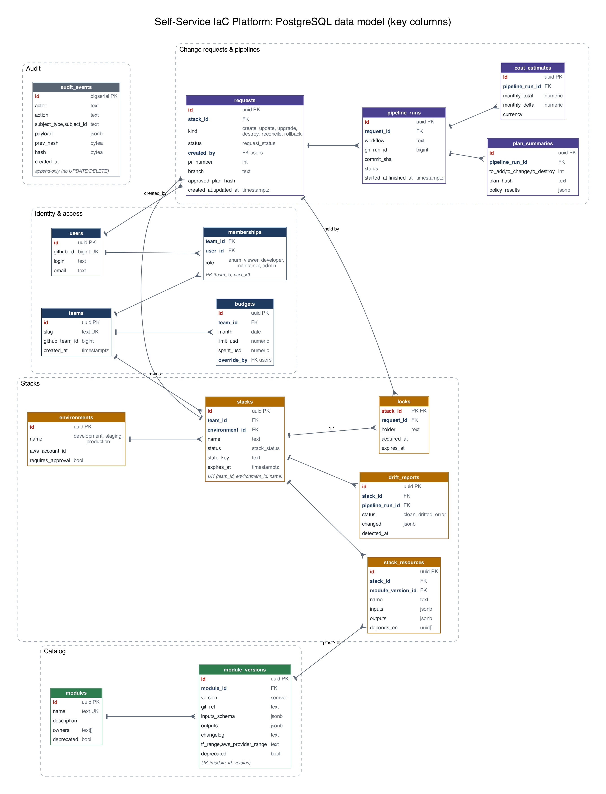
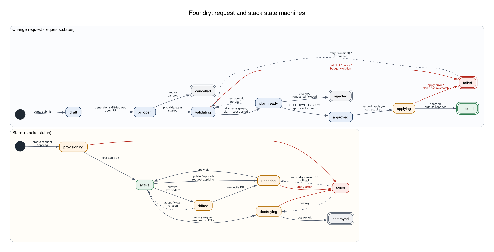
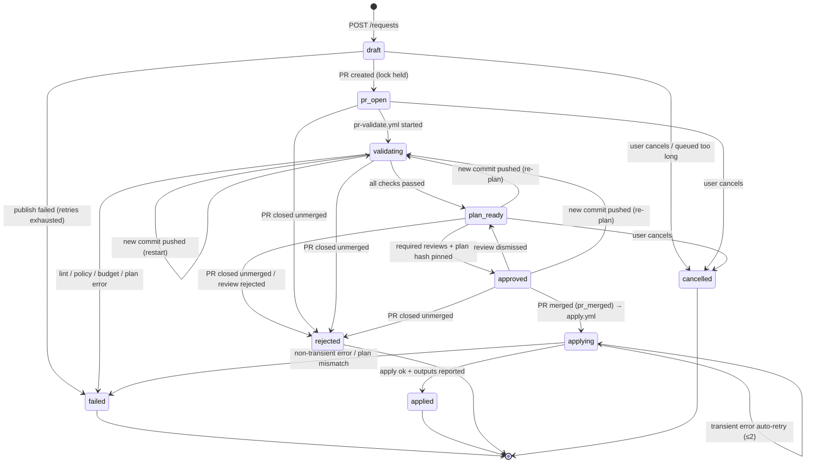
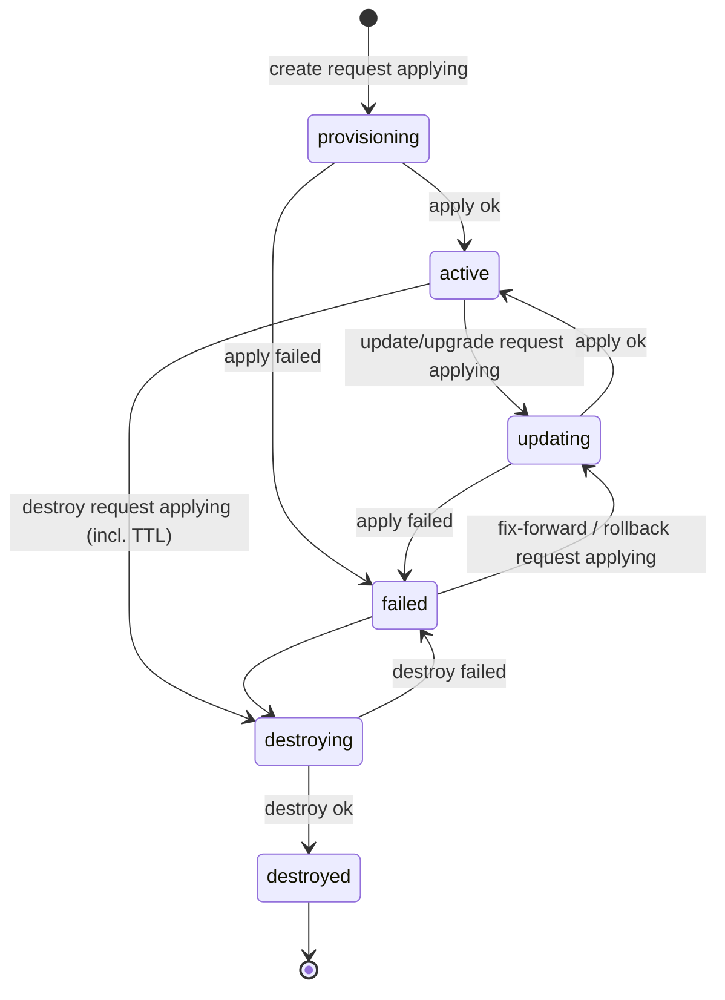

# 03 — Data Model and API

> Purpose: specify the platform's PostgreSQL schema, the request and stack state machines, the REST API contract, and the Go package layout of `backend/`.

## Contents

1. [Entity overview](#1-entity-overview)
2. [PostgreSQL DDL](#2-postgresql-ddl)
3. [Hash-chained audit log](#3-hash-chained-audit-log)
4. [State machines](#4-state-machines)
5. [API conventions](#5-api-conventions)
6. [REST API reference](#6-rest-api-reference)
7. [Error model](#7-error-model)
8. [Go package layout](#8-go-package-layout)

Related: [01-system-architecture.md](01-system-architecture.md) · [04-module-registry.md](04-module-registry.md) · [05-automation-pipeline.md](05-automation-pipeline.md) · [06-lifecycle-management.md](06-lifecycle-management.md) · [07-security-and-policy.md](07-security-and-policy.md)

---

## 1. Entity overview



| Table | Purpose | Key relationships |
|---|---|---|
| `teams` | Tenant unit; mirrors a GitHub team. | has many memberships, stacks, budgets |
| `users` | GitHub-authenticated humans (and the `iacp-bot` system user). | memberships |
| `memberships` | user × team × role (`viewer`/`developer`/`maintainer`/`admin`). | |
| `modules` | Catalog package (e.g. `s3`). | has many module_versions |
| `module_versions` | Immutable released version with manifest, input schema, outputs, git tag/SHA. | referenced by stack_resources |
| `environments` | `development`/`staging`/`production` (+ AWS account, region, approval rules). | stacks |
| `stacks` | One Terraform root module at `environments/<env>/<team>/<stack>/`. | belongs to team, environment; has many stack_resources, requests |
| `stack_resources` | Module instance inside a stack (name, module version, inputs). | stack, module_version |
| `stack_dependencies` | DAG edges between stacks (output injection). | stack → stack |
| `requests` | Change request: create/update/upgrade/destroy/reconcile. | stack, user, pipeline_runs |
| `pipeline_runs` | One GitHub Actions workflow run (validate/apply/drift/ttl). | request (nullable for drift), stack |
| `plan_summaries` | Parsed plan: add/change/destroy counts, resource changes, plan hash, policy results. | pipeline_run |
| `cost_estimates` | Infracost result: monthly before/after/delta. | pipeline_run |
| `drift_reports` | One drift check of one stack (result, resource counts, plan hash) and, for drift, its resolution. | stack, pipeline_run, user (resolver), request (reconcile) |
| `budgets` | Team monthly budget (`limit_usd`, `spent_usd`, `override_by`). | team, users (override_by) |
| `budget_overrides` | Admin override for a specific request (max delta, reason, expiry). | budget, request |
| `policy_exceptions` | Time-boxed waiver of a policy rule for a stack/team. | team, stack |
| `locks` | Platform-level per-stack mutation lock with fencing token. | stack, request |
| `audit_events` | Append-only, hash-chained log of every action. | actor, subject |
| `webhook_deliveries` | De-duplication of GitHub webhook deliveries. | |
| `oidc_jti` | GitHub OIDC token ids already used, kept until `exp` + leeway (replay protection, shared by replicas). | |
| `idempotency_keys` | Stored responses for idempotent POSTs. | user |
| `outbox` | Transactional outbox for side effects published to SQS. | request / stack |

## 2. PostgreSQL DDL

Migrations live in `backend/migrations/` (goose, `NNNN_name.sql`); queries in `backend/queries/*.sql` compiled with sqlc. PostgreSQL 16.

```sql
-- 0001_init.sql
-- gen_random_uuid() is built in (PostgreSQL 13+); audit hashes are computed in Go, so no pgcrypto.
CREATE EXTENSION IF NOT EXISTS citext;

-- ---------- enums ----------
CREATE TYPE team_role         AS ENUM ('viewer', 'developer', 'maintainer', 'admin');
CREATE TYPE env_name          AS ENUM ('development', 'staging', 'production');
CREATE TYPE module_status     AS ENUM ('active', 'deprecated', 'yanked');
CREATE TYPE stack_status      AS ENUM ('provisioning', 'active', 'drifted', 'updating', 'destroying', 'destroyed', 'failed');
CREATE TYPE request_kind      AS ENUM ('create', 'update', 'upgrade', 'destroy', 'reconcile', 'rollback');
CREATE TYPE request_status    AS ENUM ('draft', 'pr_open', 'validating', 'plan_ready', 'approved', 'applying',
                                       'applied', 'failed', 'rejected', 'cancelled');
CREATE TYPE pipeline_kind     AS ENUM ('validate', 'apply', 'drift', 'ttl_destroy', 'module_release');
CREATE TYPE pipeline_status   AS ENUM ('queued', 'in_progress', 'succeeded', 'failed', 'cancelled', 'timed_out');
CREATE TYPE drift_result      AS ENUM ('clean', 'drifted', 'error');
CREATE TYPE drift_status      AS ENUM ('open', 'reconciled', 'ignored', 'codified');   -- resolution of a drifted report

-- ---------- identity ----------
CREATE TABLE teams (
    id               uuid PRIMARY KEY DEFAULT gen_random_uuid(),
    slug             text        NOT NULL UNIQUE CHECK (slug ~ '^[a-z][a-z0-9-]{1,38}$'),
    name             text        NOT NULL,
    github_team_id   bigint      NOT NULL UNIQUE,
    github_team_slug text        NOT NULL,
    cost_center      text        NOT NULL,
    slack_channel    text,
    created_at       timestamptz NOT NULL DEFAULT now(),
    updated_at       timestamptz NOT NULL DEFAULT now()
);

CREATE TABLE users (
    id              uuid PRIMARY KEY DEFAULT gen_random_uuid(),
    github_user_id  bigint      NOT NULL UNIQUE,
    github_login    citext      NOT NULL UNIQUE,
    email           citext,
    display_name    text,
    is_platform_admin boolean   NOT NULL DEFAULT false,
    is_system       boolean     NOT NULL DEFAULT false,
    last_login_at   timestamptz,
    created_at      timestamptz NOT NULL DEFAULT now(),
    disabled_at     timestamptz
);

CREATE TABLE memberships (
    team_id     uuid        NOT NULL REFERENCES teams(id) ON DELETE CASCADE,
    user_id     uuid        NOT NULL REFERENCES users(id) ON DELETE CASCADE,
    role        team_role   NOT NULL,
    source      text        NOT NULL DEFAULT 'github_sync' CHECK (source IN ('github_sync', 'manual')),
    synced_at   timestamptz NOT NULL DEFAULT now(),
    PRIMARY KEY (team_id, user_id)
);
CREATE INDEX memberships_user_idx ON memberships (user_id);

-- ---------- catalog ----------
CREATE TABLE modules (
    id             uuid PRIMARY KEY DEFAULT gen_random_uuid(),
    name           text        NOT NULL UNIQUE CHECK (name ~ '^[a-z][a-z0-9-]{1,40}$'),
    display_name   text        NOT NULL,
    description    text        NOT NULL,
    category       text        NOT NULL,                 -- storage, messaging, compute, database, cache, network, observability
    owners         text[]      NOT NULL,                 -- GitHub team slugs
    repo_path      text        NOT NULL,                 -- modules/s3
    status         module_status NOT NULL DEFAULT 'active',
    created_at     timestamptz NOT NULL DEFAULT now(),
    updated_at     timestamptz NOT NULL DEFAULT now()
);

CREATE TABLE module_versions (
    id                uuid PRIMARY KEY DEFAULT gen_random_uuid(),
    module_id         uuid        NOT NULL REFERENCES modules(id) ON DELETE RESTRICT,
    version           text        NOT NULL CHECK (version ~ '^\d+\.\d+\.\d+(-[0-9A-Za-z.-]+)?$'),
    major             int         NOT NULL,
    minor             int         NOT NULL,
    patch             int         NOT NULL,
    git_tag           text        NOT NULL UNIQUE,       -- modules/s3/v1.2.0
    git_sha           char(40)    NOT NULL,
    manifest          jsonb       NOT NULL,              -- full module.yaml as JSON
    inputs_schema     jsonb       NOT NULL,              -- JSON Schema 2020-12
    outputs           jsonb       NOT NULL,              -- [{name, description, sensitive}]
    cost_hints        jsonb,
    tf_version_range  text        NOT NULL,              -- ">= 1.10, < 2.0"
    aws_provider_range text       NOT NULL,              -- "~> 5.80"
    changelog_md      text,
    status            module_status NOT NULL DEFAULT 'active',
    deprecation_note  text,
    released_by       text        NOT NULL,              -- github login of tagger
    released_at       timestamptz NOT NULL DEFAULT now(),
    UNIQUE (module_id, version),
    CHECK (status <> 'deprecated' OR deprecation_note IS NOT NULL)
);
CREATE INDEX module_versions_semver_idx ON module_versions (module_id, major DESC, minor DESC, patch DESC);

CREATE TABLE environments (
    id                 uuid PRIMARY KEY DEFAULT gen_random_uuid(),
    name               env_name    NOT NULL UNIQUE,
    aws_account_id     char(12)    NOT NULL UNIQUE,
    default_region     text        NOT NULL DEFAULT 'us-east-1',
    allowed_regions    text[]      NOT NULL,
    requires_approval  boolean     NOT NULL DEFAULT false,
    min_approver_role  team_role   NOT NULL DEFAULT 'developer',
    allow_ephemeral    boolean     NOT NULL DEFAULT true,
    max_ttl_hours      int         CHECK (max_ttl_hours IS NULL OR max_ttl_hours > 0)
);

-- ---------- stacks ----------
CREATE TABLE stacks (
    id               uuid PRIMARY KEY DEFAULT gen_random_uuid(),
    team_id          uuid        NOT NULL REFERENCES teams(id) ON DELETE RESTRICT,
    environment_id   uuid        NOT NULL REFERENCES environments(id) ON DELETE RESTRICT,
    name             text        NOT NULL CHECK (name ~ '^[a-z][a-z0-9-]{1,40}$'),
    path             text        NOT NULL UNIQUE,        -- environments/development/payments/order-events
    state_key        text        NOT NULL UNIQUE,        -- development/payments/order-events/terraform.tfstate
    region           text        NOT NULL,
    status           stack_status NOT NULL DEFAULT 'provisioning',
    is_ephemeral     boolean     NOT NULL DEFAULT false,
    ttl_hours        int         CHECK (ttl_hours IS NULL OR ttl_hours > 0),   -- lifetime asked for at request time
    ttl_extended_hours int       NOT NULL DEFAULT 0 CHECK (ttl_extended_hours >= 0),  -- total added by extensions
    expires_at       timestamptz,
    ttl_warned_at    timestamptz,                                -- 24 h warning sent for the current expires_at
    outputs          jsonb       NOT NULL DEFAULT '{}'::jsonb,   -- non-sensitive outputs only
    last_applied_sha char(40),
    last_applied_request_id uuid,
    last_drift_check_at timestamptz,
    tags             jsonb       NOT NULL DEFAULT '{}'::jsonb,
    created_by       uuid        NOT NULL REFERENCES users(id),
    created_at       timestamptz NOT NULL DEFAULT now(),
    updated_at       timestamptz NOT NULL DEFAULT now(),
    destroyed_at     timestamptz,
    UNIQUE (environment_id, team_id, name),
    CHECK (NOT is_ephemeral OR expires_at IS NOT NULL),
    CHECK (is_ephemeral OR (ttl_hours IS NULL AND ttl_extended_hours = 0)),
    CHECK (status <> 'destroyed' OR destroyed_at IS NOT NULL)
);
CREATE INDEX stacks_team_status_idx  ON stacks (team_id, status);
CREATE INDEX stacks_expiry_idx       ON stacks (expires_at) WHERE is_ephemeral AND status NOT IN ('destroying', 'destroyed');
CREATE INDEX stacks_drift_due_idx    ON stacks (last_drift_check_at NULLS FIRST) WHERE status IN ('active', 'drifted');

CREATE TABLE stack_resources (
    id                 uuid PRIMARY KEY DEFAULT gen_random_uuid(),
    stack_id           uuid        NOT NULL REFERENCES stacks(id) ON DELETE CASCADE,
    instance_name      text        NOT NULL CHECK (instance_name ~ '^[a-z][a-z0-9_]{0,62}$'),  -- HCL identifier
    module_version_id  uuid        NOT NULL REFERENCES module_versions(id) ON DELETE RESTRICT,
    inputs             jsonb       NOT NULL,
    created_at         timestamptz NOT NULL DEFAULT now(),
    updated_at         timestamptz NOT NULL DEFAULT now(),
    removed_at         timestamptz,
    UNIQUE (stack_id, instance_name)
);
CREATE INDEX stack_resources_module_version_idx ON stack_resources (module_version_id) WHERE removed_at IS NULL;

CREATE TABLE stack_dependencies (
    stack_id            uuid NOT NULL REFERENCES stacks(id) ON DELETE CASCADE,
    depends_on_stack_id uuid NOT NULL REFERENCES stacks(id) ON DELETE RESTRICT,
    output_bindings     jsonb NOT NULL,     -- [{"from":"orders_queue.queue_arn","to":"order_processor.sqs_event_source.queue_arn"}]
    PRIMARY KEY (stack_id, depends_on_stack_id),
    CHECK (stack_id <> depends_on_stack_id)
);
CREATE INDEX stack_dependencies_upstream_idx ON stack_dependencies (depends_on_stack_id);

-- ---------- requests & pipelines ----------
CREATE TABLE requests (
    id                 uuid PRIMARY KEY DEFAULT gen_random_uuid(),
    short_id           text        NOT NULL UNIQUE,              -- req-7k3p9x (branch name)
    stack_id           uuid        NOT NULL REFERENCES stacks(id) ON DELETE RESTRICT,
    kind               request_kind NOT NULL,
    status             request_status NOT NULL DEFAULT 'draft',
    spec               jsonb       NOT NULL,                     -- desired StackSpec after this request
    previous_spec      jsonb,                                    -- spec before (for diff/rollback)
    rendered_tree_sha  char(40),                                 -- git tree SHA of generated files
    justification      text,
    queued_behind      uuid        REFERENCES requests(id),
    fencing_token      bigint,
    github_branch      text,
    github_pr_number   int,
    github_pr_url      text,
    github_head_sha    char(40),                       -- PR head last accepted (webhook replay/order guard)
    merge_commit_sha   char(40),
    approved_plan_hash char(64),                                 -- sha256 of normalised plan JSON
    approved_by        uuid        REFERENCES users(id),
    approved_at        timestamptz,
    failure_reason     text,
    failure_detail     jsonb,
    retry_count        int         NOT NULL DEFAULT 0 CHECK (retry_count BETWEEN 0 AND 5),
    created_by         uuid        NOT NULL REFERENCES users(id),
    created_at         timestamptz NOT NULL DEFAULT now(),
    updated_at         timestamptz NOT NULL DEFAULT now(),
    completed_at       timestamptz,
    CHECK ((status IN ('applied', 'failed', 'rejected', 'cancelled')) = (completed_at IS NOT NULL)),
    CHECK (status NOT IN ('approved', 'applying', 'applied') OR approved_plan_hash IS NOT NULL)
);
CREATE INDEX requests_stack_created_idx ON requests (stack_id, created_at DESC);
CREATE INDEX requests_open_idx          ON requests (status) WHERE completed_at IS NULL;
CREATE INDEX requests_creator_idx       ON requests (created_by, created_at DESC);
CREATE UNIQUE INDEX requests_pr_idx     ON requests (github_pr_number) WHERE github_pr_number IS NOT NULL;

CREATE TABLE pipeline_runs (
    id                 uuid PRIMARY KEY DEFAULT gen_random_uuid(),
    request_id         uuid        REFERENCES requests(id) ON DELETE CASCADE,
    stack_id           uuid        NOT NULL REFERENCES stacks(id) ON DELETE CASCADE,  -- part of the run key
    kind               pipeline_kind NOT NULL,
    status             pipeline_status NOT NULL DEFAULT 'queued',
    github_run_id      bigint      NOT NULL,
    github_run_attempt int         NOT NULL DEFAULT 1,
    github_job_id      bigint,
    workflow_ref       text        NOT NULL,          -- acme/self-service-iac-platform/.github/workflows/pr-validate.yml@refs/pull/812/merge
    head_sha           char(40)    NOT NULL,
    stages             jsonb       NOT NULL DEFAULT '[]'::jsonb,  -- [{"name":"checkov","status":"passed","duration_ms":8123}]
    log_url            text,
    started_at         timestamptz,
    finished_at        timestamptz,
    created_at         timestamptz NOT NULL DEFAULT now(),
    UNIQUE (github_run_id, github_run_attempt, stack_id)
);
CREATE INDEX pipeline_runs_request_idx ON pipeline_runs (request_id, created_at DESC);
CREATE INDEX pipeline_runs_active_idx  ON pipeline_runs (status) WHERE status IN ('queued', 'in_progress');

CREATE TABLE plan_summaries (
    id                uuid PRIMARY KEY DEFAULT gen_random_uuid(),
    pipeline_run_id   uuid        NOT NULL UNIQUE REFERENCES pipeline_runs(id) ON DELETE CASCADE,
    plan_hash         char(64)    NOT NULL,
    add_count         int         NOT NULL CHECK (add_count >= 0),
    change_count      int         NOT NULL CHECK (change_count >= 0),
    destroy_count     int         NOT NULL CHECK (destroy_count >= 0),
    replace_count     int         NOT NULL DEFAULT 0,
    resource_changes  jsonb       NOT NULL,      -- [{"address":"module.orders_queue.aws_sqs_queue.this","actions":["create"]}]
    policy_results    jsonb       NOT NULL,      -- {"opa":{"deny":[],"warn":[]},"checkov":{"failed":0,"passed":42},"tflint":{...}}
    policy_passed     boolean     NOT NULL,
    plan_artifact_uri text        NOT NULL,      -- s3://iacp-plan-artifacts-111111111111/<run>/plan.json
    created_at        timestamptz NOT NULL DEFAULT now()
);

CREATE TABLE cost_estimates (
    id                   uuid PRIMARY KEY DEFAULT gen_random_uuid(),
    pipeline_run_id      uuid          NOT NULL UNIQUE REFERENCES pipeline_runs(id) ON DELETE CASCADE,
    currency             char(3)       NOT NULL DEFAULT 'USD',
    monthly_before       numeric(12,2) NOT NULL,
    monthly_after        numeric(12,2) NOT NULL,
    monthly_delta        numeric(12,2) GENERATED ALWAYS AS (monthly_after - monthly_before) STORED,
    breakdown            jsonb         NOT NULL,     -- per-resource from infracost JSON
    budget_check         jsonb         NOT NULL,     -- {"budget":2000,"committed":1450.10,"remaining":549.90,"decision":"allow"}
    created_at           timestamptz   NOT NULL DEFAULT now()
);

CREATE TABLE drift_reports (
    id                    uuid PRIMARY KEY DEFAULT gen_random_uuid(),
    stack_id              uuid         NOT NULL REFERENCES stacks(id) ON DELETE CASCADE,
    pipeline_run_id       uuid         NOT NULL UNIQUE REFERENCES pipeline_runs(id) ON DELETE RESTRICT,  -- the drift.yml run: one report per run and stack
    result                drift_result NOT NULL,
    terraform_exit_code   smallint     NOT NULL CHECK (terraform_exit_code IN (0, 1, 2)),
    resources_drifted     int          NOT NULL DEFAULT 0,
    resources_updated     int          NOT NULL DEFAULT 0,
    resources_deleted     int          NOT NULL DEFAULT 0,
    changed               jsonb        NOT NULL DEFAULT '[]'::jsonb,   -- [{address, type, actions}], at most 200; never attribute values
    plan_hash             char(64),                                    -- fingerprint of addresses, actions and changed attribute names
    log_url               text,
    error_message         text,                                        -- result = 'error'
    status                drift_status,                                -- NULL unless result = 'drifted'
    detected_at           timestamptz  NOT NULL DEFAULT now(),
    resolved_by           uuid         REFERENCES users(id),           -- NULL when a clean scan closed the report
    resolved_at           timestamptz,
    resolution_reason     text,                                        -- required for ignore (CHECK)
    resolution_request_id uuid         REFERENCES requests(id),        -- the update request a reconcile opened
    CHECK ((result = 'drifted') = (status IS NOT NULL)),
    CHECK ((status IS NULL OR status = 'open') = (resolved_at IS NULL)),
    CHECK (result <> 'drifted' OR resources_drifted > 0),
    CHECK (result = 'drifted' OR resources_drifted = 0)
);
CREATE INDEX drift_reports_stack_idx ON drift_reports (stack_id, detected_at DESC, id DESC);
CREATE INDEX drift_reports_open_idx  ON drift_reports (stack_id) WHERE status = 'open';
-- iacp_app: SELECT, INSERT, and UPDATE only on (status, resolved_by, resolved_at, resolution_reason,
-- resolution_request_id). Findings are immutable and reports are never deleted.

-- ---------- budgets & exceptions ----------
CREATE TABLE budgets (
    id              uuid PRIMARY KEY DEFAULT gen_random_uuid(),
    team_id         uuid          NOT NULL REFERENCES teams(id) ON DELETE CASCADE,
    environment_id  uuid          REFERENCES environments(id),        -- NULL = all environments
    month           date          NOT NULL CHECK (date_trunc('month', month) = month),
    limit_usd       numeric(12,2) NOT NULL CHECK (limit_usd >= 0),
    spent_usd       numeric(12,2) NOT NULL DEFAULT 0,                -- committed estimates + CUR actuals, refreshed daily
    alert_thresholds int[]        NOT NULL DEFAULT '{50,80,100}',
    hard_block      boolean       NOT NULL DEFAULT true,
    override_by     uuid          REFERENCES users(id),             -- admin who granted the most recent override (detail in budget_overrides)
    created_by      uuid          NOT NULL REFERENCES users(id),
    created_at      timestamptz   NOT NULL DEFAULT now(),
    UNIQUE NULLS NOT DISTINCT (team_id, environment_id, month)
);

CREATE TABLE budget_overrides (
    id           uuid PRIMARY KEY DEFAULT gen_random_uuid(),
    budget_id    uuid          NOT NULL REFERENCES budgets(id) ON DELETE CASCADE,
    request_id   uuid          NOT NULL UNIQUE REFERENCES requests(id) ON DELETE CASCADE,
    max_delta_usd numeric(12,2) NOT NULL CHECK (max_delta_usd > 0),
    reason       text          NOT NULL CHECK (length(reason) >= 20),
    granted_by   uuid          NOT NULL REFERENCES users(id),
    granted_at   timestamptz   NOT NULL DEFAULT now(),
    expires_at   timestamptz   NOT NULL
);
-- On insert, the service also sets budgets.override_by = granted_by (same transaction) for quick display.

CREATE TABLE policy_exceptions (
    id           uuid PRIMARY KEY DEFAULT gen_random_uuid(),
    rule_id      text        NOT NULL,                -- iacp.s3.no_public | CKV_AWS_18
    team_id      uuid        NOT NULL REFERENCES teams(id),
    stack_id     uuid        REFERENCES stacks(id),   -- NULL = team-wide (rare)
    resource_address text,                            -- optional narrowing
    reason       text        NOT NULL,
    ticket_url   text,
    requested_by uuid        NOT NULL REFERENCES users(id),
    approved_by  uuid        REFERENCES users(id),
    status       text        NOT NULL DEFAULT 'pending' CHECK (status IN ('pending', 'approved', 'rejected', 'expired', 'revoked')),
    expires_at   timestamptz NOT NULL,
    created_at   timestamptz NOT NULL DEFAULT now(),
    CHECK (expires_at <= created_at + interval '90 days'),
    CHECK (status <> 'approved' OR (approved_by IS NOT NULL AND approved_by <> requested_by))
);
CREATE INDEX policy_exceptions_active_idx ON policy_exceptions (team_id, rule_id) WHERE status = 'approved';

-- ---------- locks ----------
CREATE SEQUENCE lock_fencing_seq;
-- 1:1 with stacks: at most one lock row per stack.
CREATE TABLE locks (
    stack_id          uuid        PRIMARY KEY REFERENCES stacks(id) ON DELETE CASCADE,
    request_id        uuid        NOT NULL REFERENCES requests(id) ON DELETE CASCADE,
    holder            text        NOT NULL,            -- "request:req-7k3p9x" | "run:11873399021" (apply job holding it)
    fencing_token     bigint      NOT NULL DEFAULT nextval('lock_fencing_seq'),
    acquired_at       timestamptz NOT NULL DEFAULT now(),
    expires_at        timestamptz NOT NULL,            -- lease
    CHECK (expires_at > acquired_at)
);
CREATE INDEX locks_expiry_idx ON locks (expires_at);

-- ---------- infra tables ----------
CREATE TABLE webhook_deliveries (
    delivery_id  uuid PRIMARY KEY,           -- X-GitHub-Delivery
    event        text        NOT NULL CHECK (length(event) BETWEEN 1 AND 64),
    received_at  timestamptz NOT NULL DEFAULT now()
);
CREATE INDEX webhook_deliveries_received_idx ON webhook_deliveries (received_at);  -- purge > 7 days

-- Replay protection for GitHub OIDC tokens (migration 0006). iacp_app: SELECT, INSERT, DELETE (no UPDATE).
CREATE TABLE oidc_jti (
    jti        text        PRIMARY KEY CHECK (length(jti) BETWEEN 1 AND 128),
    expires_at timestamptz NOT NULL,           -- token exp + verifier leeway
    created_at timestamptz NOT NULL DEFAULT now()
);
CREATE INDEX oidc_jti_expiry_idx ON oidc_jti (expires_at);                       -- expired rows purged on each claim

CREATE TABLE idempotency_keys (
    user_id        uuid        NOT NULL REFERENCES users(id) ON DELETE CASCADE,
    key            text        NOT NULL CHECK (length(key) BETWEEN 8 AND 128),
    request_hash   char(64)    NOT NULL,     -- sha256(method + path + body)
    response_code  int,
    response_body  jsonb,
    created_at     timestamptz NOT NULL DEFAULT now(),
    PRIMARY KEY (user_id, key)
);
CREATE INDEX idempotency_keys_created_idx ON idempotency_keys (created_at);       -- purge > 24 h

-- Transactional outbox: side effects (GitHub writes, notifications, schedules) written in the
-- same transaction as the state change. While local-first (ADR-0009) it is also the job queue:
-- the in-process worker (internal/outbox) claims rows with FOR UPDATE SKIP LOCKED and a lease,
-- runs the topic handler, and completes, retries (exponential backoff) or gives up. Publishing
-- rows to SQS instead is a later adapter with the same handler contract.
CREATE TABLE outbox (
    id            bigint GENERATED ALWAYS AS IDENTITY PRIMARY KEY,
    topic         text        NOT NULL,          -- request.publish, github.event (later: notify.slack, scheduler.ttl …)
    aggregate_id  uuid,                          -- request id when known
    dedupe_key    text,                          -- at most one pending job per key (publish:<request id>)
    payload       jsonb       NOT NULL,
    created_at    timestamptz NOT NULL DEFAULT now(),
    available_at  timestamptz NOT NULL DEFAULT now(),   -- backoff
    locked_until  timestamptz,                          -- worker lease
    attempts      int         NOT NULL DEFAULT 0,
    last_error    text,
    processed_at  timestamptz,
    dead_at       timestamptz                           -- gave up after the last attempt
);
CREATE INDEX outbox_pending_idx ON outbox (available_at, id) WHERE processed_at IS NULL AND dead_at IS NULL;
CREATE UNIQUE INDEX outbox_dedupe_idx ON outbox (dedupe_key)
    WHERE dedupe_key IS NOT NULL AND processed_at IS NULL AND dead_at IS NULL;
-- iacp_app: webhook_deliveries SELECT/INSERT/DELETE (7-day purge), outbox SELECT/INSERT/UPDATE (migration 0008).
```

`request_kind` extends the four user-facing kinds (create/update/upgrade/destroy) with two platform-initiated kinds: `reconcile` (drift remediation) and `rollback` (revert PR to the last applied spec). Both follow the same state machine.

**Lock acquisition** (inside the request-creation transaction; `backend/internal/locks`):

```sql
-- 1. Serialise every lock operation on the stack.
SELECT team_id FROM stacks WHERE id = $1 FOR UPDATE;
-- 2. Read the lease and the queue; the pure locks.Decide picks granted / held / queued.
-- 3. Grant (fresh lease, or take over an expired one):
INSERT INTO locks (stack_id, request_id, holder, acquired_at, expires_at)
VALUES ($1, $2, $3, $4, $4 + interval '7 days')
ON CONFLICT (stack_id) DO UPDATE
   SET request_id    = EXCLUDED.request_id,
       holder        = EXCLUDED.holder,
       fencing_token = nextval('lock_fencing_seq'),
       acquired_at   = EXCLUDED.acquired_at,
       expires_at    = EXCLUDED.expires_at
RETURNING request_id, fencing_token;
-- and record requests.fencing_token; or, when queued, set requests.queued_behind = holder.
```

A free or expired lock goes to the oldest queued request first, so a newcomer never jumps the queue. Release deletes the row and, in the same transaction, grants the oldest waiter a new token and points the remaining waiters at it.

## 3. Hash-chained audit log

```sql
-- 0002_audit.sql
CREATE TABLE audit_events (
    seq           bigint GENERATED ALWAYS AS IDENTITY PRIMARY KEY,
    id            uuid        NOT NULL UNIQUE,       -- set by the writer (part of the hash)
    occurred_at   timestamptz NOT NULL,              -- set by the writer, microsecond precision
    actor_type    text        NOT NULL CHECK (actor_type IN ('user', 'system', 'github_actions', 'github_webhook')),
    actor_id      text        NOT NULL,              -- user uuid | "worker" | workflow_ref + run_id
    actor_ip      inet,
    action        text        NOT NULL,              -- request.created, request.approved, stack.destroyed, budget.override.granted …
    subject_type  text        NOT NULL,              -- request | stack | module_version | budget | policy_exception | membership
    subject_id    text        NOT NULL,
    team_id       uuid,
    correlation_id text,                             -- HTTP request id / GitHub run id
    payload       jsonb       NOT NULL DEFAULT '{}'::jsonb,
    prev_hash     bytea       NOT NULL,
    hash          bytea       NOT NULL UNIQUE
);
CREATE INDEX audit_events_subject_idx ON audit_events (subject_type, subject_id, seq DESC);
CREATE INDEX audit_events_team_idx    ON audit_events (team_id, seq DESC);
CREATE INDEX audit_events_action_idx  ON audit_events (action, occurred_at DESC);

-- Chain: hash = sha256(prev_hash || canonical JSON of the event), computed by the Go writer
-- (backend/internal/audit, pure function ChainHash). The database enforces linkage: inside the
-- shared advisory lock, prev_hash must equal the hash of the current head, so seq order == chain order.
CREATE OR REPLACE FUNCTION audit_events_link_check() RETURNS trigger LANGUAGE plpgsql AS $$
DECLARE
    head bytea;
BEGIN
    PERFORM pg_advisory_xact_lock(727274);   -- 'audit' chain lock, also taken by the writer
    SELECT hash INTO head FROM audit_events ORDER BY seq DESC LIMIT 1;
    IF NEW.prev_hash IS DISTINCT FROM COALESCE(head, decode(repeat('00', 32), 'hex')) THEN
        RAISE EXCEPTION 'audit_events: prev_hash does not match chain head';
    END IF;
    RETURN NEW;
END $$;

CREATE TRIGGER audit_events_link_trg BEFORE INSERT ON audit_events
    FOR EACH ROW EXECUTE FUNCTION audit_events_link_check();

-- Append-only: reject UPDATE/DELETE/TRUNCATE even for the table owner path used by the app.
CREATE OR REPLACE FUNCTION audit_events_immutable() RETURNS trigger LANGUAGE plpgsql AS $$
BEGIN
    RAISE EXCEPTION 'audit_events is append-only';
END $$;
CREATE TRIGGER audit_events_no_update BEFORE UPDATE OR DELETE ON audit_events
    FOR EACH ROW EXECUTE FUNCTION audit_events_immutable();
CREATE TRIGGER audit_events_no_truncate BEFORE TRUNCATE ON audit_events
    FOR EACH STATEMENT EXECUTE FUNCTION audit_events_immutable();

-- Privileges: application role may only INSERT and SELECT (the migration creates iacp_app
-- when the migrating role is allowed to, and skips with a notice otherwise).
REVOKE ALL ON audit_events FROM iacp_app;
GRANT INSERT, SELECT ON audit_events TO iacp_app;
```

Notes:

- **Canonical form** (`audit.CanonicalJSON`): a JSON object with keys in alphabetical order: `action`, `actor_id`, `actor_ip` (canonical address text, empty when null), `actor_type`, `correlation_id`, `id`, `occurred_at` (`YYYY-MM-DDTHH:MM:SS.ffffffZ`), `payload`, `subject_id`, `subject_type`, `team_id` (empty string when null). The payload is decoded with exact numbers and re-encoded with sorted keys, and every number is rewritten as a plain decimal that keeps all significant digits (`1e2` becomes `100`, `2.50` becomes `2.5`). The writer stores those canonical bytes; they are a fixed point of jsonb's output, so the round trip does not change the hash, the verifier can recompute it from stored or exported rows, and changing any digit (even beyond float64 precision) is detected. A known-value test pins the format; changing it invalidates existing chains.
- Hashing in Go rather than in the trigger ([ADR-0010](adr/0010-audit-hash-chain-computed-in-go.md)) keeps the chain logic a pure, unit-testable function (`ChainHash`, `VerifyChain`) while the database still guarantees linkage and immutability. `GET /v1/audit/verify` recomputes a `seq` range of at most 10,000 events per call and returns `has_more` when the chain continues.
- **Roles:** the API connects as `iacp_app` (INSERT and SELECT on `audit_events`, DML elsewhere, nothing on `goose_db_version`); migrations run as the schema owner on a separate connection (migration `0004_app_role_grants.sql`). The app role cannot disable triggers or set `session_replication_role`.
- **Verification job** (worker, nightly): streams `audit_events` in `seq` order, recomputes the chain, emits metric `the platform/AuditChainValid` (alarm on 0).
- **Anchoring:** at 00:15 UTC the worker writes `{seq, hash, occurred_at}` of the chain head plus an NDJSON export of the previous day to `s3://iacp-audit-anchor-111111111111/yyyy/mm/dd/` (Object Lock compliance, 7 y). Any later tampering with Postgres (even by a superuser disabling triggers) is detectable against the anchors.
- The single advisory lock serialises audit inserts (~ tens/sec sustained); measured headroom is ample for 500 requests/day. If needed, partition chains per team.

## 4. State machines



### 4.1 Request



| From | Event | To | Side effects |
|---|---|---|---|
| — | `POST /v1/requests` | `draft` | validate, acquire lock or queue, audit `request.created` |
| `draft` | PR opened by the publisher (`pr_opened`) | `pr_open` | store branch/PR/tree sha, audit `request.transitioned` |
| `draft` | publisher gave up after its last attempt (`publish_failed`) | `failed` | `failure_reason = publish_failed`, release lock, promote and publish the next waiter |
| `draft` | cancel / queued > 7 d | `cancelled` | dequeue |
| `pr_open`/`plan_ready` | `POST /requests/{id}/cancel` | `cancelled` | close PR, release lock |
| `pr_open` | `workflow_run` (pr-validate) in_progress | `validating` | create `pipeline_runs` |
| `validating` | callback `stage=summary, passed=true` | `plan_ready` | store plan summary + cost, PR comment |
| `validating` | callback `passed=false` | `failed` | store findings; close PR with comment (configurable); release lock |
| `plan_ready` | `pull_request_review` approved + required checks green | `approved` | `approved_plan_hash = plan_summaries.plan_hash`, audit |
| `plan_ready` | TTL-expiry `destroy` request in **non-prod**, checks green | `approved` | `iacp-approver` machine user (member of `@acme/self-service-iac-platform-approvers`; GitHub Apps cannot be code owners) submits the approving review and the worker merges; production is never auto-approved; audit `request.auto_approved` |
| `validating`/`plan_ready`/`approved` | `pull_request.synchronize` | `validating` | clear approval & pinned hash; restart validation |
| `approved` | `pull_request_review` dismissed | `plan_ready` | clear approval & pinned hash |
| `pr_open`/`validating`/`plan_ready`/`approved` | `pull_request.closed` (unmerged) | `rejected` | release lock |
| `approved` | `pull_request.closed` merged (`pr_merged`, the push to main) / the first accepted `apply` run report (`apply_started`) | `applying` | store `merge_commit_sha`; the stack moves to `provisioning`/`updating`/`destroying` with the first apply report |
| `applying` | `apply` run finished: `summary` passed, or failed only because the smoke test did | `applied` | stack outputs, `last_applied_sha`, `last_applied_request_id`, `health`; stack → `active` (or `destroyed` with `destroyed_at` after a destroy); release lock and promote and publish the next queued request, in the same transaction |
| `applying` | callback apply failed (transient), `retry_count < 2` | `applying` | `retry_count += 1`; re-dispatch with backoff. The state machine has the edge; the pipeline reports do not use it yet (no re-dispatch exists), so a transient failure fails the request like a permanent one |
| `applying` | `apply` run failed or was cancelled (`plan`, `apply`/`destroy` or `summary` stage failed) | `failed` | `failure_reason` (`plan_failed`, `apply_failed`, `apply_incomplete`, `apply_cancelled`) and `failure_detail` (stage, error, exit code); stack → `failed` (open to fix-forward or destroy); release lock and promote the next waiter |

**Apply reports drive the lifecycle (WBS 5.3).** `POST /v1/runs` with `pipeline: apply` moves the request and its stack in the report's own transaction (`runs.Service.Record` → `requests.Service.ApplyIn`, with the pure `requests.DecideApply` deciding). Locks are taken stacks → locks → request, the order every lock operation uses. A `validate` report is stored and never moves anything: a passed validation is not an approval. A request that is not `approved`, `applying` or terminal gets `409 request_not_applying` and nothing is recorded. The run status comes from the stages: `plan`, `apply`/`destroy` and `summary` finish it when they fail, the `smoke` stage does not (a failed smoke test degrades the stack instead), and `release` never does. Because `apply.yml` sends `summary` from `job.status`, a red smoke step makes the summary `failed`; when the mutating stage passed and the smoke test is the only failure, the run is `succeeded`, the request `applied`, the stack `active` with `health = degraded`. A failed `release` after the verdict is stored in the run, audited as `request.lock_release_failed` (with whether the lock is still held and by whom) and never moves the request. Every request event is audited as `request.transitioned` and every stack move as `stack.status_changed` (plus `stack.destroyed`). Replays are no-ops (stages are replaced by name, and a replayed `DecideApply` yields no events). Once the request is terminal the backend has released the lease, so a later report that carries the request's own token (a replayed `summary`, a failed `release`) is accepted only for a run the API already recorded for that request, audited and ignored (`request.run_report_ignored`) without touching the finished run's stages (except the advisory `release` stage); any other token, or a new run id or attempt, is `409 stale_fencing_token`.

**Publishing (WBS 4.8), review hardening.** `PublishTarget` and `RecordPublished` check the stack's current lock row (`locks.CheckToken`), since `requests.fencing_token` is not cleared on release or takeover. Every promotion of a queued request (release, `DELETE …/lock`, or an expired lease handed to the head of the queue) runs the lock service's promotion hook, which enqueues the promoted request's publish job in the grant transaction. Commits replace the stack directory as a whole, keeping files the generator does not render (`.terraform.lock.hcl`); on GitHub only the stack's subtree is listed. A final publish failure withdraws the branch and PR it left behind (best effort, audited), unless a re-read shows a PR is recorded. Outbox outcome writes are guarded by the claim's attempt number.

**Publishing (WBS 4.8).** `POST /v1/requests` inserts a `request.publish` outbox job in the creation transaction when the request holds the lock (and `IACP_PUBLISHER` is not `none`). The worker (`internal/prflow`) renders the stack with the generator outside any transaction, commits it on `iacp/<short_id>` through the `publish.Publisher` port (GitHub App via the git data API, or `localgit` for ADR-0009), opens and labels the PR, then records `pr_opened` in a second transaction that checks the request still holds the lock with the token it was rendered with. Every publisher call is idempotent (the branch is force-moved, an existing PR is returned), so retries converge. Each failed attempt is audited (`request.publish_failed`); the last one fires `publish_failed`. A terminal transition releases the lock in the same transaction (stacks row locked first) and enqueues the promoted request's publish job.

Transitions are enforced in `internal/requests/statemachine.go` by a pure transition table, `Transition(from, event) (to, error)`, and `Next(snapshot, event)`, which also enforces the retry budget (`MaxApplyRetries = 2`, counted in `requests.retry_count`). The `Request` entity wraps them (`Fire`, and `Approve`, which also pins the plan hash); DB updates use `UPDATE … WHERE id=$1 AND status=$2` (optimistic check) so concurrent webhook + callback races resolve deterministically.

### 4.2 Stack

Drift is **not** a lifecycle state. A drift check moves `stacks.health` (migration 0013 adds `drifted` to #25's `unknown`, `healthy`, `degraded`) and never `stacks.status`, so it cannot disturb a request in flight: an `active` stack stays `active` and takes update and destroy requests while it is `drifted`. `stack_status` still lists `drifted` (editable like `active` in `requests.CheckStackAllowsKind`); no code path sets it any more. Health has two writers and moves through the pure table `drift.NextHealth` ([ADR-0013](adr/0013-drift-in-stack-health.md)): a drifted report sets `drifted`, a clean report only clears `drifted` to `healthy` (never `unknown` or `degraded`), a failed check (`error`) changes nothing, and an apply sets health from its smoke result.



`stacks.health` (migration `0011_stack_health.sql`: `unknown`, `healthy`, `degraded`; `drifted` from `0013_drift_reports.sql`) is separate from this status. A successful apply sets it from the smoke stage (`healthy`, `degraded`, or `unknown` when none ran); a failed apply leaves it alone and a destroy resets it to `unknown`. The stack row also keeps `outputs`, `last_applied_sha` and `last_applied_request_id` of the last successful apply (a destroy clears the outputs and stamps `destroyed_at`).

## 5. API conventions

- Base URL `https://api.iacp.acme.internal/v1`. JSON only (`application/json; charset=utf-8`). OpenAPI 3.1 spec in `backend/api/openapi.yaml` is the source of truth; handlers and portal client are generated from it (`oapi-codegen`, `openapi-typescript`).
- **Auth:** browser sessions use an opaque server-side session: `iacp_session` is an HttpOnly, SameSite=Lax cookie (Secure except on plain-http loopback; named `__Host-iacp_session` whenever Secure) holding 256 random bits; only its SHA-256 is stored (`sessions`, migration `0009_sessions.sql`). A session lives at most `IACP_AUTH_SESSION_TTL` (8 h) and dies after `IACP_AUTH_SESSION_IDLE_TTL` (1 h) without use; logout, user disablement and deletion revoke it at once. Every login mints a new id (no fixation) and revokes the one the browser presented. Because the session is opaque and checked in the database on every request, there is no JWT or refresh cookie. CLI/automation uses `Authorization: Bearer <PAT-style token>` scoped to a team and role (stored hashed). Actions callbacks use `Authorization: Bearer <GitHub OIDC JWT>`. CSRF: every unsafe method (anything but GET, HEAD, OPTIONS) authenticated by the cookie must carry `X-CSRF-Token`, a per-session token derived as HMAC-SHA256 keyed with the session id, compared in constant time (`403 csrf_token_invalid` otherwise). The token is returned by `GET /v1/me`; a cross-site page cannot read that response.
- **IDs:** UUIDs; requests also have a human-friendly `short_id`.
- **Timestamps:** RFC 3339 UTC.
- **Pagination:** cursor-based. `?limit=50` (max 200) `&cursor=<opaque>`. Response `{"data":[…], "next_cursor":"eyJzZXEiOjEyMzR9"|null}`. Cursor = base64 of the last sort key; stable under inserts.
- **Filtering/sorting:** explicit query params per endpoint (`status`, `team`, `env`, `module`); `sort=-created_at`.
- **Idempotency:** all `POST` creating resources accept `Idempotency-Key` (required for `POST /requests`). Same key + same body hash within 24 h → the original resource is returned with header `Idempotent-Replayed: true` (the key row stores `{"request_id": …}`, so a replay shows the request's current state; a create that fails validation stores nothing, so the key can be retried); same key + different body → `422 idempotency_key_reuse`. Keys expire after 24 h: a claim deletes an expired row for the same key first, and `PurgeExpiredIdempotencyKeys` lets the worker sweep old rows.
- **Concurrency control:** resources return `ETag` (row version); `PATCH`/`DELETE` honour `If-Match` → `412` on mismatch.
- **Rate limits:** 600 req/min per user, 60 req/min for `POST /requests`; headers `RateLimit-Limit`, `RateLimit-Remaining`, `RateLimit-Reset`.
- **Correlation:** `X-Request-Id` echoed/generated; appears in logs and audit events.
- **Versioning:** URI major version (`/v1`); additive changes only within a major.
- **Metrics:** `GET /metrics` (outside `/v1`) serves Prometheus text format: `iacp_http_requests_total` and `iacp_http_request_duration_seconds` labelled by method, **chi route pattern** (never the raw path; unmatched paths share `route="unmatched"`) and status, plus `iacp_db_pool_connections{state}`. Methods outside GET/HEAD/POST/PUT/PATCH/DELETE/OPTIONS are labelled `OTHER`. It shares the API listener and answers only direct loopback peers (no `Forwarded` / `X-Forwarded-*` headers) or callers presenting `IACP_METRICS_TOKEN`; anything else gets `403 metrics_forbidden`. This assumes no same-host proxy relays outside traffic from 127.0.0.1 without forwarding headers (see `backend/README.md`, Metrics).

## 6. REST API reference

RBAC column uses team roles (see [07-security-and-policy.md](07-security-and-policy.md#7-rbac-matrix)). "any" = any authenticated user.

### 6.1 Auth

| Method | Path | Description | RBAC |
|---|---|---|---|
| GET | `/auth/login?return_to=` | `302` to GitHub (authorization code with `state` and S256 PKCE). Sets the `iacp_oauth_state` cookie that binds the attempt to this browser. `return_to` must be a path or an origin in `IACP_AUTH_REDIRECT_ALLOWLIST`, else the default. Only with `IACP_AUTH_MODE=github`. | public |
| GET | `/auth/callback?code=&state=` | Checks `state` against the cookie and the single-use stored row, exchanges the code, requires active membership of `IACP_GITHUB_ORG`, upserts the user, syncs teams, issues a new session cookie, `302` to `return_to`. Failures `302` to the default redirect with `?login_error=` (`invalid_state`, `not_org_member`, `user_disabled`, `github_unavailable`, `login_failed`). | public |
| POST | `/auth/logout` | Clears the cookie and answers `204`. A live session also needs `X-CSRF-Token` and is revoked and audited as `auth.logout`; a missing, expired or revoked session just has its cookie cleared (no token needed). | public |
| GET | `/me` | Current user, teams with roles, `is_platform_admin`, `auth_mode`, and `csrf_token` (cookie sessions). Works in dev mode too (no token). `Cache-Control: no-store`. | any |
| POST | `/tokens` / GET `/tokens` / DELETE `/tokens/{id}` | Personal API tokens (scoped, max 90 d). | any (own) |

`GET /v1/me`

```json
{
  "id": "4b1f2a0e-8a71-4b0c-9c1e-2f1d5e6a7b80",
  "github_login": "priya-s",
  "display_name": "Priya S.",
  "is_platform_admin": false,
  "teams": [
    { "slug": "payments", "role": "developer" },
    { "slug": "checkout", "role": "viewer" }
  ],
  "auth_mode": "github",
  "csrf_token": "Qm9n…"
}
```

`/auth/refresh` and `/tokens` are not built: sessions are opaque and slide on use, and personal API tokens remain future work.

**Tables.** `sessions(id_hash PK, user_id, created_at, last_seen_at, expires_at, revoked_at)` and `oauth_login_states(state_hash PK, code_verifier, return_to, created_at, expires_at)`; the callback consumes a state row with `DELETE ... RETURNING`, so a state is single-use. A background sweep deletes dead rows every five minutes.

### 6.2 Catalog: modules and versions

| Method | Path | Description | RBAC |
|---|---|---|---|
| GET | `/catalog/modules?category=&status=` | List modules with latest version. | any |
| GET | `/catalog/modules/{name}` | Module detail, owners, README. | any |
| GET | `/catalog/modules/{name}/versions` | Versions (SemVer desc), status, release date. | any |
| GET | `/catalog/modules/{name}/versions/{version}` | Manifest, `inputs_schema`, outputs, cost hints. | any |
| GET | `/catalog/modules/{name}/upgrade-path?from=1.2.0&to=latest` | Intermediate versions, breaking flags, concatenated changelog. | any |
| GET | `/catalog/modules/{name}/usage` | Stacks using each version (fleet view). | maintainer of owning team / admin |
| POST | `/catalog/modules/{name}/versions/{version}/deprecate` | Mark deprecated with note. | module owner / admin |
| POST | `/internal/catalog/index` | Index a released version: `{module, version, git_tag, commit_sha}`; backend fetches `module.yaml` at that SHA (called by `module-release.yml`). Until the GitHub client lands, the parsed manifest is sent inline. A re-index that changes owners or other metadata writes a `module.updated` audit event. | OIDC JWT: `module-release.yml@refs/heads/main` (interim: shared bearer token `IACP_INTERNAL_TOKEN`, constant-time compare; no token configured means 401) |

`GET /v1/catalog/modules/sqs/versions/1.3.0`

```json
{
  "module": "sqs",
  "version": "1.3.0",
  "git_tag": "modules/sqs/v1.3.0",
  "git_sha": "9c1d4e5f6a7b8c9d0e1f2a3b4c5d6e7f8a9b0c1d",
  "status": "active",
  "source": "git::https://github.com/acme/self-service-iac-platform.git//modules/sqs?ref=modules/sqs/v1.3.0",
  "tf_version_range": ">= 1.10, < 2.0",
  "aws_provider_range": "~> 5.80",
  "inputs_schema": {
    "$schema": "https://json-schema.org/draft/2020-12/schema",
    "type": "object",
    "required": ["name"],
    "additionalProperties": false,
    "properties": {
      "name": { "type": "string", "pattern": "^[a-z][a-z0-9-]{2,70}$" },
      "visibility_timeout_seconds": { "type": "integer", "minimum": 0, "maximum": 43200, "default": 30 },
      "message_retention_seconds": { "type": "integer", "minimum": 60, "maximum": 1209600, "default": 345600 },
      "dlq_max_receive_count": { "type": "integer", "minimum": 1, "maximum": 20, "default": 5 },
      "fifo": { "type": "boolean", "default": false }
    }
  },
  "outputs": [
    { "name": "queue_url", "sensitive": false },
    { "name": "queue_arn", "sensitive": false },
    { "name": "dlq_arn", "sensitive": false }
  ],
  "cost_hints": { "fixed_monthly_usd": 0, "usage_based": ["requests"] },
  "released_at": "2026-10-02T09:14:22Z"
}
```

### 6.3 Stacks

| Method | Path | Description | RBAC |
|---|---|---|---|
| GET | `/stacks?team=&env=&status=&limit=&cursor=` | List stacks, newest first, keyset-paginated (`next_cursor`). A user sees only the stacks of teams they belong to (any role); platform admins see all. Visibility is `identity.Visibility`, the helper the request routes use, so one caller sees the same teams on `/requests`, `/stacks` and `/requests/{id}/events`. `module=` is not implemented yet. | viewer |
| GET | `/stacks/{id}` | Stack detail: `status`, `health` (`unknown`, `healthy`, `degraded` or `drifted`: the post-apply smoke test and the drift check both write it, see 4.2), `lock` (`null`, or `{request_id, request_short_id, holder, acquired_at, expires_at}`; the fencing token is never shown), `outputs` (non-sensitive, as reported by the last apply), `last_applied_sha`, `latest_request {id, short_id, kind, status}` and `links` to it. A stack the caller may not see is `404`. `is_ephemeral`, `ttl_hours`, `ttl_extended_hours` and `expires_at` carry the TTL ([06 section 6](06-lifecycle-management.md#6-ttl-and-ephemeral-environments)). Resources, versions and drift arrive with their features. | viewer |
| GET | `/stacks/{id}/requests` | Request history. | viewer |
| GET | `/stacks/{id}/outputs` | Non-sensitive outputs. | viewer |
| GET | `/stacks/{id}/files` | Current generated files (from `main`). | viewer |
| GET | `/stacks/{id}/upgrades` | Available module upgrades per resource. | viewer |
| POST | `/stacks/{id}/ttl/extend` | Extend an ephemeral stack's TTL: body `{"hours": 24}` (one extension is `IACP_TTL_MIN_HOURS`..`IACP_TTL_MAX_HOURS`). `200 {"stack_id", "expires_at", "extended_hours", "remaining_extension_hours"}`. The hours are added to the current `expires_at` (to now when the stack expired but is not being destroyed yet). Refused with `409 ttl_extension_cap` once the stack's extensions would total more than `IACP_TTL_MAX_EXTENSION_HOURS` (default 168), `409 ttl_environment_max` when the lifetime would pass the environment's `max_ttl_hours`, `409 destroy_pending` when a destroy request is open, `409 not_ephemeral` for a permanent stack. Clears `ttl_warned_at` when the new expiry is more than 24 h away, so the next window warns again (a shorter extension keeps the warning already sent); audit `ttl.extended`. A caller without the `stack.extend_ttl` role (developer or higher) in the stack's team gets `403`; a stack of another team is `404`. There is no pull request: the TTL is database state, not a generated file. | developer |
| GET | `/stacks/{id}/lock` / DELETE `/stacks/{id}/lock` | Inspect / force-release platform lock. | viewer / admin |

Stacks are never created or destroyed directly; mutation is always a request.

### 6.4 Requests

| Method | Path | Description | RBAC |
|---|---|---|---|
| POST | `/requests` | Create request (`kind`: create, update, destroy are implemented; upgrade, reconcile, rollback answer `422 unsupported_kind`). Requires `Idempotency-Key`. | developer (any env); maintainer to create `destroy` in production. Enforced by the `rbac` matrix from `memberships` (platform admins count as admin); denials are audited as `rbac.denied` |
| GET | `/requests?team=&status=&kind=&mine=true` | List, limited to the caller's teams (all teams for a platform admin); `team` only narrows within them. | viewer |
| GET | `/requests/{id}` | Detail incl. PR, pipeline runs, plan, cost, timeline. | viewer in the request's team; otherwise `404`, as if it did not exist |
| POST | `/requests/{id}/preview` | Dry-run render: returns generated files + diff without opening a PR. | developer |
| POST | `/requests/{id}/cancel` | Cancel (`draft`/`pr_open`/`plan_ready`); closes PR, releases lock. | creator or maintainer |
| POST | `/requests/{id}/replan` | Re-dispatch `pr-validate.yml` (e.g. after plan mismatch). | developer |
| POST | `/requests/{id}/retry-apply` | Re-dispatch `apply.yml` for a `failed` request whose merge is on `main`. | maintainer |
| GET | `/requests/{id}/events` | Server-Sent Events stream of status changes (below). Any role in the request's team; others get `404`. | viewer |

**Create** — `POST /v1/requests`

```http
POST /v1/requests HTTP/1.1
Idempotency-Key: 6a1f0c7e-2b9d-4d3e-a1c2-9f8e7d6c5b4a
Content-Type: application/json
```

```json
{
  "kind": "create",
  "team": "payments",
  "environment": "development",
  "stack": "order-events",
  "region": "us-east-1",
  "ephemeral": { "ttl_hours": 72 },
  "justification": "Order events pipeline for FEAT-1182",
  "resources": [
    {
      "name": "events_bucket",
      "module": "s3",
      "version": "1.2.0",
      "inputs": { "name": "payments-order-events-dev", "versioning_enabled": true,
                  "lifecycle_rules": [{ "id": "expire-raw", "prefix": "raw/", "expiration_days": 30 }] }
    },
    {
      "name": "orders_queue",
      "module": "sqs",
      "version": "1.3.0",
      "inputs": { "name": "payments-order-events-dev", "visibility_timeout_seconds": 60 }
    },
    {
      "name": "order_processor",
      "module": "lambda",
      "version": "2.0.1",
      "inputs": {
        "name": "payments-order-processor-dev",
        "runtime": "provided.al2023",
        "handler": "bootstrap",
        "memory_size": 256,
        "timeout": 30,
        "sqs_event_source": { "queue_arn": { "$ref": "orders_queue.queue_arn" }, "batch_size": 10 },
        "s3_write_bucket_arns": [{ "$ref": "events_bucket.bucket_arn" }],
        "environment_variables": {
          "QUEUE_URL": { "$ref": "orders_queue.queue_url" },
          "BUCKET_NAME": { "$ref": "events_bucket.bucket_name" }
        }
      }
    }
  ],
  "depends_on": []
}
```

If the change spans several dependent stacks, the backend splits it into **sequential requests ordered topologically**: the response carries a `chain` of request IDs, and each downstream request stays `draft` (`queued_behind` = its upstream) until the upstream is `applied`, so the downstream `iacp.deps.auto.tfvars.json` is rendered with fresh outputs. `apply.yml` refuses a push touching two dependent stacks.

`202 Accepted` (PR creation is asynchronous):

```json
{
  "id": "0d7e3a52-6c11-4f0e-b9b6-5f2f3c8d1a90",
  "short_id": "req-7k3p9x",
  "kind": "create",
  "status": "draft",
  "stack": { "id": "b2c1f0a9-3e4d-4c5b-8a7f-1e2d3c4b5a69", "path": "environments/development/payments/order-events", "status": "provisioning" },
  "queued_behind": null,
  "links": {
    "self": "/v1/requests/0d7e3a52-6c11-4f0e-b9b6-5f2f3c8d1a90",
    "events": "/v1/requests/0d7e3a52-6c11-4f0e-b9b6-5f2f3c8d1a90/events"
  },
  "created_at": "2026-11-24T10:02:11Z"
}
```

**Update** — same shape with `"kind": "update"`, `"stack_id"` instead of team/env/stack/region/ephemeral (sending those is `422 not_allowed`: they are fixed once the stack exists), and the full desired `resources` list (declarative; removed resources are destroyed and shown in the plan). The new inputs and versions are validated like a create's. The publisher renders over the stack root and keeps `.terraform.lock.hcl`. An update that omits resources of the stack's newest live spec (the latest create or update that is not failed, rejected or cancelled) is refused with `422 resources_removed`, naming them, unless it sends `"allow_removals": true`. That stops a form built from an older spec from silently deleting what a newer request added; plan review remains the second guard. `if_match_spec_version` is not implemented: the removal check is the cheaper guard that works before applied specs are tracked.

**Upgrade** — `POST /v1/requests`

```json
{
  "kind": "upgrade",
  "stack_id": "b2c1f0a9-3e4d-4c5b-8a7f-1e2d3c4b5a69",
  "upgrades": [ { "resource": "events_bucket", "to_version": "1.4.0" } ],
  "input_migrations": "auto"
}
```

The API validates existing inputs against the target version's schema, applies manifest-declared input renames (`migrations` in `module.yaml`), and rejects with `422 upgrade_requires_input_changes` listing fields if manual edits are needed. Major upgrades require `"acknowledge_breaking": true`.

**Destroy** — `{"kind": "destroy", "stack_id": "…", "justification": "Feature retired", "confirm_stack_name": "order-events"}`. `justification` is required and `confirm_stack_name` must equal the stack's name (`422 mismatch`); `resources` must be omitted. The generator writes a destroy marker (`iacp.stack.json` `"lifecycle": "destroy"`) and empties `main.tf` module blocks (the stored spec has `"resources": []`), so `pr-validate.yml` and `apply.yml` plan and apply the destruction through the normal pipeline with no special mode; the PR body says that merging destroys the stack. Production destroys require maintainer + `prevent_destroy`-protected resources need a prior update request to lift protection. The cleanup PR and the `destroyed` status belong to WBS 7.6. `request.created` records the justification and the confirmed stack name in the audit chain. While local-first (ADR-0009) the stack's Terraform state is throw-away per job, so a destroy plans and applies nothing; it only changes real infrastructure with remote state (and `allow_stateful_destroy` is not implemented). A destroy root has no module calls, so `terraform init` writes no `.terraform/modules/modules.json`; `verify-modules` accepts that when `iacp.stack.json` pins no modules, and the rest of `pr-validate.yml` and `apply.yml` (validate, TFLint, Checkov, plan, conftest, summary, reports, apply, smoke "nothing to check") was run against the golden destroy root.

**What a stack accepts.** Update and destroy are checked against the stack, by the pure `requests.CheckStackAllowsKind`, first before the transaction and again inside it with the stack row locked:

| Stack status | Update / destroy |
|---|---|
| `active`, `drifted`, `failed` | accepted (a failed stack is open to fix-forward and destroy) |
| `provisioning`, `updating`, `destroying` | `409 stack_busy`: an apply is in flight |
| `destroyed` | `409 stack_destroyed` |

A caller with no role in the stack's team gets the same `404 stack_not_found` as for an unknown `stack_id`, so existence is not revealed. **Update and destroy are inert end to end until WBS 5.3's apply reports move the stack's status:** nothing writes `stacks.status` after a create yet, so a real stack stays `provisioning` and answers `409 stack_busy` (the tests seed `active`). Wiring the `/v1/runs` apply stage to the request and stack status is part of 5.3 (it needs the request transitions too).

A stack with an open `destroy` request also refuses further update and destroy requests (`409 destroy_pending`). Anything else queues behind the lock holder exactly like a create (`queued_behind`, publish on promotion). Request creation does not change the stack status; the apply reports do (`requests.StackStatusWhileApplying` and `StackStatusAfterApply` are the table WBS 5.3 applies). Idempotency, the audit chain (`request.created`) and the role rules are the same as for a create. `upgrade` stays `unsupported_kind` until the applied-spec and input-migration pieces it needs exist.

**Status stream** — `GET /v1/requests/{id}/events` (`text/event-stream`). The feed is the request's `request.created` and `request.transitioned` audit rows, so no change is lost between polls (the DB is polled every 2 s; no broker). Each frame's `id` is the audit `seq`; `EventSource` sends it back as `Last-Event-ID` on reconnect and the stream resumes after it. Without a valid `Last-Event-ID` it starts with the current state:

```
id: 1048213
event: snapshot
data: {"request_id":"…","status":"pr_open","kind":"update","updated_at":"…","seq":1048213}

id: 1048230
event: status
data: {"request_id":"…","seq":1048230,"occurred_at":"…","status":"validating","from":"pr_open","event":"validation_started"}

event: end
data: {"request_id":"…","status":"applied"}

```

`end` (no id) is sent once the request is terminal and the server closes the stream: the client closes its `EventSource` instead of reconnecting. A reconnect whose `Last-Event-ID` is already the terminal seq (or past it) gets `end` at once. A `: heartbeat` comment goes out every 15 s while idle, and the stream closes after 5 minutes without an `end`, which the client answers by reconnecting with `Last-Event-ID`. Authorization is checked before the first byte (a non-member gets the same `404` as an unknown request, as problem+json) and again on every poll, so a revoked member's stream ends. Each write extends its own deadline, so the server-wide `WriteTimeout` does not cut the stream. Each user may hold 5 streams and the process 500; beyond that the answer is `429 too_many_streams` with `Retry-After`. The server's shutdown signal ends every stream at once. Authorization uses the same `identity.Visibility` as `GET /v1/requests` and `GET /v1/stacks` (the platform-admin flag from the principal, so the dev-mode user included, otherwise the user's memberships), re-checked on every poll. With GitHub login the stream also asks the session store on every poll (without sliding the idle window) and ends when the session is revoked, expired or its user disabled, so logout cuts it at once. The portal proxy serves `v1/requests/{uuid}/events` with GET only, unbuffered, forwards `Last-Event-ID` and aborts the upstream call when the browser leaves.

**Request detail** — `GET /v1/requests/{id}` (abridged)

```json
{
  "id": "0d7e3a52-6c11-4f0e-b9b6-5f2f3c8d1a90",
  "short_id": "req-7k3p9x",
  "kind": "create",
  "status": "plan_ready",
  "stack": { "id": "b2c1f0a9-3e4d-4c5b-8a7f-1e2d3c4b5a69", "path": "environments/development/payments/order-events" },
  "github": { "branch": "iacp/req-7k3p9x", "pr_number": 812, "pr_url": "https://github.com/acme/self-service-iac-platform/pull/812" },
  "plan": {
    "plan_hash": "3f9a1c0b7e2d4f6a8b0c1d2e3f405162738495a6b7c8d9e0f1a2b3c4d5e6f708",
    "add": 11, "change": 0, "destroy": 0, "replace": 0,
    "policy": { "passed": true, "deny": [], "warn": ["iacp.lambda.reserved_concurrency_recommended"] }
  },
  "cost": { "currency": "USD", "monthly_before": 0.0, "monthly_after": 4.10, "monthly_delta": 4.10,
            "budget": { "limit": 2000.0, "committed": 1450.10, "remaining": 549.90, "decision": "allow" } },
  "pipeline_runs": [
    { "kind": "validate", "status": "succeeded", "github_run_id": 11873399021,
      "stages": [ { "name": "fmt", "status": "passed" }, { "name": "validate", "status": "passed" },
                  { "name": "tflint", "status": "passed" }, { "name": "checkov", "status": "passed" },
                  { "name": "plan", "status": "passed" }, { "name": "opa", "status": "passed" },
                  { "name": "infracost", "status": "passed" } ] }
  ],
  "timeline": [
    { "at": "2026-11-24T10:02:11Z", "status": "draft" },
    { "at": "2026-11-24T10:02:14Z", "status": "pr_open" },
    { "at": "2026-11-24T10:02:31Z", "status": "validating" },
    { "at": "2026-11-24T10:06:02Z", "status": "plan_ready" }
  ]
}
```

### 6.5 Plans and costs

| Method | Path | Description | RBAC |
|---|---|---|---|
| GET | `/requests/{id}/plan` | Latest plan summary + resource changes. | viewer |
| GET | `/requests/{id}/plan/raw` | Pre-signed URL (5 min) to redacted plan JSON artifact. | developer |
| GET | `/requests/{id}/cost` | Cost estimate with per-resource breakdown. | viewer |
| GET | `/teams/{slug}/costs?month=2026-11` | Team cost: estimated committed + CUR actuals per stack. | viewer |

### 6.6 Drift

| Method | Path | Description | RBAC |
|---|---|---|---|
| GET | `/stacks/{id}/drift?limit=` | Drift history of one stack, newest first (default 30, at most 200): `{data: [report]}`. A report is `{id, stack_id, stack_path, result: clean\|drifted\|error, status: open\|reconciled\|ignored\|codified\|null, terraform_exit_code, summary {drifted, updated, deleted}, changed [{address, type, actions}], plan_hash, log_url, error, detected_at, resolved_by, resolved_at, reason, request_id}`. A stack the caller may not see is `404`. | viewer |
| POST | `/drift/{id}/resolve` | `{"action": "reconcile"\|"codify"\|"ignore", "reason": "…"}` on an `open` drifted report. **reconcile** opens an `update` request for the same stack from the stack's newest recorded spec (the same `POST /requests` path: same RBAC, queueing behind the stack lock, PR, review and apply; idempotent per report) and answers `request {id, short_id, status, link}`. **codify** records the decision only and answers a `note`: the platform does not turn the drift diff into module inputs, so the operator submits an update request that sets them. **ignore** needs a `reason` of at least 8 characters (`422` otherwise) and keeps the stack `drifted` until a clean scan. Resolving also closes the stack's other open reports with the same status. Replaying the same action returns the stored resolution (`replayed: true`); another action on a resolved report is `409 drift_already_resolved`, on a clean or failed check `409 drift_not_resolvable`. Audited as `drift.resolved`. | reconcile, codify: developer; ignore: maintainer |
| GET | `/drift?team=&env=&status=open` | Open drift reports across teams. **Not implemented yet.** | viewer |
| POST | `/stacks/{id}/drift/check` | Trigger an on-demand drift check (`workflow_dispatch` of drift.yml for one stack). **Not implemented yet.** | developer |

Machine routes (`drift` route class, [6.9](#69-pipeline-runs-actions-callbacks)):

| Method | Path | Description |
|---|---|---|
| GET | `/internal/drift/stacks?limit=` | The stacks to check: lifecycle `active` (or the legacy `drifted`), no request holding their lock, least recently checked first, at most 256: `{stacks: [{stack_id, path, team, environment, region}]}`. |
| POST | `/internal/drift` | One check of one stack: `{stack_path, github {run_id, run_attempt, head_sha}, result, terraform_exit_code, summary {drifted, updated, deleted}, changed [{address, type, actions}], plan_hash, log_url, error}`. Strict decoding. `result` must be what the exit code means (`0` clean, `2` drifted, `1` error; an exit `2` with no drifted resource, i.e. only output values changed, is `clean`), the counts must agree with the result, a drifted report needs `plan_hash`, an error report an `error`. The report must come from the calling run (`run_mismatch`), drift.yml on main via `schedule` or `workflow_dispatch` (`workflow_not_allowed`). A stack that is not settled (`provisioning`, `updating`, `destroying`, `failed`, `destroyed`) is `409 stack_not_checkable`. In one transaction: the drift `pipeline_runs` row is upserted, the report is stored (a replay of the same run returns it with `replayed: true` and changes nothing), `stacks.health` and `last_drift_check_at` move, and `drift.detected`, `drift.check_failed` or `drift.cleared` is audited. A clean report closes the stack's open reports as `reconciled` with no resolver. Answer: `{accepted, report_id, result, status, replayed}`. |

Severity (`high`/`medium`), team notifications, the cross-team list and the on-demand check are part of the rest of WBS 8.3 and not built yet.

### 6.7 Budgets and exceptions

| Method | Path | Description | RBAC |
|---|---|---|---|
| GET | `/teams/{slug}/budgets` | Budgets and utilisation. | viewer |
| PUT | `/teams/{slug}/budgets/{month}` | Set/replace monthly budget. | admin |
| POST | `/requests/{id}/budget-override` | `{"max_delta_usd": 900, "reason": "...", "expires_in_hours": 72}` → inserts `budget_overrides`, sets `budgets.override_by`; triggers re-plan. | admin |
| POST | `/policy-exceptions` | Request exception `{rule_id, stack_id, reason, ticket_url, expires_at}`. | maintainer |
| POST | `/policy-exceptions/{id}/approve` / `/reject` | Decision. | security approver (`security` GitHub team) |
| GET | `/policy-exceptions?status=approved&team=` | List. | viewer |

### 6.8 Audit

| Method | Path | Description | RBAC |
|---|---|---|---|
| GET | `/audit?team=&subject_type=&subject_id=&action=&from=&to=` | Query audit events (cursor on `seq`). | maintainer (own team), admin / security (all) |
| GET | `/audit/verify?from_seq=&to_seq=` | Recompute chain over range; returns `{valid, first_bad_seq}`. | admin / security |
| GET | `/audit/export?date=2026-11-23` | Pre-signed URL to anchored NDJSON export. | admin / security |

```json
{
  "data": [
    {
      "seq": 1048213,
      "occurred_at": "2026-11-24T10:41:07.512Z",
      "actor": { "type": "user", "id": "4b1f2a0e-8a71-4b0c-9c1e-2f1d5e6a7b80", "login": "marco-p" },
      "action": "request.approved",
      "subject": { "type": "request", "id": "0d7e3a52-6c11-4f0e-b9b6-5f2f3c8d1a90" },
      "team": "payments",
      "correlation_id": "gh-review-2484412231",
      "payload": { "pr_number": 812, "plan_hash": "3f9a1c0b…f708" },
      "hash": "b7e1…9a0c",
      "prev_hash": "11d4…77e2"
    }
  ],
  "next_cursor": "eyJzZXEiOjEwNDgyMTJ9"
}
```

### 6.9 Pipeline runs (Actions callbacks)

Called only by GitHub Actions jobs with `Authorization: Bearer <GitHub OIDC JWT>` (audience `https://api.iacp.acme.internal`). These are the only endpoints the execution plane uses to talk to the control plane.

| Method | Path | Called by | Purpose |
|---|---|---|---|
| POST | `/runs` | `pr-validate.yml`, `apply.yml`, `ttl-reaper.yml` | Report run status and stage results (validating, plan summary, policy, cost, apply outcome, outputs). Creates/updates `pipeline_runs`, `plan_summaries`, `cost_estimates`. |
| GET | `/internal/requests/by-path?stack_path=&head_sha=` | `apply.yml` (before the lock claim) | Resolves the request that holds the stack's lock: stack and request ids, `fencing_token`, `approved_plan_hash` (below). Fails closed. |
| GET | `/internal/budget-context?stack_path=` | `pr-validate.yml`, `apply.yml` | OPA input (`conftest --data`): environment, team, allowed regions, budget (`limit_usd`, `spent_usd`, active override), approved policy exceptions, yanked module versions. |
| GET | `/internal/drift/stacks` | `drift.yml` | Stacks to check (see [6.6](#66-drift)). |
| POST | `/internal/drift` | `drift.yml` | Drift result per stack (see [6.6](#66-drift)). |
| POST | `/internal/catalog/index` | `module-release.yml` | Index a released module version (see [6.2](#62-catalog-modules-and-versions)). |
| GET | `/internal/stacks/{id}/lock` | worker, `apply.yml` | Current platform lock: `stack_id`, `request_id`, `holder`, `fencing_token`, `acquired_at`, `expires_at`; `404` when unlocked. |
| GET | `/internal/ttl/due` | `ttl-reaper.yml` | The stacks due now: `200 {"warnings": [...], "teardowns": [...], "blocked": [...]}`, each entry `{stack_id, path, team, environment, expires_at}`. A warning is a live ephemeral stack within 24 h of `expires_at` whose `ttl_warned_at` is unset; a teardown is a live ephemeral stack past `expires_at` with no open destroy request. `blocked` lists expired stacks that used up their TTL destroy attempts: they are reported only, never retried, and kept out of `teardowns` so they cannot crowd out stacks that can be torn down; `ttl.blocked` is recorded (once per expiry) when one is listed. A stack in backoff after a failed TTL destroy is left out. Production never appears. Candidates are read in pages and classified page by page, so stacks in backoff or blocked never use up the limit: at most 500 actionable and 500 blocked entries, soonest expiry first, from at most 5000 rows scanned. |
| POST | `/internal/ttl/{id}/warn` | `ttl-reaper.yml` | Record the 24 h warning: sets `ttl_warned_at`, appends `ttl.warned`, and (when the publisher can comment) enqueues a `ttl.warning` outbox job that comments on the pull request of the stack's newest request. `200 {"warned": true}`, or `200 {"warned": false, "reason": "..."}` when the stack left the window (extended, already warned, expired): idempotent. |
| POST | `/internal/ttl/{id}/teardown` | `ttl-reaper.yml` | Open a `destroy` request for an expired stack as the platform bot (`iacp-bot`, justification `ttl expired`, audit `ttl.expired` with the request id). `202 {"status": "created", "request_id", "short_id", "queued"}`, or `200 {"status": "already_pending"}` when a destroy request is open. Under the stack row lock it re-checks that the stack is ephemeral, not production and past `expires_at`: `409 ttl_not_due`, `409 not_ephemeral`, `409 production_not_ephemeral`, `409 stack_busy` (an apply is in flight: the next run retries), `409 ttl_backoff` (an earlier TTL destroy failed, was rejected or cancelled less than `IACP_TTL_RETRY_BACKOFF_HOURS` ago) and `409 ttl_blocked` (`IACP_TTL_MAX_ATTEMPTS` unsuccessful TTL destroys: audit `ttl.blocked` once, nothing opened). The request then takes the stack lock or queues like any other. |
| POST | `/internal/stacks/{id}/lock` | worker, `apply.yml` | Acquire for `{"request_id"}`: `200 {"lock": "granted"\|"held", "queued_behind": null, "current": {…}}` or `202 {"lock": "queued", "queued_behind": "<holder request id>", "current": {…}}`. |
| POST | `/internal/stacks/{id}/lock/heartbeat` | worker, `apply.yml` | Renew the lease: `{"request_id", "fencing_token"}`; `409 stale_fencing_token` when superseded. |
| DELETE | `/internal/stacks/{id}/lock?request_id=&fencing_token=` | worker, `apply.yml` | Release (terminal request) and promote the oldest queued request: `200 {"released": {…}, "promoted": {…}\|null}`; `409 stale_fencing_token`. Idempotent once the request ended: apply reports release the lease with the final transition, so a later release by the request's own token answers `200 {"released": null, "promoted": null, "already_released": true}`. |

Machine endpoints accept the GitHub OIDC JWT, and, as a fallback while workflows migrate, the shared `IACP_INTERNAL_TOKEN`. Neither configured means every call is rejected.

Verification order: JWKS signature (RS256 only; https JWKS endpoint, redirects never followed) → `iss == https://token.actions.githubusercontent.com` → `aud` → `exp`/`nbf`/`iat` (30 s leeway) → `repository`, `repository_owner` and, when `IACP_OIDC_REPOSITORY_ID` is configured (required in production), `repository_id == 87654321` → `ref` and `job_workflow_ref` in the global allowlist (`403 workflow_not_allowed`) → the **route class** policy below → for `/runs`, the per-pipeline rules: the report's `run_id` + `run_attempt` and `head_sha` equal the token's `run_id`, `run_attempt` and `sha` (`403 run_mismatch`) → fencing token current. Replays: after every check above, the token's `jti` is claimed until its `exp` plus the leeway; a second use in that window gets the generic `401` (workflows request a fresh token per call). The claim is a primary-key insert into `oidc_jti`, atomic across replicas (expired rows: the claim deletes only its own, a background sweep removes the rest in bounded batches); a store outage refuses the token with `503 replay_store_unavailable` and `Retry-After`; `IACP_OIDC_REPLAY_STORE=memory` swaps in a bounded per-process cache for single-instance setups. A token without `jti` is rejected.

Route classes (`backend/internal/auth/routes.go`, pure table enforced by middleware). A pull-request token (`pr-validate.yml` on `refs/pull/*/merge`, whose workflow file the PR author controls) can only reach `/runs` and the read-only budget context. Callers using the shared internal token are not workflow-scoped.

| Route class | Routes | Workflow files | Ref | `event_name` |
|---|---|---|---|---|
| locks | `/internal/stacks/{id}/lock*` | `apply.yml`, `ttl-reaper.yml` | `refs/heads/main` (ref and workflow definition) | `push`, `workflow_dispatch`, `schedule` |
| catalog_index | `/internal/catalog/index` | `module-release.yml` | `refs/heads/main` | `push`, `workflow_dispatch` |
| runs | `/runs` | `pr-validate.yml`, `apply.yml`, `drift.yml`, `ttl-reaper.yml` | per pipeline | `pull_request`, `push`, `workflow_dispatch`, `schedule` |
| request_lookup | `/internal/requests/by-path` (read-only) | `apply.yml` only | `refs/heads/main` (ref and workflow definition) | `push`, `workflow_dispatch` |
| drift | `/internal/drift`, `/internal/drift/stacks` | `drift.yml` only | `refs/heads/main` (ref and workflow definition) | `schedule`, `workflow_dispatch` |
| ttl | `/internal/ttl/*` | `ttl-reaper.yml` only | `refs/heads/main` (ref and workflow definition) | `schedule`, `workflow_dispatch` |
| budget_context | `/internal/budget-context` (read-only) | `pr-validate.yml`, `apply.yml` | global allow-list (PR merge ref for `pr-validate.yml`, main otherwise) | `pull_request`, `push`, `workflow_dispatch` |

Per pipeline on `/runs`: `validate` ← `pr-validate.yml` on `pull_request`; `apply` ← `apply.yml` on main via `push`/`workflow_dispatch`; `drift` ← `drift.yml` on main via `schedule`/`workflow_dispatch` (drift.yml itself reports through `/internal/drift`, see [6.6](#66-drift); `/runs` still accepts the pipeline); `ttl_destroy` ← `ttl-reaper.yml` on main via `schedule`/`workflow_dispatch`. `pull_request_target` and `workflow_run` never qualify.

`GET /v1/internal/requests/by-path?stack_path=environments/production/payments/order-events&head_sha=a1b2c3d4e5f60718293a4b5c6d7e8f9012345678` (apply) → `200`

```json
{ "stack_id": "b2c1f0a9-3e4d-4c5b-8a7f-1e2d3c4b5a69", "stack_path": "environments/production/payments/order-events",
  "request_id": "0d7e3a52-6c11-4f0e-b9b6-5f2f3c8d1a90", "request_short_id": "req-7k3p9x", "kind": "update", "status": "approved",
  "fencing_token": 48214,
  "approved_plan_hash": "3f9a1c0b7e2d4f6a8b0c1d2e3f405162738495a6b7c8d9e0f1a2b3c4d5e6f708",
  "merge_commit_sha": "a1b2c3d4e5f60718293a4b5c6d7e8f9012345678",
  "links": { "request": "/v1/requests/0d7e3a52-…", "lock": "/v1/internal/stacks/b2c1f0a9-…/lock" } }
```

`stack_path` is validated like every stack path (`environments/<development|staging|production>/<team>/<stack>`, no trailing slash, sent once) and `head_sha` must be 40 lowercase hex characters; an unknown query parameter is `400`, so a misspelt `head_sha` cannot skip the check. The answer is the request named by the stack's lock row. It is refused when:

| Condition | Response |
|---|---|
| no stack at the path | `404 stack_not_found` |
| no lock, or the lease has expired | `404 no_active_request` |
| the holder is not `approved` or `applying` | `409 request_not_approved` |
| no merge commit is recorded for the holder (the `pr_merged` webhook, which also moves it to `applying`, has not arrived, or the PR is still open) | `409 merge_not_recorded`, retryable. Whether or not `head_sha` is sent, no lock credential or hash is handed out for an unmerged change; otherwise an `apply.yml` run could release the lock of an open request. The tools client retries it 6 times, 5 s apart, to cover the webhook lag |
| `head_sha` differs from the recorded `merge_commit_sha` | `409 merge_commit_mismatch` |

The route class is `apply.yml` only, from main, on `push` or `workflow_dispatch`. `pr-validate.yml` does not get it: it needs neither ids nor tokens (it reads its request id and fencing token from `iacp.stack.json`), and the response is the credential for the stack lock plus the hash an apply is verified against, which a workflow file under a PR author's control must never read. `tools.stack_pipeline lock acquire --stack-path … [--head-sha …]` calls it when the UUIDs are not passed, and writes `stack_id`, `request_id` and `approved_plan_hash` to the step outputs for the release and the plan-hash check. The earlier `approvals`/`author`/`allow_stateful_destroy` fields for the pre-apply OPA gate are not returned: that gate reads the budget context.

`POST /v1/runs` (PR validation summary)

```json
{
  "pipeline": "validate",
  "stack_path": "environments/development/payments/order-events",
  "request_short_id": "req-7k3p9x",
  "fencing_token": 48213,
  "github": { "run_id": 11873399021, "run_attempt": 1, "job_id": 33412988710, "head_sha": "e4c2a1f0b9d8c7e6f5a4b3c2d1e0f9a8b7c6d5e4" },
  "stage": "summary",
  "status": "passed",
  "plan": {
    "hash": "3f9a1c0b7e2d4f6a8b0c1d2e3f405162738495a6b7c8d9e0f1a2b3c4d5e6f708",
    "counts": { "add": 11, "change": 0, "destroy": 0, "replace": 0 },
    "artifact_uri": "s3://iacp-plan-artifacts-111111111111/11873399021/plan.json",
    "resource_changes": [
      { "address": "module.orders_queue.aws_sqs_queue.this", "actions": ["create"] },
      { "address": "module.orders_queue.aws_sqs_queue.dlq", "actions": ["create"] }
    ]
  },
  "policy": {
    "opa": { "deny": [], "warn": ["iacp.lambda.reserved_concurrency_recommended"] },
    "checkov": { "passed": 42, "failed": 0, "skipped": 1 },
    "tflint": { "errors": 0, "warnings": 0 }
  },
  "cost": { "currency": "USD", "monthly_before": 0.0, "monthly_after": 4.10 }
}
```

Apply callback adds `"outputs": {...}` (sensitive outputs replaced with `"<sensitive>"`), `"terraform_exit_code"`, and on failure `"error": {"class": "transient|permanent", "message": "...", "log_excerpt": "..."}`.

Response `200 {"accepted": true, "run_id": "…", "run_status": "succeeded", "request_status": "plan_ready"}`; `409 stale_fencing_token` aborts the job.

Current implementation (WBS 4.10, 5.3): `pipeline` is one of `validate`, `apply`, `drift`, `ttl_destroy`; `status` is `in_progress`, `passed`, `failed` or `cancelled`. `fencing_token` and `request_short_id` are required except for `drift`; `github.head_sha` must be the job's `github.sha`. Each report is recorded in `pipeline_runs.stages` (one row per run id, attempt and stack): a report for a stage already recorded replaces that entry, so retried calls are idempotent, and a run records at most 32 distinct stages (`422 too_many_stages`). A `passed` `summary` stage finishes the run as `succeeded`, a `failed`/`cancelled` stage finishes it as such, and a finished run keeps its status. The report transaction locks the `stacks` row (`FOR UPDATE`, which also serialises the reports of one stack) before reading the lock and the request, the same order as the lock operations, so reports never deadlock with release or promotion. `request_status` is the request's status after the report: `apply` reports move the request and stack as described in §4.1 (outputs must be a JSON object of already redacted values, `422` otherwise), `validate` reports leave it alone. `plan_summaries` and `cost_estimates` arrive with WBS 5.2.

`GET /v1/internal/budget-context?stack_path=environments/development/payments/order-events` (pr-validate) → `200`. The body is the conftest `--data` file, read by the policies as `data.iacp.context` ([07 §6.1](07-security-and-policy.md#61-layout-and-evaluation)). Everything is derived from the path, so it also works for a stack the PR is creating. `budget` is the team's row for the current UTC month, the environment-specific row winning over a team-wide one (`scope`), or `null` when none is set; `spent_usd` stays `0` until cost estimates are recorded (WBS 8.5). `budget_override` is `null` and `exceptions` is `[]` until those tables exist. `yanked_module_versions` lists every yanked version, including all versions of a yanked module. `stack=` is accepted as an alias. Errors: `422 invalid_stack_path`, `404 environment_not_found`.

```json
{
  "iacp": {
    "context": {
      "environment": "development", "team": "payments", "stack": "order-events",
      "stack_path": "environments/development/payments/order-events",
      "allowed_regions": ["us-east-1"],
      "budget": { "month": "2026-11", "limit_usd": 2000.0, "spent_usd": 0, "hard_block": true, "scope": "environment" },
      "budget_override": null,
      "exceptions": [],
      "yanked_module_versions": [ { "module": "s3", "version": "1.1.0", "tag": "modules/s3/v1.1.0" } ],
      "now": "2026-11-24T10:05:00Z"
    }
  }
}
```

### 6.10 GitHub webhooks

| Method | Path | Description |
|---|---|---|
| POST | `/webhooks/github` | GitHub App webhook. Verifies `X-Hub-Signature-256` (HMAC-SHA256, constant-time compare; `401 webhook_not_configured` without `IACP_GITHUB_WEBHOOK_SECRET`, `401 invalid_signature` otherwise), caps the body at 2 MiB, dedupes `X-GitHub-Delivery` (`webhook_deliveries` primary key) and enqueues the mapped command in the same transaction, returns `202 {"accepted","duplicate","enqueued"}`. Local-first: the queue is the `outbox` table, not SQS. |

Current implementation (WBS 4.9): `pull_request` closed+merged → `pr_merged`, closed unmerged → `pr_closed` (→ `rejected`, lock released), `synchronize` → `new_commit`; `workflow_run` completed → audited as `request.workflow_run_completed` (no transition; run reports drive status). Only branches named `iacp/<short_id>` map to requests, and when `IACP_GITHUB_REPOSITORY` is set other repositories are ignored. The worker applies commands idempotently: an event that is not allowed in the current status, or names another PR, is audited as `request.github_event_ignored`. Commands carry the PR head SHA, tracked in `requests.github_head_sha` (the published commit, then each accepted push). Only a `synchronize` is head-checked: it must start from the known head, so a replayed old push (the delivery id is not signed) cannot clear an approval. On a mismatch the worker re-reads the PR head through the publisher and, if it moved, applies one push from the known head to it; a replay finds the head unchanged and is audited as `stale_head`. Closes and merges are never dropped for their head, since they are status-guarded and a dropped close would keep the stack lock. A push still moves the tracked head when `new_commit` is not allowed in the current status. An event for a `draft` request whose PR is not recorded yet is retried through the outbox with backoff for about 13.5 minutes. The repository filter is case-insensitive. Every other event is acknowledged with `202` and no job. Reviews, `check_run`, `push` and installation events are follow-ups.

Subscribed events and handling:

| Event | Action(s) | Effect |
|---|---|---|
| `pull_request` | opened, synchronize, closed, reopened | link PR ↔ request; synchronize → back to `validating`; closed unmerged → `rejected`; merged → await apply |
| `pull_request_review` | submitted, dismissed | approval → `approved` (if checks green); dismissed → back to `plan_ready` |
| `workflow_run` | requested, in_progress, completed | create/update `pipeline_runs`; failed without callback → reconcile from logs/artifacts |
| `check_run` | completed | required-check bookkeeping for status display |
| `push` | (main) | detect hand edits to `environments/**` not originating from the platform PRs → alert |
| `installation`, `membership`, `team` | * | refresh installation token cache; resync team memberships |

### 6.11 Teams and environments (admin)

| Method | Path | Description | RBAC |
|---|---|---|---|
| GET | `/teams` / `/teams/{slug}` | Teams + members (synced). | any |
| POST | `/teams/{slug}/sync` | Force GitHub team sync. | maintainer |
| GET | `/environments` | Environments, accounts, rules. | any |
| PATCH | `/environments/{name}` | Change allowed regions, max TTL, approval rules. | admin |

## 7. Error model

All errors use RFC 9457 Problem Details (`application/problem+json`) with the platform extensions:

```json
{
  "type": "https://iacp.acme.internal/errors/validation_failed",
  "title": "Request inputs failed schema validation",
  "status": 422,
  "code": "validation_failed",
  "detail": "2 inputs are invalid for module sqs@1.3.0",
  "instance": "/v1/requests",
  "request_id": "01JDF3X9K8M2N4P6Q8R0S2T4V6",
  "errors": [
    { "pointer": "/resources/1/inputs/visibility_timeout_seconds", "code": "maximum", "message": "must be <= 43200" },
    { "pointer": "/resources/1/inputs/colour", "code": "additionalProperties", "message": "unknown input 'colour'" }
  ]
}
```

| HTTP | `code` | When |
|---|---|---|
| 400 | `bad_request` | Malformed JSON, bad query param |
| 401 | `unauthenticated` | Missing/expired session or token; invalid OIDC JWT |
| 403 | `forbidden` | RBAC denies (e.g. developer approving prod) |
| 403 | `workflow_not_allowed` | OIDC `job_workflow_ref` not allowlisted for endpoint |
| 403 | `run_mismatch` | `POST /runs` report names a different `run_id`/`run_attempt` or `head_sha` than the caller's OIDC token |
| 422 | `too_many_stages` | `POST /runs` would record more than 32 distinct stages for one run |
| 404 | `not_found` | Resource missing or not visible to caller |
| 409 | `stack_locked` | Operation needs lock immediately (e.g. `preview` with `exclusive=true`); body includes `holder` and `request_id` |
| 409 | `invalid_transition` | e.g. cancel an `applying` request |
| 409 | `stale_fencing_token` | Callback from superseded run |
| 401 | `invalid_signature` / `webhook_not_configured` | Webhook signature missing or wrong / no webhook secret configured |
| 409 | `stack_exists` | Create for existing env/team/name |
| 412 | `precondition_failed` | `If-Match` mismatch |
| 422 | `validation_failed` | Schema/semantic validation |
| 422 | `module_version_unavailable` | Yanked version or incompatible TF/provider range |
| 422 | `upgrade_requires_input_changes` | See upgrade |
| 422 | `idempotency_key_reuse` | Same key, different body |
| 422 | `policy_preflight_denied` | Fast pre-checks (region, env TTL) failed before PR |
| 429 | `rate_limited` | With `Retry-After` |
| 502 | `github_unavailable` | Synchronous GitHub call failed (rare; most are async) |
| 503 | `maintenance` | Read-only mode / DB failover |

## 8. Go package layout

```
backend/
├── cmd/
│   └── api/                     # HTTP API (worker and CLI entrypoints arrive with WBS 4.8/4.9)
│       └── main.go
├── api/
│   └── openapi.yaml             # source of truth; oapi-codegen → internal/httpapi/gen
├── migrations/                  # goose SQL migrations (0001_init.sql, 0002_audit.sql, …)
├── queries/                     # sqlc query files (*.sql)
├── sqlc.yaml
├── internal/
│   ├── config/                  # env config, Secrets Manager loader
│   ├── db/                      # sqlc-generated code, pgxpool setup, tx helper (WithTx)
│   ├── httpapi/                 # chi router, middleware (auth, rbac, idempotency, ratelimit, problem+json), handlers
│   │   └── gen/                 # generated server interfaces/types
│   ├── auth/                    # GitHub OAuth, session JWT, API tokens, GitHub OIDC verifier (JWKS cache)
│   ├── rbac/                    # role/permission matrix, Authorize(ctx, subject, action, resource)
│   ├── catalog/                 # modules, versions, upgrade paths, manifest indexing
│   ├── requests/                # request service, state machine, validation, queueing
│   ├── stacks/                  # stack queries, outputs, DAG (topological sort, cycle detection)
│   ├── generator/               # pure renderer: StackSpec → map[path][]byte
│   │   ├── templates/           # *.tf.tmpl (embed.FS)
│   │   └── testdata/golden/     # golden files
│   ├── github/                  # GitHub App client (installation tokens, git data API, PRs, dispatch), rate-limit aware
│   ├── webhooks/                # signature verification, dedupe, event mapping → SQS
│   ├── runs/                    # POST /v1/runs: report validation, OIDC provenance, pipeline_runs
│   ├── callbacks/               # pipeline callback handlers (plan, cost, apply, drift)
│   ├── locks/                   # acquire/heartbeat/release, fencing, FIFO queue promotion
│   ├── budgets/                 # budgets, overrides, OPA budget context
│   ├── policyex/                # policy exceptions workflow
│   ├── drift/                   # drift scheduling (batch fan-out), report handling
│   ├── ttl/                     # hourly reaper tick: 24 h warnings, destroy requests on expiry, non-prod auto-approval
│   ├── audit/                   # writer (in-tx insert), verifier, S3 anchor/export
│   ├── notify/                  # Slack, email
│   ├── queue/                   # SQS producer/consumer, message envelopes, retry/backoff
│   ├── worker/                  # consumer loop, handlers registry, reconciler
│   └── observability/           # slog JSON logger, Prometheus /metrics (EMF later), OTel tracing
├── pkg/
│   └── iacpclient/           # generated Go client (used by CLI and tests)
├── Dockerfile                   # distroless static, non-root
└── Makefile
```

Conventions: handlers are thin (decode → authorize → call service → encode); services take `context.Context` and a `db.Querier`; every state-changing service call writes its audit event **in the same transaction** (`audit.Record(ctx, tx, evt)`); external side effects (GitHub writes, notifications) go through SQS (transactional outbox table `outbox` drained by the worker) to keep DB and GitHub consistent.
