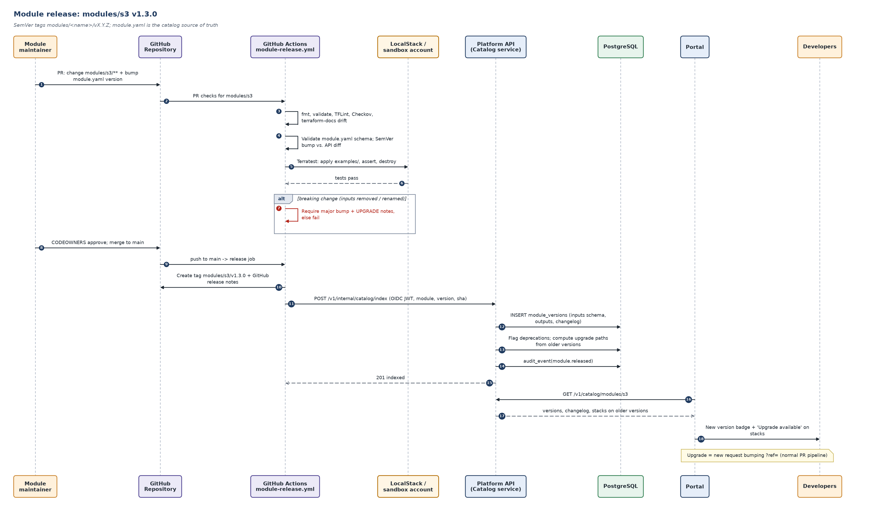

# 04 — Module Registry

> Purpose: define how the platform packages, versions, publishes, discovers and governs Terraform modules — the "Docker Hub for Terraform modules" that every self-service request is built from.

Related: [01-system-architecture.md](01-system-architecture.md) · [03-data-model-and-api.md](03-data-model-and-api.md) · [05-automation-pipeline.md](05-automation-pipeline.md) · [06-lifecycle-management.md](06-lifecycle-management.md) · [07-security-and-policy.md](07-security-and-policy.md) · [ADR-0003](adr/0003-monorepo-git-tag-module-versioning.md)

## Contents

1. [Registry model](#1-registry-model)
2. [Repository layout](#2-repository-layout)
3. [Module contract](#3-module-contract)
4. [`module.yaml` manifest specification](#4-moduleyaml-manifest-specification)
5. [Versioning and tag format](#5-versioning-and-tag-format)
6. [Compatibility matrix](#6-compatibility-matrix)
7. [Deprecation and yanking](#7-deprecation-and-yanking)
8. [How consumers pin versions](#8-how-consumers-pin-versions)
9. [Release flow and catalog indexing](#9-release-flow-and-catalog-indexing)
10. [Package catalogue](#10-package-catalogue)
11. [Reference interface: `modules/s3`](#11-reference-interface-moduless3)
12. [Example interfaces: `modules/sqs` and `modules/lambda`](#12-example-interfaces-modulessqs-and-moduleslambda)
13. [Authoring guidelines and review checklist](#13-authoring-guidelines-and-review-checklist)

---

## 1. Registry model

The registry has three layers. Git is the source of truth; the catalog is a derived, queryable index.

| Layer | Where | What it holds | Mutable? |
|---|---|---|---|
| Source | `modules/<name>/` in the `iacp` monorepo | HCL, `module.yaml`, README, examples, tests | Yes (via PR to `main`) |
| Release | Git tag `modules/<name>/vX.Y.Z` | Immutable snapshot of a module at a version | No (tags are protected) |
| Catalog | Postgres `modules`, `module_versions` (see [03-data-model-and-api.md](03-data-model-and-api.md)) | Parsed manifest, input JSON Schema, outputs, changelog, status (`active`/`deprecated`/`yanked`) | Status only |

The portal renders forms directly from the `inputs` JSON Schema stored in `module_versions`, the Config Generator renders HCL that references the tag, and the pipeline downloads the module from Git by tag. No module code is ever copied into `environments/`.

| Docker Hub concept | The platform equivalent |
|---|---|
| Repository (`library/nginx`) | Module (`modules/s3`) |
| Image tag (`1.25.3`) | Git tag `modules/s3/v1.2.0` |
| Image digest | Tag's commit SHA (recorded in `module_versions.commit_sha`) |
| Dockerfile / labels | HCL + `module.yaml` |
| Official image review | CODEOWNERS + review checklist (§13) |
| Deprecated / removed tag | `deprecated` / `yanked` status in catalog |

## 2. Repository layout

```
iacp/
├── modules/
│   ├── s3/
│   │   ├── module.yaml          # manifest (indexed into catalog)
│   │   ├── README.md            # generated sections via terraform-docs
│   │   ├── CHANGELOG.md         # Keep-a-Changelog format, one entry per version
│   │   ├── main.tf
│   │   ├── variables.tf
│   │   ├── outputs.tf
│   │   ├── versions.tf          # required_version + required_providers ranges
│   │   ├── locals.tf            # tag merging, naming convention
│   │   ├── examples/
│   │   │   ├── basic/main.tf
│   │   │   └── complete/main.tf
│   │   └── tests/
│   │       ├── s3.tftest.hcl    # terraform test (plan-level unit tests)
│   │       └── fixtures/
│   ├── sqs/  lambda/  vpc/  monitoring/  dynamodb/  ecs-service/  postgres/  redis/
│   └── _shared/                 # NOT a module: shared lint config, tag schema
│       ├── .tflint.hcl
│       └── tags.schema.json
├── tests/
│   └── modules/
│       ├── s3_test.go           # Terratest against LocalStack
│       ├── sqs_test.go
│       └── lambda_test.go
└── .github/workflows/module-release.yml
```

Each module directory is self-contained: it must `terraform init` and `terraform validate` in isolation with no relative `../` references.

## 3. Module contract

Every platform module implements the same contract so the generator, policies and portal can treat modules uniformly.

### 3.1 Standard inputs (mandatory in every module)

| Variable | Type | Rule | Purpose |
|---|---|---|---|
| `name` | `string` | `^[a-z][a-z0-9-]{2,40}$` | Logical resource name; final names are `${team}-${environment}-${name}` |
| `team` | `string` | `^[a-z][a-z0-9-]{1,30}$`, must match a platform team slug | Ownership, tagging, IAM scoping |
| `environment` | `string` | one of `development`, `staging`, `production` | Drives environment-specific defaults |
| `stack` | `string` | `^[a-z][a-z0-9-]{1,62}$` | Owning stack; sets the `iacp:stack` tag |
| `tags` | `map(string)` | max 30 entries, keys may not start with `iacp:` | Extra user tags, merged under mandatory tags |

The Config Generator always injects `team`, `environment`, `stack` and the mandatory tag set; users only supply `name` and the module-specific inputs. Modules compute:

```hcl
locals {
  full_name = "${var.team}-${var.environment}-${var.name}"
  tags = merge(var.tags, {
    "iacp:team"        = var.team
    "iacp:environment" = var.environment
    "iacp:stack"       = var.stack
    "iacp:module"      = "s3"
    "iacp:managed-by"  = "iacp"
  })
}
```

Mandatory tags are applied last, so user tags cannot override them. The OPA policy `tags.rego` (see [07-security-and-policy.md](07-security-and-policy.md)) rejects any plan where a taggable resource lacks them.

### 3.2 Secure defaults

| Principle | Implementation |
|---|---|
| Encrypted at rest by default | KMS CMK created per instance unless `kms_key_arn` supplied; never AWS-owned keys for data stores |
| Encrypted in transit | TLS-only bucket/queue policies; `transit_encryption_enabled = true` for Redis; `rds.force_ssl = 1` |
| Private by default | No public endpoints; S3 public access block all four flags; RDS/Redis in private subnets only |
| Least privilege | Modules output IAM policy JSON documents (`*_read_policy_json`, `*_write_policy_json`) instead of creating broad roles |
| Recoverable | Versioning, PITR, backups, deletion protection in `production` |
| Observable | Access/execution logs and default CloudWatch alarms where the service supports them |
| Unsafe options are explicit | Any weakening input is named `allow_*` / `enable_insecure_*`, defaults to `false`, and is denied in `production` by OPA |

### 3.3 Standardized outputs

| Output | Required | Description |
|---|---|---|
| `id` | yes | Primary resource identifier (bucket name, queue URL, function name) |
| `arn` | yes | Primary resource ARN |
| `name` | yes | Final computed name (`local.full_name`) |
| `kms_key_arn` | if encrypted | CMK used by the resource |
| `<access>_policy_json` | if data-bearing | Least-privilege IAM policy documents for consumers |
| `connection` | if network service | Object with `host`, `port`, `secret_arn` (never plaintext secrets) |
| `iacp_metadata` | yes | `{ module = "s3", version = "1.2.0" }` for drift/inventory correlation |

Outputs listed in `module.yaml` under `outputs[].wireable: true` are the only ones the platform can inject into downstream stacks (see dependency management in [06-lifecycle-management.md](06-lifecycle-management.md)).

## 4. `module.yaml` manifest specification

### 4.1 Field reference

| Field | Type | Required | Notes |
|---|---|---|---|
| `apiVersion` | string | yes | `iacp.dev/v1` |
| `kind` | string | yes | `Module` |
| `metadata.name` | string | yes | Must equal directory name |
| `metadata.version` | SemVer string | yes | Must equal tag being released; CI enforces |
| `metadata.displayName` | string | yes | Portal card title |
| `metadata.description` | string | yes | ≤ 200 chars |
| `metadata.category` | enum | yes | `storage`, `messaging`, `compute`, `database`, `cache`, `network`, `observability` |
| `metadata.owners` | list | yes | GitHub teams (`@org/team`), mirrored to CODEOWNERS |
| `metadata.maturity` | enum | yes | `alpha`, `beta`, `stable` — alpha cannot be used in `production` |
| `compatibility.terraform` | constraint | yes | e.g. `>= 1.10, < 2.0` |
| `compatibility.providers` | map | yes | provider source → constraint |
| `compatibility.environments` | list | yes | Environments in which the module may be instantiated |
| `inputs` | JSON Schema (draft 2020-12) | yes | Drives portal form + API validation; must agree with `variables.tf` |
| `inputs.properties.*.x-iacp-*` | extension | no | `x-iacp-ui` (widget), `x-iacp-group`, `x-iacp-production-only`, `x-iacp-immutable` (forces replacement) |
| `outputs` | list | yes | `name`, `description`, `sensitive`, `wireable` |
| `dependencies` | list | no | Typed input slots that accept another module's output (e.g. `vpc_id` from `vpc`) |
| `cost` | object | no | `baseline_monthly_usd`, `drivers[]` — portal hints before Infracost runs |
| `upgrade` | object | no | `from` constraint, `notes`, `requires_migration` — consumed by upgrade-path logic |
| `deprecation` | object | no | Set by catalog ops, not authors (see §7) |

CI validates `module.yaml` against `modules/_shared/module.schema.json` and runs a parity check that every key in `inputs.properties` exists in `variables.tf` with a compatible type, and vice versa (excluding injected `team`/`environment`/`stack`). The check is implemented by `tools/manifest_validator` (`.venv/bin/python -m tools.manifest_validator modules/`), which also checks that `outputs` match `outputs.tf` and that `metadata.version` equals `locals.module_version` (the value behind the `iacp_metadata` output).

### 4.2 Example: `modules/s3/module.yaml`

```yaml
apiVersion: iacp.dev/v1
kind: Module
metadata:
  name: s3
  version: 1.2.0
  displayName: S3 Bucket
  description: Private, KMS-encrypted S3 bucket with versioning, lifecycle rules and least-privilege access policies.
  category: storage
  maturity: stable
  owners:
    - "@acme/platform-storage"
  documentation: https://github.com/acme/self-service-iac-platform/tree/modules/s3/v1.2.0/modules/s3

compatibility:
  terraform: ">= 1.10, < 2.0"
  providers:
    hashicorp/aws: ">= 5.60, < 6.0"
  environments: [development, staging, production]

inputs:
  $schema: https://json-schema.org/draft/2020-12/schema
  type: object
  required: [name]
  additionalProperties: false
  properties:
    name:
      type: string
      pattern: "^[a-z][a-z0-9-]{2,40}$"
      description: Logical bucket name. Final name is <team>-<environment>-<name>.
      x-iacp-immutable: true
    versioning_enabled:
      type: boolean
      default: true
      description: Keep object versions. Forced true in production.
      x-iacp-production-only: false
    kms_key_arn:
      type: [string, "null"]
      default: null
      pattern: "^arn:aws:kms:[a-z0-9-]+:[0-9]{12}:key/.+$"
      description: Existing CMK. If null, a dedicated CMK is created.
      x-iacp-group: Encryption
    noncurrent_version_expiration_days:
      type: integer
      minimum: 1
      maximum: 3650
      default: 90
      x-iacp-group: Lifecycle
    transition_to_ia_days:
      type: [integer, "null"]
      minimum: 30
      default: null
      x-iacp-group: Lifecycle
    force_destroy:
      type: boolean
      default: false
      description: Allow destroy with objects present. Denied in production by policy.
      x-iacp-ui: danger-toggle
    access_logging_enabled:
      type: boolean
      default: true
    tags:
      type: object
      additionalProperties: { type: string }
      maxProperties: 30

outputs:
  - { name: id,                 description: Bucket name,                      wireable: true }
  - { name: arn,                description: Bucket ARN,                       wireable: true }
  - { name: name,               description: Computed bucket name,             wireable: false }
  - { name: kms_key_arn,        description: CMK ARN,                          wireable: true }
  - { name: read_policy_json,   description: IAM policy granting read access,  wireable: true }
  - { name: write_policy_json,  description: IAM policy granting write access, wireable: true }
  - { name: iacp_metadata,   description: Module name and version,          wireable: false }

cost:
  baseline_monthly_usd: 1.00      # KMS CMK
  drivers:
    - storage_gb
    - requests_per_month
    - kms_requests

upgrade:
  from: ">= 1.0.0, < 2.0.0"
  requires_migration: false
  notes: |
    1.2.0 adds optional `transition_to_ia_days`. No state changes.
```

## 5. Versioning and tag format

### 5.1 Tag format

```
modules/<name>/v<MAJOR>.<MINOR>.<PATCH>[-<prerelease>]
e.g.  modules/s3/v1.2.0
      modules/lambda/v2.0.0-rc.1
```

- Tags are created only by `module-release.yml` (GitHub App identity); a repository ruleset blocks humans from creating, moving or deleting tags matching `modules/**`.
- Prerelease tags (`-rc.N`, `-beta.N`) are indexed with `maturity` forced to `alpha` and hidden from the portal unless the user opts in. They can never be used in `production`.

### 5.2 SemVer rules for infrastructure modules

"Breaking" is defined from the consumer's point of view, including effects on existing state.

| Change | Bump |
|---|---|
| Remove or rename an input or output | MAJOR |
| Add a required input without default | MAJOR |
| Change an input type or narrow its validation | MAJOR |
| Change that causes destroy/replace of an existing resource on upgrade (resource address change without `moved` block, `ForceNew` attribute change) | MAJOR |
| Raise minimum Terraform or provider *major* version | MAJOR |
| Tighten a default in a way that changes existing resources (e.g. enabling a setting that alters behaviour) | MAJOR unless guarded by a new input defaulting to old behaviour |
| Add optional input with backwards-compatible default | MINOR |
| Add output | MINOR |
| Add new resource that does not affect existing ones (e.g. optional alarm) | MINOR |
| Refactor with `moved` blocks producing a no-op plan | MINOR |
| Raise minimum provider *minor* version | MINOR |
| Bug fix, docs, tag fixes, in-place no-op | PATCH |

Enforcement in `module-release.yml`:

1. **Interface diff** (implemented: `tools/module_release`, `make module-gate`). The gate parses the module's `*.tf` files with `python-hcl2` at the last final release tag and at HEAD, compares the public interface and classifies each change:

   | Change | Required bump |
   |---|---|
   | Variable or output removed (a rename is a removal plus an addition) | MAJOR |
   | New variable without a default | MAJOR |
   | Variable type changed (compared after removing whitespace outside string literals) | MAJOR |
   | Default removed, so the variable becomes required | MAJOR |
   | `nullable` turned off | MAJOR |
   | Validation `condition` added or changed (it may reject values that were valid before; string literals are compared verbatim) | MAJOR |
   | Output marked `sensitive = true` (consumers that re-export it must mark theirs sensitive); any change to or from a non-literal `sensitive = <expression>`, which is read as sensitive | MAJOR |
   | Required provider removed, or its source changed | MAJOR |
   | Lowest allowed **major** version raised in `required_version` or a `required_providers` constraint | MAJOR |
   | A Terraform or provider constraint changed in a way the gate cannot read | MAJOR |
   | New optional variable, new output | MINOR |
   | Default added or changed, `nullable` turned on, validation removed, output no longer `sensitive` | MINOR |
   | Lowest allowed **minor** version raised in a Terraform or provider constraint; new required provider | MINOR |
   | Any other change to the module directory (descriptions, `error_message`, resources, README, a lowered or unchanged constraint floor) | PATCH |

   **Constraint floors.** The gate reads `required_version` and every `required_providers` entry from the `terraform {}` block, keyed by `source`; an entry without a source, including the legacy shorthand `aws = ">= 5.0"`, gets Terraform's implied `hashicorp/<name>`. The floor of a constraint is the highest lower bound among its comma-separated parts: `>=`, `=`, `~>` and a bare version set a lower bound, `> X.Y.Z` is treated as `>= X.Y.Z`, and `<`, `<=` and `!=` do not raise it. No constraint means 0.0.0. Only the floors are compared, so `">= 5.60, < 6.0"` to `"~> 5.60"` is not a change, and raising only the ceiling (`< 6.0` to `< 7.0`) is PATCH. The gate reads the `.tf` files, not `module.yaml` `compatibility`. The manifest validator (`compatibility-parity` check, `make validate-manifests`) fails when `compatibility.terraform` differs from `required_version` or `compatibility.providers` differs from `required_providers` (same providers, same constraints after normalising whitespace), so the ranges the catalog indexes match what the gate compares.

   Changes only under `tests/` or `examples/` need no new version. The required bump is the largest of these. The gate then compares `metadata.version` with the last tag: it fails when the declared bump is smaller than required, when the version is lower than the last release, and when the module changed but the version did not. With no previous tag (first release) the gate passes. For a `0.x` module, a breaking change needs only a MINOR bump (SemVer item 4).

   **Prereleases.** Prerelease tags are never the comparison base for the bump; the last final release is. But when the declared version is already tagged (prereleases included) and the module changed since that tag, the gate fails, so `2.0.0-rc.1` cannot be edited after it is tagged. A prerelease lower than an existing prerelease of the same version (`rc.0` after `rc.1`) also fails.

   **Reviewer checklist** until the upgrade-plan test (check 2) lands: the gate classifies a changed default as MINOR, because it cannot tell whether the new default alters existing resources. If it does, the change is MAJOR by the table above ("Tighten a default..."), and the reviewer must ask for a major bump or for a new input that keeps the old behaviour. Likewise, narrowing a constraint ceiling (`< 7.0` to `< 6.0`, or a range to an exact version) is PATCH to the gate but can make a consumer's lock file unresolvable; treat it as MAJOR.
2. **Upgrade plan test** (planned, not yet in the workflow) — apply `examples/complete` at the previous tag against LocalStack, switch source to HEAD, run `terraform plan -detailed-exitcode`. Any `delete` or `replace` action fails a MINOR/PATCH release.
3. **CHANGELOG / upgrade notes check** (planned) — `CHANGELOG.md` must contain a section for the new version. MAJOR releases must contain a `### Migration` subsection and `module.yaml` `upgrade.notes`; its text is copied to `module_versions.upgrade_notes`. Today the release notes come from the CHANGELOG section when it exists, and otherwise from a generated interface-diff summary.

`module-release.yml` fails if a breaking change is not accompanied by a major bump (check 1). Once checks 2 and 3 land, it also requires upgrade notes.

## 6. Compatibility matrix

The matrix is derived from `module.yaml` and published in the catalog (`GET /v1/catalog/modules/{name}/versions`). Current target matrix:

| Module | Latest | Terraform | AWS provider | Environments | Maturity |
|---|---|---|---|---|---|
| s3 | 1.2.0 | >= 1.10, < 2.0 | >= 5.60, < 6.0 | dev, staging, prod | stable |
| sqs | 1.1.0 | >= 1.10, < 2.0 | >= 5.60, < 6.0 | dev, staging, prod | stable |
| lambda | 2.0.0 | >= 1.10, < 2.0 | >= 5.70, < 6.0 | dev, staging, prod | stable |
| ecs-service | 2.0.0 | >= 1.10, < 2.0 | >= 5.70, < 6.0 | dev, staging, prod | beta |
| postgres | 1.0.0 | >= 1.10, < 2.0 | >= 5.70, < 6.0 (+ hashicorp/random >= 3.6, < 4.0) | dev, staging, prod | beta |
| redis | 1.0.0 | >= 1.10, < 2.0 | >= 5.70, < 6.0 (+ hashicorp/random >= 3.6, < 4.0) | dev, staging, prod | beta |
| vpc | 0.2.0 | >= 1.10, < 2.0 | >= 5.60, < 6.0 | dev, staging | beta |
| monitoring | 0.1.0 | >= 1.10, < 2.0 | >= 5.60, < 6.0 | dev | alpha |

Rules:

- The platform pins one Terraform version per environment root in the generated `versions.tf` (e.g. `required_version = "~> 1.10.0"`) and the pipeline installs exactly that version. A module version is selectable only if its constraint admits the platform's pinned version.
- When the platform plans a Terraform or provider upgrade, the catalog computes the set of `module_versions` that would become incompatible and blocks the upgrade until every deployed stack is on a compatible version.
- Modules with `0.x` versions follow SemVer's "anything may change" rule; the portal labels them and OPA denies them in `production`.

## 7. Deprecation and yanking

| State | Meaning | Portal | New requests | Existing stacks | Who sets |
|---|---|---|---|---|---|
| `active` | Normal | Selectable | Allowed | Unaffected | Release workflow |
| `deprecated` | Superseded; still safe | Shown with warning + replacement | Allowed in non-prod; warning in prod | Upgrade suggestion surfaced; weekly reminder | Module owners via `POST /v1/catalog/modules/{name}/versions/{v}/deprecate` |
| `yanked` | Unsafe (security defect, data-loss bug) | Hidden | Blocked by API and OPA | Flagged `action_required`; upgrade request auto-opened for owners to review | Platform admin only; reason mandatory |

- Deprecation carries `deprecation.reason`, `deprecation.replacement` (e.g. `s3 >= 1.3.0`) and `deprecation.sunset_date`. After the sunset date, the version behaves as yanked for *new* requests only.
- Yanking never deletes the Git tag. Existing stacks must remain plannable and destroyable; a deleted tag would break `terraform init` for them.
- Every state transition writes an `audit_events` row (`module_version.deprecated`, `module_version.yanked`).
- OPA receives the catalog status as input data (`data.iacp.module_versions`) and denies plans whose module source references a yanked version, except for `destroy` requests.

## 8. How consumers pin versions

Developers never write `source` lines by hand; the Config Generator renders them. Generated `environments/development/payments/orders-store/main.tf`:

```hcl
# Code generated by the platform. DO NOT EDIT.
# request: req_01JD6K8T3V  stack: payments/orders-store  env: development

module "orders_bucket" {
  source = "git::https://github.com/acme/self-service-iac-platform.git//modules/s3?ref=modules/s3/v1.2.0"

  name        = "orders"
  team        = "payments"
  environment = "development"

  versioning_enabled                 = true
  noncurrent_version_expiration_days = 30
  tags = {
    cost-center = "cc-1042"
  }
}
```

Pinning rules:

- **Exact tag only.** `ref` is always a full `modules/<name>/vX.Y.Z` tag; branches, SHAs and ranges are rejected by the generator and by the OPA `module_source.rego` policy on the plan's `configuration` block.
- **Approved source host only.** Only `git::https://github.com/acme/self-service-iac-platform.git//modules/*` is allowed; public registry modules are denied.
- **Integrity.** The pipeline resolves each tag to its commit SHA and compares it with `module_versions.commit_sha`; a mismatch (moved tag) fails the run.
- **Upgrades** are always explicit requests (see [06-lifecycle-management.md](06-lifecycle-management.md#1-version-management)); the platform never floats a version.

## 9. Release flow and catalog indexing



1. Author opens PR touching `modules/<name>/**` with updated `module.yaml` `metadata.version` and `CHANGELOG.md`.
2. `module-release.yml` (PR mode) runs: fmt, validate, TFLint, Checkov, `terraform test`, manifest schema + parity check, interface diff vs. previous tag, Terratest against LocalStack, upgrade-plan test.
3. CODEOWNERS (module owners + `@acme/platform-team`) approve; merge to `main`.
4. `module-release.yml` (push mode) re-runs tests, creates tag `modules/<name>/v<version>` via the GitHub App, and creates a GitHub Release with the CHANGELOG section.
5. The workflow calls `POST /v1/internal/catalog/index` with an OIDC token and `{module, version, commit_sha}`. The backend fetches `module.yaml` at that SHA via the GitHub App, validates it, and upserts:
   - `modules` (name, display name, category, owners, latest_version)
   - `module_versions` (version, commit_sha, inputs_schema JSONB, outputs JSONB, compatibility JSONB, cost JSONB, upgrade_notes, status=`active`, released_at)
6. The backend writes `audit_events(type='module_version.published')` and invalidates the portal catalog cache.
7. A reconciliation job in the worker runs hourly: it lists `modules/**` tags via the GitHub API and indexes any tag missing from `module_versions` (covers callback failures).

Indexing is idempotent on `(module, version)`; re-indexing the same version with a different `commit_sha` is rejected and raises a security alert.

**Current implementation (local-first, ADR-0009).** The flow above is the target. What runs today:

- Static checks, `terraform test`, the manifest validator and Terratest run on every PR in `ci.yml`. Modules built on services LocalStack community does not emulate (ECS, ECR, ELBv2, RDS, ElastiCache: `ecs-service`, `postgres`, `redis`) have offline suites: `plan` runs use the real AWS provider with every endpoint on a closed local port and `override_data` for the account lookups, and `apply` runs use `mock_provider "aws"` in a separate state. A suite whose files all declare `mock_provider "aws"` runs in the `module-tests-offline` job without an emulator; the others run against LocalStack in `module-tests`, which also plans every `examples/complete` and checks it with conftest (`policies/example-plan.sh`). `module-release.yml` in PR mode runs only the interface-diff gate (check 1 of section 5.2), for modules the PR changes and for modules whose declared version is not tagged yet. Its single required check is `semver gate result`. The `module-tests-floor` job runs the same offline suites again on the lowest provider versions the module declares: `python -m tools.provider_floor stage` copies the module to a scratch directory and adds a `provider_floor_override.tf` that pins each provider to the floor of its `required_providers` constraint (`aws >= 5.70, < 6.0` becomes `= 5.70.0`), then `terraform init -upgrade` and `terraform test` run there (`make module-test-floor` locally). Only suites that mock the provider can run this way, so `ecs-service`, `postgres` and `redis` are covered; the LocalStack suites (`dynamodb`, `lambda`, `monitoring`, `s3`, `sqs`, `vpc`) are not, because they need an emulator whose behaviour is tied to the newest provider. Their next best check is the `terraform validate` and `tflint` run on the resolved version. The first run found that `modules/redis/tests` compared a provider attribute whose type differs between 5.x versions.
- On a push to `main`, `module-release.yml` runs the gate again and, for each such module, creates the tag `modules/<name>/v<version>` if it does not exist, pointing at the pushed commit. It uses the workflow `GITHUB_TOKEN` with `contents: write` until the GitHub App exists (WBS 4.8). An existing tag is never moved. It then creates a GitHub release whose notes are the module's CHANGELOG section, or a generated interface-diff summary against the last final release below the declared version. Modules whose declared version is untagged, or tagged without a GitHub release, are always included, so a run that failed before or at `gh release create` is picked up by the next push to `main` that touches the release paths, or by a manual `workflow_dispatch` run on `main`, which covers every module.
- The index call (`python -m tools.module_release index`) sends the parsed `module.yaml` inline, matching `catalog.IndexCommand` (see [03](03-data-model-and-api.md)), with the shared bearer token. A 201 means indexed and a 200 means already indexed. The client refuses redirects (it would otherwise replay the bearer token to the new location) and treats any status other than 200 or 201 as a failure. The step is skipped with a notice while neither the `IACP_API_URL` variable nor the `IACP_INTERNAL_TOKEN` secret is configured, which is the case until a hosted API exists; setting only one of them fails the step. A failed index call is not retried by the next push; until the reconciliation job (step 7) exists, re-run the release job or dispatch the workflow on `main`. Authentication today is the shared token. The backend also accepts a GitHub OIDC token on this route, but only from `module-release.yml` on `refs/heads/main` triggered by `push` or `workflow_dispatch` (`auth.RouteCatalogIndex`, see [03](03-data-model-and-api.md)); those are exactly the events the release job runs on, so switching the client to OIDC needs no trigger change.

## 10. Package catalogue

| Package | Resources created | Key inputs | Secure defaults | Outputs |
|---|---|---|---|---|
| **s3** (MVP) | `aws_s3_bucket`, versioning, SSE config, public access block, ownership controls, lifecycle, bucket policy, `aws_kms_key` + alias, optional logging target | `name`, `versioning_enabled`, `kms_key_arn`, `noncurrent_version_expiration_days`, `transition_to_ia_days`, `force_destroy` | SSE-KMS with CMK + bucket key, all public access blocked, `BucketOwnerEnforced`, TLS-only policy, versioning on, `force_destroy=false` | `id`, `arn`, `name`, `kms_key_arn`, `read_policy_json`, `write_policy_json` |
| **sqs** (MVP) | `aws_sqs_queue` (main + DLQ), redrive policy, redrive allow policy, queue policy, `aws_kms_key`, CloudWatch alarms (DLQ depth, age of oldest message) | `name`, `fifo`, `visibility_timeout_seconds`, `message_retention_seconds`, `max_receive_count`, `dlq_retention_seconds` | SSE-KMS CMK, DLQ always created, TLS-only policy, no wildcard principals, alarms on DLQ > 0 | `id` (URL), `arn`, `name`, `dlq_arn`, `dlq_url`, `kms_key_arn`, `consumer_policy_json`, `producer_policy_json` |
| **lambda** (MVP) | `aws_lambda_function`, execution role under `/iacp/` + boundary, log group (retention + KMS), optional SQS event source mapping (tagged), `aws_kms_key` | `name`, `runtime`, `handler`, `artifact_s3_uri`, `memory_mb`, `timeout_seconds`, `environment_variables`, `sqs_trigger`, `dead_letter_target_arn`, `extra_policy_jsons` (map) | Role always carries a permissions boundary (default `iacp-boundary`), `extra_policy_jsons` rejects wildcards, `iam:PassRole` (any `?` or `*` spelling) and `iam:` actions on `Resource "*"` or a wildcard account (2.0.0), no function URL, X-Ray active (required in prod), log retention 30d, env vars encrypted with CMK, reserved concurrency 1-1000 (required in prod). Default alarms and code signing in prod are planned for a later minor release | `id`, `arn`, `name`, `role_arn`, `invoke_arn`, `log_group_name`, `kms_key_arn` |
| **ecs-service** | ECS Fargate service + task definition, optional cluster (Container Insights), ECR repository + lifecycle policy, execution and task roles under `/iacp/` + boundary, security groups, log group (KMS), optional internal/public ALB with HTTPS listener + HTTP redirect, `aws_kms_key` | `name`, `vpc_id`, `subnet_ids`, `image_tag`, `cpu`, `memory`, `desired_count`, `container_port`, `health_check_path`, `load_balancer` (object), `cluster_arn`, `secrets`, `egress_security_group_rules`, `extra_policy_jsons` | Fargate only, private subnets, no public IP, ECR scan on push + immutable tags + KMS, read-only root FS, non-root user, capabilities dropped, ALB-only ingress, HTTPS listener (TLS 1.2+) with port 80 redirecting, circuit breaker with rollback, secrets by reference with an exact-ARN execution role. Autoscaling, ALB access logs and alarms are planned | `id`, `arn`, `name`, `service_name`, `cluster_arn`, `alb_dns_name`, `service_url`, `ecr_repository_url`, `task_role_arn`, `execution_role_arn`, `security_group_id`, `log_group_name`, `kms_key_arn` |
| **postgres** | `aws_db_instance` (Aurora later), subnet group, parameter group, security group, RDS-managed master secret (Secrets Manager), log groups, `aws_kms_key` | `name`, `engine_version`, `instance_class`, `allocated_storage_gb`, `multi_az`, `backup_retention_days`, `vpc_id`, `subnet_ids`, `allowed_security_group_ids` | Not publicly accessible, storage encrypted CMK, `rds.force_ssl=1`, `manage_master_user_password` (KMS), backups 7d (35d prod), deletion protection + final snapshot outside development, Multi-AZ in prod, IAM auth on, Performance Insights encrypted. Enhanced Monitoring and alarms are planned | `id`, `arn`, `name`, `endpoint`, `port`, `secret_arn`, `connection` {host, port, secret_arn}, `security_group_id`, `kms_key_arn` |
| **redis** | `aws_elasticache_replication_group`, subnet group, parameter group, security group, AUTH token secret (or RBAC user group), log groups, `aws_kms_key` | `name`, `node_type`, `num_cache_clusters`, `engine_version`, `auth_mode`, `user_group_ids`, `vpc_id`, `subnet_ids`, `allowed_security_group_ids` | At-rest (CMK) + required in-transit encryption, AUTH token in Secrets Manager or RBAC, automatic failover + Multi-AZ with 2+ nodes (required in prod), snapshots on, final snapshot outside development, private subnets only | `id`, `arn`, `name`, `primary_endpoint`, `reader_endpoint`, `port`, `secret_arn`, `connection` {host, port, secret_arn}, `security_group_id`, `kms_key_arn` |
| **vpc** (v1.0.0) | `aws_vpc`, public and private subnet per zone (1-4 zones), internet gateway, route tables (one public, one private per zone), optional `aws_eip` + `aws_nat_gateway` (shared or per zone), `aws_default_security_group`, `aws_flow_log` to a log group, flow log role, `aws_kms_key` | `name`, `cidr_block`, `subnet_newbits`, `az_count`, `availability_zones`, `enable_nat_gateway`, `single_nat_gateway`, `flow_log_traffic_type`, `flow_log_retention_days` | RFC 1918 CIDR only, DNS on, no public IP on launch in any subnet, default SG with no rules, flow logs always on to a CMK-encrypted log group, flow log role under `/iacp/` with `iacp-boundary` and write access to its own log group only, NAT off in development by default and per zone in production. Isolated subnets and VPC endpoints are planned for a later minor release | `id`, `arn`, `name`, `vpc_id`, `vpc_cidr_block`, `availability_zones`, `public_subnet_ids`, `private_subnet_ids`, `public_route_table_ids`, `private_route_table_ids`, `nat_gateway_ids`, `default_security_group_id`, `flow_log_group_name`, `kms_key_arn` |
| **monitoring** (v1.0.0) | `aws_sns_topic` + topic policy, subscriptions, `aws_cloudwatch_metric_alarm` per helper entry, `aws_cloudwatch_dashboard`, `aws_kms_key` | `name`, `subscriptions` (map of `{protocol, endpoint}`), `dashboard_widgets` (typed metric or markdown widgets), `sqs_queue_alarms`, `lambda_function_alarms`, `dynamodb_table_alarms`, `publisher_service_principals` | Topic encrypted with a CMK that CloudWatch may use for this account, topic policy limits publishers to CloudWatch (plus listed services) and denies non-TLS publishing, no plain-http or sqs subscriptions, lambda subscriptions get an invoke permission scoped to the topic, alarms notify on alarm and recovery, dashboard lists every alarm. Composite alarms are planned for a later minor release | `id`, `arn`, `name`, `sns_topic_arn`, `dashboard_name`, `dashboard_url`, `alarm_arns`, `kms_key_arn`, `publisher_policy_json` |
| **dynamodb** (v1.0.0) | `aws_dynamodb_table`, `aws_kms_key` + alias | `name`, `hash_key`, `range_key`, `billing_mode`, `read_capacity`, `write_capacity`, `global_secondary_indexes` (typed list), `ttl_attribute_name`, `stream_view_type`, `deletion_protection_enabled` | SSE with a CMK (never the AWS owned or `aws/dynamodb` key), PITR always on, deletion protection on outside development (cannot be turned off there), on-demand billing by default, attribute definitions derived from key attributes with one type per name | `id`, `arn`, `name`, `stream_arn`, `kms_key_arn`, `read_policy_json`, `write_policy_json` |

## 11. Reference interface: `modules/s3`

### `modules/s3/versions.tf`

```hcl
terraform {
  required_version = ">= 1.10, < 2.0"
  required_providers {
    aws = {
      source  = "hashicorp/aws"
      version = ">= 5.60, < 6.0"
    }
  }
}
```

### `modules/s3/variables.tf`

```hcl
variable "name" {
  description = "Logical bucket name. Final name is <team>-<environment>-<name>."
  type        = string

  validation {
    condition     = can(regex("^[a-z][a-z0-9-]{2,40}$", var.name))
    error_message = "name must be 3-41 chars, lowercase alphanumerics and hyphens, starting with a letter."
  }
}

variable "team" {
  description = "Owning team slug. Injected by the platform."
  type        = string

  validation {
    condition     = can(regex("^[a-z][a-z0-9-]{1,30}$", var.team))
    error_message = "team must be a valid the platform team slug."
  }
}

variable "environment" {
  description = "Target environment. Injected by the platform."
  type        = string

  validation {
    condition     = contains(["development", "staging", "production"], var.environment)
    error_message = "environment must be one of development, staging, production."
  }
}

variable "tags" {
  description = "Additional tags. Keys starting with 'iacp:' are reserved."
  type        = map(string)
  default     = {}

  validation {
    condition     = length(var.tags) <= 30 && alltrue([for k in keys(var.tags) : !startswith(k, "iacp:")])
    error_message = "At most 30 tags; the 'iacp:' prefix is reserved."
  }
}

variable "versioning_enabled" {
  description = "Enable object versioning. Always enabled in production."
  type        = bool
  default     = true
}

variable "kms_key_arn" {
  description = "Existing KMS CMK ARN. If null, a dedicated CMK is created."
  type        = string
  default     = null

  validation {
    condition     = var.kms_key_arn == null || can(regex("^arn:aws:kms:[a-z0-9-]+:[0-9]{12}:key/.+$", var.kms_key_arn))
    error_message = "kms_key_arn must be a KMS key ARN (aliases are not accepted)."
  }
}

variable "noncurrent_version_expiration_days" {
  description = "Days before noncurrent object versions expire."
  type        = number
  default     = 90

  validation {
    condition     = var.noncurrent_version_expiration_days >= 1 && var.noncurrent_version_expiration_days <= 3650
    error_message = "noncurrent_version_expiration_days must be between 1 and 3650."
  }
}

variable "transition_to_ia_days" {
  description = "Days before current objects transition to STANDARD_IA. Null disables."
  type        = number
  default     = null

  validation {
    condition     = var.transition_to_ia_days == null || try(var.transition_to_ia_days >= 30, false)
    error_message = "transition_to_ia_days must be >= 30 (S3 minimum for STANDARD_IA)."
  }
}

variable "force_destroy" {
  description = "Allow bucket deletion while objects exist. Denied in production by policy."
  type        = bool
  default     = false

  validation {
    condition     = !(var.force_destroy && var.environment == "production")
    error_message = "force_destroy cannot be enabled in production."
  }
}

variable "access_logging_enabled" {
  description = "Send server access logs to the account's central log bucket."
  type        = bool
  default     = true
}
```

> Cross-variable validation (`force_destroy` referencing `environment`) requires Terraform >= 1.9, which is within the module's `>= 1.10` constraint.

### `modules/s3/main.tf` (excerpt showing secure defaults)

```hcl
resource "aws_s3_bucket" "this" {
  bucket        = local.full_name
  force_destroy = var.force_destroy
  tags          = local.tags
}

resource "aws_s3_bucket_public_access_block" "this" {
  bucket                  = aws_s3_bucket.this.id
  block_public_acls       = true
  block_public_policy     = true
  ignore_public_acls      = true
  restrict_public_buckets = true
}

resource "aws_s3_bucket_ownership_controls" "this" {
  bucket = aws_s3_bucket.this.id
  rule { object_ownership = "BucketOwnerEnforced" }
}

resource "aws_s3_bucket_versioning" "this" {
  bucket = aws_s3_bucket.this.id
  versioning_configuration {
    status = (var.versioning_enabled || var.environment == "production") ? "Enabled" : "Suspended"
  }
}

resource "aws_s3_bucket_server_side_encryption_configuration" "this" {
  bucket = aws_s3_bucket.this.id
  rule {
    apply_server_side_encryption_by_default {
      sse_algorithm     = "aws:kms"
      kms_master_key_id = local.kms_key_arn
    }
    bucket_key_enabled = true
  }
}

data "aws_iam_policy_document" "tls_only" {
  statement {
    sid       = "DenyInsecureTransport"
    effect    = "Deny"
    actions   = ["s3:*"]
    resources = [aws_s3_bucket.this.arn, "${aws_s3_bucket.this.arn}/*"]
    principals {
      type        = "*"
      identifiers = ["*"]
    }
    condition {
      test     = "Bool"
      variable = "aws:SecureTransport"
      values   = ["false"]
    }
  }
}
```

### `modules/s3/outputs.tf`

```hcl
output "id" {
  description = "Bucket name."
  value       = aws_s3_bucket.this.id
}

output "arn" {
  description = "Bucket ARN."
  value       = aws_s3_bucket.this.arn
}

output "name" {
  description = "Computed bucket name (<team>-<environment>-<name>)."
  value       = local.full_name
}

output "kms_key_arn" {
  description = "ARN of the CMK encrypting the bucket."
  value       = local.kms_key_arn
}

output "read_policy_json" {
  description = "IAM policy document granting read-only access to the bucket."
  value       = data.aws_iam_policy_document.read.json
}

output "write_policy_json" {
  description = "IAM policy document granting read/write access to the bucket."
  value       = data.aws_iam_policy_document.write.json
}

output "iacp_metadata" {
  description = "Module identity for inventory and drift correlation."
  value       = { module = "s3", version = "1.2.0" }
}
```

`iacp_metadata.version` is stamped by `module-release.yml` from `module.yaml`; a CI check fails if they differ.

## 12. Example interfaces: `modules/sqs` and `modules/lambda`

Standard inputs (`name`, `team`, `environment`, `tags`) are identical to §11 and omitted.

### `modules/sqs` (v1.1.0)

```hcl
# variables.tf (module-specific)
variable "fifo" {
  type    = bool
  default = false
}

variable "visibility_timeout_seconds" {
  type    = number
  default = 30
  validation {
    condition     = var.visibility_timeout_seconds >= 0 && var.visibility_timeout_seconds <= 43200
    error_message = "visibility_timeout_seconds must be 0-43200."
  }
}

variable "message_retention_seconds" {
  type    = number
  default = 345600 # 4 days
  validation {
    condition     = var.message_retention_seconds >= 60 && var.message_retention_seconds <= 1209600
    error_message = "message_retention_seconds must be 60-1209600."
  }
}

variable "max_receive_count" {
  description = "Receives before a message moves to the DLQ."
  type        = number
  default     = 5
  validation {
    condition     = var.max_receive_count >= 1 && var.max_receive_count <= 100
    error_message = "max_receive_count must be 1-100."
  }
}

variable "dlq_retention_seconds" {
  type    = number
  default = 1209600 # 14 days, always >= main queue retention
}

# outputs.tf
output "id"                   { value = aws_sqs_queue.this.url }
output "arn"                  { value = aws_sqs_queue.this.arn }
output "name"                 { value = aws_sqs_queue.this.name }
output "dlq_arn"              { value = aws_sqs_queue.dlq.arn }
output "dlq_url"              { value = aws_sqs_queue.dlq.url }
output "kms_key_arn"          { value = local.kms_key_arn }
output "consumer_policy_json" { value = data.aws_iam_policy_document.consumer.json }
output "producer_policy_json" { value = data.aws_iam_policy_document.producer.json }
```

### `modules/lambda` (v2.0.0)

```hcl
# variables.tf (module-specific)
variable "runtime" {
  type = string
  validation {
    condition     = contains(["python3.12", "python3.13", "nodejs20.x", "nodejs22.x", "java21", "provided.al2023"], var.runtime)
    error_message = "runtime must be a supported, non-deprecated Lambda runtime."
  }
}

variable "handler" {
  type    = string
  default = "bootstrap"
}

variable "artifact_s3_uri" {
  description = "s3://bucket/key of the deployment package (built by the app's CI)."
  type        = string
  validation {
    condition     = can(regex("^s3://[a-z0-9.-]+/.+\\.zip$", var.artifact_s3_uri))
    error_message = "artifact_s3_uri must be an s3:// URI to a .zip file."
  }
}

variable "memory_mb" {
  type    = number
  default = 256
  validation {
    condition     = var.memory_mb >= 128 && var.memory_mb <= 10240
    error_message = "memory_mb must be 128-10240."
  }
}

variable "timeout_seconds" {
  type    = number
  default = 30
  validation {
    condition     = var.timeout_seconds >= 1 && var.timeout_seconds <= 900
    error_message = "timeout_seconds must be 1-900."
  }
}

variable "environment_variables" {
  description = "Non-secret configuration. Use Secrets Manager ARNs for secrets."
  type        = map(string)
  default     = {}
}

variable "sqs_trigger" {
  description = "Optional SQS trigger; queue_arn and kms_key_arn are wireable from the sqs module."
  type = object({
    queue_arn                          = string
    batch_size                         = optional(number, 10) # 1-10 unless a batching window is set
    maximum_batching_window_in_seconds = optional(number, 0)
    kms_key_arn                        = optional(string) # role gets kms:Decrypt on it
  })
  default = null
}

variable "extra_policy_jsons" {
  description = "Additional IAM policy documents keyed by a stable name (e.g. { orders-read = s3 read_policy_json }). Allow statements may not use '*', '<service>:*', NotAction or NotResource."
  type        = map(string)
  default     = {}
}

# outputs.tf
output "id"             { value = aws_lambda_function.this.function_name }
output "arn"            { value = aws_lambda_function.this.arn }
output "name"           { value = aws_lambda_function.this.function_name }
output "role_arn"       { value = aws_iam_role.this.arn }
output "invoke_arn"     { value = aws_lambda_function.this.invoke_arn }
output "log_group_name" { value = aws_cloudwatch_log_group.this.name }
```

The `sqs_trigger.queue_arn` and `extra_policy_jsons` inputs are declared as `dependencies` in `lambda/module.yaml`, so the portal offers "wire from existing stack output" pickers for them, populated from `sqs.arn`, `sqs.consumer_policy_json` and `s3.read_policy_json`.

Optional companions that take a wireable value (`sqs_trigger`, the s3 module's `access_logging`) are objects, not plain strings. A resource's `count` can then depend on whether the object is null, which Terraform knows at plan time even when the wired ARN or name is only known after apply (for example when the source resource is created in the same configuration).

## 13. Authoring guidelines and review checklist

### 13.1 Guidelines

1. **One concern per module.** A module provisions one logical service plus its mandatory companions (KMS key, DLQ, log group). Compose at the stack level, not inside modules.
2. **No providers inside modules.** Modules declare `required_providers` only; the generated root supplies `provider "aws"` with `assume_role` and `default_tags`.
3. **No data sources that read outside the target account** and no `terraform_remote_state`; cross-stack values arrive as inputs (see [06-lifecycle-management.md](06-lifecycle-management.md#7-dependency-management)).
4. **Stable addresses.** Use `this` for the primary resource; any rename must ship a `moved` block.
5. **`count`/`for_each` only on optional companions**, never on the primary resource (avoids `[0]` address churn).
6. **Every input has `description`, `type`, and either `default` or `validation`.** Prefer validation that mirrors the JSON Schema.
7. **Sensitive values** are never outputs; return Secrets Manager ARNs.
8. **Examples are tests.** `examples/basic` and `examples/complete` must plan and apply against LocalStack in CI.
9. **Pin nothing transitive.** Modules do not call other modules from the public registry.

### 13.2 Review checklist (PR template for `modules/**`)

```markdown
### Module review checklist
- [ ] `module.yaml` version bumped and matches CHANGELOG entry
- [ ] Bump level correct per SemVer table (interface diff + upgrade plan test green)
- [ ] MAJOR: `### Migration` section written; `moved` blocks added where possible
- [ ] Standard inputs `name`, `team`, `environment`, `tags` present and unchanged
- [ ] Mandatory `iacp:*` tags applied to every taggable resource
- [ ] Encryption at rest with CMK; TLS enforced in transit
- [ ] No public exposure (public access block / private subnets / no public IP)
- [ ] IAM: no `*` actions or resources; roles carry `iacp-boundary`
- [ ] Any weakening option named `allow_*`/`enable_insecure_*`, default false
- [ ] Inputs JSON Schema and `variables.tf` in parity (CI)
- [ ] Standard outputs present; sensitive values not output
- [ ] Checkov and TFLint clean, or suppressions justified inline with ticket
- [ ] Terratest + `terraform test` cover new inputs
- [ ] README regenerated (`terraform-docs`)
- [ ] Cost drivers in `module.yaml` updated
```

Reviewers: one module owner (from `metadata.owners`) and one member of `@acme/platform-team`; security-sensitive diffs (IAM, KMS, network) additionally require `@acme/security`, enforced via CODEOWNERS path rules (see [05-automation-pipeline.md](05-automation-pipeline.md#5-repository-protection)).
