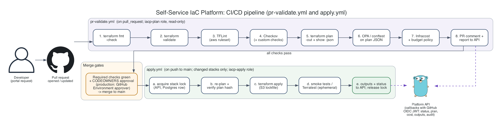

# 05 — Automation Pipeline

> Purpose: specify the GitHub Actions pipeline that turns a platform change request into validated, policy-checked, costed, approved and applied infrastructure, plus the scheduled lifecycle workflows.

Related: [01-system-architecture.md](01-system-architecture.md) · [04-module-registry.md](04-module-registry.md) · [06-lifecycle-management.md](06-lifecycle-management.md) · [07-security-and-policy.md](07-security-and-policy.md) · ADRs [0001](adr/0001-pr-based-gitops-provisioning.md), [0002](adr/0002-terraform-executes-in-github-actions.md), [0005](adr/0005-github-oidc-for-aws-access.md), [0006](adr/0006-opa-conftest-and-checkov.md), [0008](adr/0008-github-app-for-automation.md)

## Contents

1. [Overview](#1-overview)
2. [Stage reference](#2-stage-reference)
3. [Stack layout and changed-stack detection](#3-stack-layout-and-changed-stack-detection)
4. [Workflows](#4-workflows)
   - [4.1 Shared reporting action](#41-shared-reporting-action)
   - [4.2 pr-validate.yml](#42-pr-validateyml)
   - [4.3 apply.yml](#43-applyyml)
   - [4.4 drift.yml](#44-driftyml)
   - [4.5 ttl-reaper.yml](#45-ttl-reaperyml)
   - [4.6 module-release.yml](#46-module-releaseyml)
5. [Repository protection](#5-repository-protection)
6. [Caching and performance](#6-caching-and-performance)
7. [Terratest: `modules/s3` against LocalStack](#7-terratest-moduless3-against-localstack)

---

## 1. Overview



Principles:

- **Terraform runs only in GitHub Actions** ([ADR-0002](adr/0002-terraform-executes-in-github-actions.md)). The backend writes Git and reads results; it never holds AWS write credentials for workloads.
- **Plan in PR, apply on merge.** The PR is the approval artefact; `main` is the desired state.
- **Two roles per workload account.** `iacp-plan` (read-only + state read) for PR, drift and pre-apply checks; `iacp-apply` (scoped, boundary `iacp-boundary`) only in `apply.yml` jobs bound to a GitHub Environment.
- **What is applied is what was approved.** `apply.yml` re-plans and compares a normalized plan hash with the hash recorded at approval time.
- **Every run reports back.** Each job posts status, plan summary, cost and outputs to the Platform API using the job's GitHub OIDC token (audience `iacp-api`), so the portal and `pipeline_runs` stay in sync even if webhooks are delayed.

## 2. Stage reference

| # | Stage | Tool | Trigger | Runs as | Failure behaviour | Artifacts / outputs |
|---|---|---|---|---|---|---|
| 1 | Generate config | Platform Config Generator (Go, `backend/internal/generator`) | Request submitted in portal / API | Backend worker | Request stays `draft`, validation errors returned to user; nothing pushed | `main.tf`, `backend.tf`, `versions.tf`, `providers.tf`, `iacp.stack.json`, `.terraform.lock.hcl` |
| 2 | Create PR | GitHub App (branch, commit, PR, labels) | Generator success | Backend worker | Retries with backoff (3x); then request `failed` with `github_error` | Branch `iacp/<request-id>`, PR with labels `iacp`, `env:<env>`, `team:<team>`; request → `pr_open` |
| 3 | Format + validate | `terraform fmt -check`, `terraform validate` | `pull_request` | `iacp-plan` | Check fails; request → `failed` (generator bug: alerts platform team) | Job log |
| 4 | Lint | TFLint + AWS ruleset | `pull_request` | none (offline) | Check fails | SARIF uploaded to code scanning |
| 5 | Static security scan | Checkov (+ custom checks in `policies/checkov/`) | `pull_request` | none | Check fails on any `HIGH`/`CRITICAL` or custom `IACP_*` failure | `checkov.sarif`, summary in PR comment |
| 6 | Plan | `terraform plan -lock=false -out=tfplan` | `pull_request` | `iacp-plan` | Check fails; error surfaced in PR comment and portal | `tfplan`, `plan.json`, normalized `plan.sha256` |
| 7 | Policy | OPA via `conftest test plan.json -p policies/opa` | after plan | none | `deny` → check fails; `warn` → shown in comment | `conftest.json` |
| 8 | Cost | Infracost `breakdown` + `diff`; budget evaluated by OPA `budget.rego` | after plan | Infracost API key (secret) | Over-budget → fails unless `budget-override` approved by team admin | `infracost.json`; `cost_estimates` row |
| 9 | Report | PR comment (sticky) + `POST /v1/runs` (OIDC JWT) | end of PR job | OIDC → Platform API | Report failure does not fail check; reconciler fetches run later | `plan_summaries` row; request → `plan_ready` |
| 10 | Approve + merge | CODEOWNERS review; GitHub Environment reviewer for production | human | — | Merge blocked until all required checks + reviews | request → `approved` |
| 11 | Apply | `terraform plan` → hash check → `terraform apply tfplan` | `push` to `main` | `iacp-apply` in GitHub Environment `<env>` | Plan-hash mismatch → abort, request `failed` (`plan_mismatch`); apply error → stack `failed`, transient errors auto-retried by backend (max 2 retries with backoff) | `apply.log`, `outputs.json`; stack → `active` |
| 12 | Post-apply tests | Smoke tests; Terratest for ephemeral stacks | after apply | `iacp-plan` | Stack marked `active` with `health=degraded`, team notified; no auto-destroy | `go test` JSON report |

Statuses follow the request lifecycle `draft → pr_open → validating → plan_ready → approved → applying → applied | failed | rejected | cancelled` (see [06-lifecycle-management.md](06-lifecycle-management.md)).

## 3. Stack layout and changed-stack detection

Each stack is a directory `environments/<env>/<team>/<stack>/` generated by the platform:

```
environments/development/payments/orders-store/
├── main.tf                       # module blocks (generated)
├── backend.tf                    # S3 backend with use_lockfile = true
├── versions.tf                   # pinned terraform + provider versions
├── providers.tf                  # aws provider: region, assume_role-free (OIDC creds), default_tags
├── iacp.deps.auto.tfvars.json # upstream outputs injected by the platform (optional)
├── iacp.stack.json            # metadata used by CI (not read by Terraform)
└── .terraform.lock.hcl
```

`iacp.stack.json`:

```json
{
  "stack_id": "stk_01JD6K2W9M",
  "request_id": "req_01JD6K8T3V",
  "environment": "development",
  "team": "payments",
  "name": "orders-store",
  "account_id": "222222222222",
  "desired_state": "present",
  "ephemeral": true,
  "expires_at": "2026-12-01T00:00:00Z",
  "depends_on": ["stk_01JC9Z0F1A"],
  "terraform_version": "1.10.5"
}
```

Detection algorithm (`.github/scripts/changed-stacks.sh`, used by `pr-validate.yml` and `apply.yml`):

1. `git diff --name-only <base>...<head> -- environments/` (PR: merge base vs. head; push: `github.event.before..github.event.after`).
2. Map each path to its stack root by taking the first four segments (`environments/<env>/<team>/<stack>`).
3. Deduplicate; keep roots that still contain `iacp.stack.json`. Roots that were deleted (cleanup after destroy) are skipped — their state is already empty.
4. Emit a JSON matrix: `[{ "path": "...", "env": "...", "account_id": "...", "stack_id": "...", "desired_state": "...", "ephemeral": false }]`, built from each `iacp.stack.json`.
5. Guard rails: fail if more than 20 stacks changed (generator emits at most one stack per request; bulk changes require the `iacp/bulk` label and platform-team approval). Fail if two changed stacks have a `depends_on` edge between them — the backend serialises dependent stacks into separate requests (DAG ordering, see [06-lifecycle-management.md](06-lifecycle-management.md#7-dependency-management)).

Changes outside `environments/` do not plan stacks: `modules/**` triggers `module-release.yml`; `policies/**` triggers `opa test` / `conftest verify` and Checkov custom-check unit tests; `backend/**` and `portal/**` have their own app CI.

## 4. Workflows

All third-party actions are pinned to a full commit SHA, written below as `@<sha> # vX.Y.Z`; Dependabot (`package-ecosystem: github-actions`) proposes pin updates. Tool versions (Terraform, TFLint, Checkov, conftest, Infracost) are pinned in `.github/tool-versions.env`.

### 4.1 Shared reporting action

`.github/actions/iacp-report/action.yml` — a composite action that exchanges the job's OIDC token for an API call. The API validates `iss`, `aud=iacp-api`, `repository=acme/self-service-iac-platform` and `job_workflow_ref` against an allow-list of workflow files on `main` or the PR.

```yaml
name: iacp-report
description: Report pipeline status to the Platform API using GitHub OIDC
inputs:
  event:      { required: true }   # plan_ready | plan_failed | apply_started | applied | apply_failed | drift
  stack-id:   { required: true }
  payload:    { required: false, default: "{}" }   # path to JSON file or inline JSON
runs:
  using: composite
  steps:
    - shell: bash
      env:
        IACP_API_URL: ${{ vars.IACP_API_URL }}
      run: |
        set -euo pipefail
        TOKEN=$(curl -sSf -H "Authorization: bearer $ACTIONS_ID_TOKEN_REQUEST_TOKEN" \
          "$ACTIONS_ID_TOKEN_REQUEST_URL&audience=iacp-api" | jq -r .value)
        BODY='${{ inputs.payload }}'
        [ -f "$BODY" ] && BODY=$(cat "$BODY")
        jq -n --arg event '${{ inputs.event }}' --arg stack '${{ inputs.stack-id }}' \
              --arg run "$GITHUB_RUN_ID" --arg attempt "$GITHUB_RUN_ATTEMPT" \
              --arg sha "$GITHUB_SHA" --argjson data "$BODY" \
              '{event:$event, stack_id:$stack, run_id:$run, run_attempt:$attempt, commit_sha:$sha, data:$data}' \
        | curl -sS --retry 5 --retry-all-errors --max-time 20 \
            -H "Authorization: Bearer $TOKEN" -H "Content-Type: application/json" \
            -X POST "$IACP_API_URL/v1/runs" --data-binary @- \
          || echo "::warning::Platform API report failed; reconciler will backfill"
```

### 4.2 `pr-validate.yml`

```yaml
name: pr-validate

on:
  pull_request:
    branches: [main]
    paths:
      - "environments/**"

permissions:
  contents: read

concurrency:
  group: pr-validate-${{ github.event.pull_request.number }}
  cancel-in-progress: true

env:
  TF_IN_AUTOMATION: "true"
  TF_INPUT: "false"
  TF_PLUGIN_CACHE_DIR: ${{ github.workspace }}/.terraform.d/plugin-cache
  STATE_REGION: us-east-1

jobs:
  detect:
    runs-on: ubuntu-24.04
    outputs:
      matrix: ${{ steps.detect.outputs.matrix }}
      count:  ${{ steps.detect.outputs.count }}
    steps:
      - uses: actions/checkout@<sha> # v4.2.2
        with:
          fetch-depth: 0
      - id: detect
        run: .github/scripts/changed-stacks.sh "${{ github.event.pull_request.base.sha }}" "${{ github.event.pull_request.head.sha }}"

  validate:
    needs: detect
    if: needs.detect.outputs.count != '0'
    runs-on: ubuntu-24.04
    timeout-minutes: 30
    permissions:
      contents: read
      id-token: write          # OIDC for AWS + Platform API
      pull-requests: write     # sticky PR comment
      security-events: write   # SARIF upload
    strategy:
      fail-fast: false
      max-parallel: 10
      matrix:
        stack: ${{ fromJSON(needs.detect.outputs.matrix) }}
    concurrency:
      group: stack-${{ matrix.stack.stack_id }}-plan-pr${{ github.event.pull_request.number }}
      cancel-in-progress: true
    defaults:
      run:
        working-directory: ${{ matrix.stack.path }}
    steps:
      - uses: actions/checkout@<sha> # v4.2.2

      - name: Load tool versions
        working-directory: .
        run: cat .github/tool-versions.env >> "$GITHUB_ENV"

      - uses: hashicorp/setup-terraform@<sha> # v3.1.2
        with:
          terraform_version: ${{ env.TERRAFORM_VERSION }}
          terraform_wrapper: false

      - name: Cache Terraform providers
        uses: actions/cache@<sha> # v4.2.0
        with:
          path: ${{ env.TF_PLUGIN_CACHE_DIR }}
          key: tf-providers-${{ runner.os }}-${{ hashFiles(format('{0}/.terraform.lock.hcl', matrix.stack.path)) }}
          restore-keys: tf-providers-${{ runner.os }}-

      - name: Report validating
        uses: ./.github/actions/iacp-report
        with: { event: validating, stack-id: "${{ matrix.stack.stack_id }}" }

      - name: terraform fmt
        run: terraform fmt -check -recursive -diff

      - name: Configure AWS credentials (plan role)
        uses: aws-actions/configure-aws-credentials@<sha> # v4.0.2
        with:
          role-to-assume: arn:aws:iam::${{ matrix.stack.account_id }}:role/iacp-plan
          role-session-name: plan-${{ github.run_id }}-${{ matrix.stack.stack_id }}
          aws-region: ${{ env.STATE_REGION }}
          role-duration-seconds: 3600

      - name: terraform init
        run: |
          mkdir -p "$TF_PLUGIN_CACHE_DIR"
          terraform init -lockfile=readonly

      - name: terraform validate
        run: terraform validate -no-color

      - name: TFLint
        run: |
          tflint --init --config "$GITHUB_WORKSPACE/modules/_shared/.tflint.hcl"
          tflint --config "$GITHUB_WORKSPACE/modules/_shared/.tflint.hcl" \
                 --call-module-type=all --format sarif > "$RUNNER_TEMP/tflint.sarif"

      - name: Checkov (static)
        run: |
          checkov -d . --download-external-modules true \
            --external-checks-dir "$GITHUB_WORKSPACE/policies/checkov" \
            --framework terraform --compact --quiet \
            -o cli -o sarif --output-file-path console,"$RUNNER_TEMP"

      - name: terraform plan
        id: plan
        run: |
          if [ "${{ matrix.stack.desired_state }}" = "absent" ]; then MODE="-destroy"; else MODE=""; fi
          terraform plan $MODE -lock=false -out=tfplan -no-color 2>&1 | tee "$RUNNER_TEMP/plan.txt"
          terraform show -json tfplan > plan.json
          # Normalized hash: ignores timestamps/run metadata, stable across re-plans of identical changes
          jq -S '[.resource_changes[] | {address, actions: .change.actions, after: .change.after}]' plan.json \
            | sha256sum | cut -d' ' -f1 > plan.sha256
          echo "hash=$(cat plan.sha256)" >> "$GITHUB_OUTPUT"

      - name: OPA / conftest
        run: |
          curl -sSf -H "Authorization: Bearer $(.github/scripts/iacp-token.sh)" \
            "${{ vars.IACP_API_URL }}/v1/internal/budget-context?stack_path=${{ matrix.stack.path }}" \
            > "$RUNNER_TEMP/policy-data.json"     # team, budget, overrides, exceptions, module_versions status, RBAC context
          conftest test plan.json \
            --policy "$GITHUB_WORKSPACE/policies/opa" \
            --data "$RUNNER_TEMP/policy-data.json" \
            --namespace iacp.plan --all-namespaces \
            --output json > conftest.json || (cat conftest.json; exit 1)

      - name: Infracost
        env:
          INFRACOST_API_KEY: ${{ secrets.INFRACOST_API_KEY }}
        run: |
          infracost breakdown --path tfplan --format json --out-file infracost.json
          conftest test infracost.json \
            --policy "$GITHUB_WORKSPACE/policies/opa/budget" \
            --data "$RUNNER_TEMP/policy-data.json" --namespace iacp.budget

      - name: Upload plan artifact
        if: always()
        uses: actions/upload-artifact@<sha> # v4.6.0
        with:
          name: plan-${{ matrix.stack.stack_id }}-${{ github.event.pull_request.head.sha }}
          path: |
            ${{ matrix.stack.path }}/tfplan
            ${{ matrix.stack.path }}/plan.json
            ${{ matrix.stack.path }}/plan.sha256
            ${{ matrix.stack.path }}/conftest.json
            ${{ matrix.stack.path }}/infracost.json
          retention-days: 30

      - name: Upload SARIF
        if: always()
        uses: github/codeql-action/upload-sarif@<sha> # v3.28.0
        with:
          sarif_file: ${{ runner.temp }}
          category: iac-${{ matrix.stack.stack_id }}

      - name: Build summary
        if: always()
        id: summary
        run: |
          .github/scripts/plan-summary.sh plan.json infracost.json conftest.json > "$RUNNER_TEMP/summary.json"
          .github/scripts/render-comment.sh "$RUNNER_TEMP/summary.json" "$RUNNER_TEMP/plan.txt" > "$RUNNER_TEMP/comment.md"

      - name: Sticky PR comment
        if: always()
        uses: marocchino/sticky-pull-request-comment@<sha> # v2.9.0
        with:
          header: iacp-${{ matrix.stack.stack_id }}
          path: ${{ runner.temp }}/comment.md

      - name: Report result to the platform
        if: always()
        uses: ./.github/actions/iacp-report
        with:
          event: ${{ job.status == 'success' && 'plan_ready' || 'plan_failed' }}
          stack-id: ${{ matrix.stack.stack_id }}
          payload: ${{ runner.temp }}/summary.json   # includes plan hash, add/change/destroy counts, cost delta, policy results

  # Single required status check, independent of matrix size
  pr-validate-result:
    needs: [detect, validate]
    if: always()
    runs-on: ubuntu-24.04
    steps:
      - run: |
          [ "${{ needs.detect.result }}" = "success" ] || exit 1
          [ "${{ needs.validate.result }}" = "success" ] || [ "${{ needs.validate.result }}" = "skipped" ] || exit 1
```

Notes:

- `-lock=false` on PR plans: plans are read-only and must not contend with an apply; the platform-level lock already prevents concurrent mutating requests on the same stack.
- The approved plan hash is stored by the API in `plan_summaries.plan_hash` keyed by `(request_id, head_sha)`. A new push to the PR invalidates the previous hash.
- Branch protection requires `pr-validate-result`, not each matrix leg, so check names stay stable.

### 4.3 `apply.yml`

```yaml
name: apply

on:
  push:
    branches: [main]
    paths:
      - "environments/**"
  workflow_dispatch:            # used by backend for retries and destroy cleanup
    inputs:
      stacks:
        description: JSON array of stack paths to apply
        required: true
      reason:
        description: retry | rollback | manual
        required: true

permissions:
  contents: read

env:
  TF_IN_AUTOMATION: "true"
  TF_INPUT: "false"
  TF_PLUGIN_CACHE_DIR: ${{ github.workspace }}/.terraform.d/plugin-cache
  STATE_REGION: us-east-1

jobs:
  detect:
    runs-on: ubuntu-24.04
    outputs:
      matrix: ${{ steps.detect.outputs.matrix }}
      count:  ${{ steps.detect.outputs.count }}
    steps:
      - uses: actions/checkout@<sha> # v4.2.2
        with: { fetch-depth: 0 }
      - id: detect
        run: |
          if [ "${{ github.event_name }}" = "workflow_dispatch" ]; then
            .github/scripts/changed-stacks.sh --paths '${{ inputs.stacks }}'
          else
            .github/scripts/changed-stacks.sh "${{ github.event.before }}" "${{ github.event.after }}"
          fi

  apply:
    needs: detect
    if: needs.detect.outputs.count != '0'
    runs-on: ubuntu-24.04
    timeout-minutes: 60
    environment: ${{ matrix.stack.env }}       # development | staging | production (required reviewers on production)
    permissions:
      contents: read
      id-token: write
    strategy:
      fail-fast: false
      max-parallel: 5
      matrix:
        stack: ${{ fromJSON(needs.detect.outputs.matrix) }}
    concurrency:
      group: stack-${{ matrix.stack.stack_id }}-apply   # one apply per stack, ever
      cancel-in-progress: false                          # never cancel a running apply
    defaults:
      run:
        working-directory: ${{ matrix.stack.path }}
    steps:
      - uses: actions/checkout@<sha> # v4.2.2

      - name: Load tool versions
        working-directory: .
        run: cat .github/tool-versions.env >> "$GITHUB_ENV"

      - uses: hashicorp/setup-terraform@<sha> # v3.1.2
        with:
          terraform_version: ${{ env.TERRAFORM_VERSION }}
          terraform_wrapper: false

      - uses: actions/cache@<sha> # v4.2.0
        with:
          path: ${{ env.TF_PLUGIN_CACHE_DIR }}
          key: tf-providers-${{ runner.os }}-${{ hashFiles(format('{0}/.terraform.lock.hcl', matrix.stack.path)) }}

      - name: Verify platform lock and fetch approved plan hash
        id: approved
        run: |
          RESP=$(curl -sSf -H "Authorization: Bearer $(${GITHUB_WORKSPACE}/.github/scripts/iacp-token.sh)" \
            "${{ vars.IACP_API_URL }}/v1/internal/requests/by-path?stack_path=${{ matrix.stack.path }}&head_sha=$GITHUB_SHA")
          # 409 if the commit does not belong to the request holding the stack lock; 412 if that request is not `approved`
          echo "hash=$(echo "$RESP" | jq -r .approved_plan_hash)" >> "$GITHUB_OUTPUT"
          echo "fencing_token=$(echo "$RESP" | jq -r .fencing_token)" >> "$GITHUB_OUTPUT"   # sent with every callback; stale tokens are rejected

      - uses: ./.github/actions/iacp-report
        with: { event: apply_started, stack-id: "${{ matrix.stack.stack_id }}" }

      - name: Configure AWS credentials (apply role)
        uses: aws-actions/configure-aws-credentials@<sha> # v4.0.2
        with:
          role-to-assume: arn:aws:iam::${{ matrix.stack.account_id }}:role/iacp-apply
          role-session-name: apply-${{ github.run_id }}-${{ matrix.stack.stack_id }}
          aws-region: ${{ env.STATE_REGION }}
          role-duration-seconds: 3600

      - name: terraform init
        run: mkdir -p "$TF_PLUGIN_CACHE_DIR" && terraform init -lockfile=readonly

      - name: Re-plan and verify against approved plan
        run: |
          if [ "${{ matrix.stack.desired_state }}" = "absent" ]; then MODE="-destroy"; else MODE=""; fi
          terraform plan $MODE -out=tfplan -no-color
          terraform show -json tfplan > plan.json
          ACTUAL=$(jq -S '[.resource_changes[] | {address, actions: .change.actions, after: .change.after}]' plan.json | sha256sum | cut -d' ' -f1)
          if [ "$ACTUAL" != "${{ steps.approved.outputs.hash }}" ]; then
            echo "::error::Plan differs from approved plan (approved=${{ steps.approved.outputs.hash }} actual=$ACTUAL). Re-validation required."
            echo '{"reason":"plan_mismatch"}' > "$RUNNER_TEMP/fail.json"
            exit 1
          fi

      - name: terraform apply
        run: terraform apply -no-color -auto-approve tfplan 2>&1 | tee "$RUNNER_TEMP/apply.log"

      - name: Collect outputs
        if: matrix.stack.desired_state == 'present'
        run: terraform output -json | jq 'with_entries(select(.value.sensitive == false) | .value = .value.value)' > "$RUNNER_TEMP/outputs.json"

      - name: Smoke / Terratest (ephemeral stacks)
        if: matrix.stack.ephemeral == true && matrix.stack.desired_state == 'present'
        working-directory: tests
        run: go test ./smoke/... -run "TestSmoke" -count=1 -timeout 15m -json \
               -args -stack-outputs="$RUNNER_TEMP/outputs.json" > "$RUNNER_TEMP/smoke.json"

      - name: Upload apply artifacts
        if: always()
        uses: actions/upload-artifact@<sha> # v4.6.0
        with:
          name: apply-${{ matrix.stack.stack_id }}-${{ github.sha }}
          path: |
            ${{ matrix.stack.path }}/plan.json
            ${{ runner.temp }}/apply.log
            ${{ runner.temp }}/outputs.json
          retention-days: 90

      - name: Report success
        if: success()
        uses: ./.github/actions/iacp-report
        with:
          event: applied
          stack-id: ${{ matrix.stack.stack_id }}
          payload: ${{ runner.temp }}/outputs.json

      - name: Report failure
        if: failure()
        uses: ./.github/actions/iacp-report
        with:
          event: apply_failed
          stack-id: ${{ matrix.stack.stack_id }}
          payload: '{"log_tail_artifact":"apply-${{ matrix.stack.stack_id }}-${{ github.sha }}"}'
```

Notes:

- `environment: production` makes the job wait for a required reviewer and changes the OIDC `sub` to `repo:acme/self-service-iac-platform:environment:production`; `iacp-apply` in the production account trusts **only** that subject (see [07-security-and-policy.md](07-security-and-policy.md)). The development/staging apply roles trust their matching environment subjects. Nothing else can assume an apply role.
- The job-level `concurrency` group serialises applies per stack across all workflow runs; the platform lock row in Postgres (checked via `requests/by-path`, which returns the lock's fencing token) serialises at request level ([ADR-0004](adr/0004-s3-native-locking-plus-platform-lock.md)).
- State locking during apply uses the S3 lockfile (`use_lockfile = true` in `backend.tf`).
- Applies are never cancelled automatically; a cancelled apply leaves a stale lockfile — see the runbook in [06-lifecycle-management.md](06-lifecycle-management.md#3-state-locking).

### 4.4 `drift.yml`

```yaml
name: drift
on:
  schedule: [{ cron: "0 2 * * *" }]            # nightly 02:00 UTC (fallback; primary trigger is EventBridge Scheduler)
  workflow_dispatch:
    inputs:
      stacks: { description: "JSON array of stack paths (default: all)", required: false }
permissions: { contents: read }
jobs:
  list:
    runs-on: ubuntu-24.04
    outputs: { matrix: "${{ steps.list.outputs.matrix }}" }
    steps:
      - uses: actions/checkout@<sha> # v4.2.2
      - id: list
        run: .github/scripts/list-stacks.sh --state present --paths '${{ inputs.stacks }}'   # max 256 per run; worker shards larger fleets
  plan:
    needs: list
    runs-on: ubuntu-24.04
    permissions: { contents: read, id-token: write }
    strategy:
      fail-fast: false
      max-parallel: 20
      matrix: { stack: "${{ fromJSON(needs.list.outputs.matrix) }}" }
    concurrency: { group: "stack-${{ matrix.stack.stack_id }}-drift", cancel-in-progress: true }
    defaults: { run: { working-directory: "${{ matrix.stack.path }}" } }
    steps:
      - uses: actions/checkout@<sha> # v4.2.2
      - uses: hashicorp/setup-terraform@<sha> # v3.1.2
        with: { terraform_version: "1.10.5", terraform_wrapper: false }
      - uses: aws-actions/configure-aws-credentials@<sha> # v4.0.2
        with:
          role-to-assume: arn:aws:iam::${{ matrix.stack.account_id }}:role/iacp-plan
          aws-region: us-east-1
      - run: terraform init -lockfile=readonly
      - id: plan
        run: |
          set +e
          terraform plan -refresh-only -lock=false -detailed-exitcode -out=drift.tfplan -no-color > drift.txt; RC=$?
          set -e
          echo "rc=$RC" >> "$GITHUB_OUTPUT"
          [ $RC -eq 1 ] && exit 1
          terraform show -json drift.tfplan | jq '{drifted: [.resource_drift[]? | {address, actions: .change.actions}]}' > drift.json
      - if: steps.plan.outputs.rc == '2'
        uses: ./.github/actions/iacp-report
        with: { event: drift_detected, stack-id: "${{ matrix.stack.stack_id }}", payload: "${{ matrix.stack.path }}/drift.json" }
      - if: steps.plan.outputs.rc == '0'
        uses: ./.github/actions/iacp-report
        with: { event: drift_clean, stack-id: "${{ matrix.stack.stack_id }}" }
```

A second, non-refresh plan (`terraform plan -detailed-exitcode`) is run by the worker-dispatched variant when the stack has unapplied config changes on `main` (e.g. a failed apply); see [06-lifecycle-management.md](06-lifecycle-management.md#4-drift-detection).

### 4.5 `ttl-reaper.yml`

The primary TTL path is event-driven (EventBridge Scheduler → worker → destroy request). This workflow is the backstop: it finds expired stacks in Git that the platform has not yet acted on.

```yaml
name: ttl-reaper
on:
  schedule: [{ cron: "0 * * * *" }]           # hourly
  workflow_dispatch: {}
permissions: { contents: read, id-token: write }
jobs:
  reconcile:
    runs-on: ubuntu-24.04
    steps:
      - uses: actions/checkout@<sha> # v4.2.2
      - name: Find expired ephemeral stacks
        run: |
          NOW=$(date -u +%Y-%m-%dT%H:%M:%SZ)
          find environments -name iacp.stack.json -print0 \
            | xargs -0 jq -c --arg now "$NOW" \
                'select(.ephemeral == true and .desired_state == "present" and .expires_at < $now) | {stack_id, expires_at}' \
            | jq -s --arg run "$GITHUB_RUN_ID" '{event: "ttl_reconcile", run_id: $run, data: {expired: .}}' > expired.json
          cat expired.json
      - name: Ask platform to reconcile
        run: |
          curl -sSf -X POST -H "Authorization: Bearer $(.github/scripts/iacp-token.sh)" \
            -H "Content-Type: application/json" --data-binary @expired.json \
            "${{ vars.IACP_API_URL }}/v1/runs"   # event: ttl_reconcile
```

The API is idempotent: stacks already in `destroying`, or with an open destroy request, are ignored. Warnings go out 24 h before expiry (scheduler-driven). In non-production environments only, the platform bot auto-approves destroy PRs created by TTL expiry; production stacks cannot be ephemeral. This workflow never runs `terraform destroy` itself; destruction always flows through a destroy request and PR so it is reviewed, audited and policy-checked.

### 4.6 `module-release.yml`

```yaml
name: module-release
on:
  pull_request:
    paths: ["modules/**", "tests/modules/**"]
  push:
    branches: [main]
    paths: ["modules/**"]
permissions: { contents: read }
jobs:
  detect:
    runs-on: ubuntu-24.04
    outputs: { modules: "${{ steps.d.outputs.modules }}" }
    steps:
      - uses: actions/checkout@<sha> # v4.2.2
        with: { fetch-depth: 0 }
      - id: d
        run: .github/scripts/changed-modules.sh   # emits ["s3","sqs"] from changed modules/<name>/ paths
  test:
    needs: detect
    runs-on: ubuntu-24.04
    strategy: { fail-fast: false, matrix: { module: "${{ fromJSON(needs.detect.outputs.modules) }}" } }
    services:
      localstack:
        image: localstack/localstack:4.0@sha256:<digest>
        ports: ["4566:4566"]
        env: { SERVICES: "s3,sqs,kms,iam,lambda,logs,sts,cloudwatch" }
    steps:
      - uses: actions/checkout@<sha> # v4.2.2
        with: { fetch-depth: 0 }
      - uses: hashicorp/setup-terraform@<sha> # v3.1.2
        with: { terraform_version: "1.10.5", terraform_wrapper: false }
      - uses: actions/setup-go@<sha> # v5.2.0
        with: { go-version-file: tests/go.mod, cache-dependency-path: tests/go.sum }
      - run: pip install terraform-local==0.20.0 checkov==3.2.334
      - name: Static checks
        working-directory: modules/${{ matrix.module }}
        run: |
          terraform fmt -check -recursive
          terraform init -backend=false && terraform validate
          tflint --config ../_shared/.tflint.hcl
          checkov -d . --external-checks-dir ../../policies/checkov --quiet
          terraform test
      - name: Manifest schema, parity and SemVer checks
        run: |
          .github/scripts/validate-manifest.sh modules/${{ matrix.module }}
          .github/scripts/semver-gate.sh ${{ matrix.module }}   # interface diff + upgrade-plan test vs previous tag
      - name: Terratest (LocalStack)
        working-directory: tests
        run: go test -tags integration ./modules/... -run "Test$(echo ${{ matrix.module }} | sed -E 's/(^|-)(.)/\U\2/g')" -count=1 -timeout 20m
  release:
    needs: [detect, test]
    if: github.event_name == 'push'
    runs-on: ubuntu-24.04
    environment: module-release
    permissions: { contents: read, id-token: write }
    strategy: { matrix: { module: "${{ fromJSON(needs.detect.outputs.modules) }}" } }
    steps:
      - uses: actions/checkout@<sha> # v4.2.2
      - id: app-token
        uses: actions/create-github-app-token@<sha> # v1.11.0
        with:
          app-id: ${{ vars.IACP_APP_ID }}
          private-key: ${{ secrets.IACP_APP_PRIVATE_KEY }}
      - name: Tag and create release
        env: { GH_TOKEN: "${{ steps.app-token.outputs.token }}" }
        run: |
          V=$(yq -r .metadata.version modules/${{ matrix.module }}/module.yaml)
          TAG="modules/${{ matrix.module }}/v$V"
          gh api repos/${{ github.repository }}/git/refs -f ref="refs/tags/$TAG" -f sha="$GITHUB_SHA"
          .github/scripts/changelog-section.sh modules/${{ matrix.module }}/CHANGELOG.md "$V" > notes.md
          gh release create "$TAG" --title "${{ matrix.module }} v$V" --notes-file notes.md --verify-tag
          echo "{\"module\":\"${{ matrix.module }}\",\"version\":\"$V\",\"commit_sha\":\"$GITHUB_SHA\"}" > index.json
      - name: Index into catalog
        run: |
          curl -sSf -X POST -H "Authorization: Bearer $(.github/scripts/iacp-token.sh)" \
            -H "Content-Type: application/json" --data-binary @index.json \
            "${{ vars.IACP_API_URL }}/v1/internal/catalog/index"
```

The tag push fails if the tag already exists, so re-running the job cannot move a released version. See [04-module-registry.md](04-module-registry.md#9-release-flow-and-catalog-indexing).

## 5. Repository protection

### 5.1 Branch ruleset for `main`

| Setting | Value |
|---|---|
| Require pull request | yes; 1 approval (2 for paths owned by `@acme/security`) |
| Require review from Code Owners | yes |
| Dismiss stale approvals on new commits | yes |
| Require approval of most recent push | yes (author cannot self-approve after pushing) |
| Required status checks | `pr-validate-result`, `module-release / test` (when modules change), `policy-tests`, `backend-ci`, `portal-ci` |
| Require branches up to date before merging | yes (guarantees the PR plan was computed against current `main`) |
| Require linear history | yes (squash merge only) |
| Require signed commits | yes (GitHub App commits are signed by GitHub) |
| Block force pushes / deletions | yes |
| Bypass actors | none on `main`. The GitHub App is **not** a bypass actor; it merges only via the normal PR rules |

Tag ruleset `modules/**`: creation restricted to the platform GitHub App; update and deletion blocked for everyone.

### 5.2 CODEOWNERS

```
# Default
*                                         @acme/platform-team

# Generated stacks (lines generated per team; CODEOWNERS is last-match-wins, so order matters)
/environments/development/                @acme/self-service-iac-platform-approvers             # dev: auto-approved by the platform after green checks
/environments/staging/payments/           @acme/payments-maintainers
/environments/staging/search/             @acme/search-maintainers
/environments/production/payments/        @acme/payments-maintainers   # SRE gate is the production Environment reviewer
/environments/production/search/          @acme/search-maintainers

# Modules
/modules/s3/                              @acme/platform-storage @acme/platform-team
/modules/sqs/                             @acme/platform-messaging @acme/platform-team
/modules/lambda/                          @acme/platform-compute @acme/platform-team

# Security-critical
/policies/                                @acme/security
/.github/                                 @acme/platform-team @acme/security
/modules/**/iam.tf                        @acme/security
/backend/internal/generator/              @acme/platform-team
```

The backend generates the per-team `environments/*/<team>/` lines from the `teams` table and keeps CODEOWNERS in sync through a platform PR whenever a team is created.

For **development** stacks, the API auto-approves on behalf of the request when all checks pass and the requester holds `developer` on the team (an approving review is submitted by the dedicated `iacp-approver` machine user — GitHub Apps cannot be code owners — which is a CODEOWNER only for `environments/development/**` and whose token is held in Secrets Manager and used solely by the worker). Staging requires a human team `maintainer`; production requires a team `maintainer` **and** a GitHub Environment reviewer from `@acme/sre`.

### 5.3 GitHub Environments

| Environment | Required reviewers | Wait timer | Deployment branches | Secrets / vars |
|---|---|---|---|---|
| `development` | none | 0 | `main` only | `vars.AWS_ACCOUNT_ID` |
| `staging` | none (PR review is the gate) | 0 | `main` only | `vars.AWS_ACCOUNT_ID` |
| `production` | 1 of `@acme/sre`, prevent self-review | 5 min | `main` only | `vars.AWS_ACCOUNT_ID` |
| `module-release` | none | 0 | `main` only | `IACP_APP_PRIVATE_KEY` |

## 6. Caching and performance

| What | Mechanism | Key | Notes |
|---|---|---|---|
| Terraform providers | `TF_PLUGIN_CACHE_DIR` + `actions/cache` | OS + hash of stack `.terraform.lock.hcl` | Generator writes lock files with `terraform providers lock -platform=linux_amd64 -platform=darwin_arm64`, so `-lockfile=readonly` verifies checksums even from cache |
| TFLint plugins | `actions/cache` on `~/.tflint.d/plugins` | hash of `.tflint.hcl` | |
| Go modules (Terratest) | `actions/setup-go` built-in cache | `tests/go.sum` | |
| Checkov / conftest / Infracost binaries | Pre-built runner image `ghcr.io/acme/self-service-iac-platform-ci@sha256:...` (optional) | image digest | Cuts ~40s per job |
| Terraform modules (Git) | Not cached | — | Always fetched by tag so the SHA integrity check in [04-module-registry.md](04-module-registry.md#8-how-consumers-pin-versions) is meaningful |
| Infracost pricing | Infracost Cloud Pricing API cache | — | Self-hosted pricing API is an option for air-gapped setups |

Additional performance rules: matrix fan-out only over changed stacks; `max-parallel` caps AWS API pressure; PR concurrency cancels superseded plans; typical PR wall time target is under 4 minutes for a single stack.

## 7. Terratest: `modules/s3` against LocalStack

Fixture `tests/modules/fixtures/s3/main.tf`:

```hcl
variable "name" { type = string }

module "s3" {
  source      = "../../../../modules/s3"
  name        = var.name
  team        = "platform"
  environment = "development"
  tags        = { purpose = "terratest" }
}

output "id"          { value = module.s3.id }
output "arn"         { value = module.s3.arn }
output "kms_key_arn" { value = module.s3.kms_key_arn }
```

`tests/modules/s3_test.go`:

```go
//go:build integration

package modules_test

import (
	"context"
	"encoding/json"
	"fmt"
	"os"
	"strings"
	"testing"

	"github.com/aws/aws-sdk-go-v2/aws"
	"github.com/aws/aws-sdk-go-v2/config"
	"github.com/aws/aws-sdk-go-v2/credentials"
	"github.com/aws/aws-sdk-go-v2/service/s3"
	"github.com/aws/aws-sdk-go-v2/service/s3/types"
	"github.com/gruntwork-io/terratest/modules/random"
	"github.com/gruntwork-io/terratest/modules/terraform"
	"github.com/stretchr/testify/assert"
	"github.com/stretchr/testify/require"
)

func localstackEndpoint() string {
	if v := os.Getenv("LOCALSTACK_ENDPOINT"); v != "" {
		return v
	}
	return "http://localhost:4566"
}

func newS3Client(t *testing.T) *s3.Client {
	t.Helper()
	cfg, err := config.LoadDefaultConfig(context.Background(),
		config.WithRegion("us-east-1"),
		config.WithCredentialsProvider(credentials.NewStaticCredentialsProvider("test", "test", "")),
	)
	require.NoError(t, err)
	return s3.NewFromConfig(cfg, func(o *s3.Options) {
		o.BaseEndpoint = aws.String(localstackEndpoint())
		o.UsePathStyle = true
	})
}

func TestS3(t *testing.T) {
	t.Parallel()

	name := fmt.Sprintf("tt-%s", strings.ToLower(random.UniqueId()))
	opts := terraform.WithDefaultRetryableErrors(t, &terraform.Options{
		TerraformDir:    "fixtures/s3",
		TerraformBinary: "tflocal", // rewrites provider endpoints to LocalStack
		Vars:            map[string]interface{}{"name": name},
		EnvVars: map[string]string{
			"AWS_ACCESS_KEY_ID":     "test",
			"AWS_SECRET_ACCESS_KEY": "test",
			"AWS_DEFAULT_REGION":    "us-east-1",
		},
	})
	defer terraform.Destroy(t, opts)
	terraform.InitAndApply(t, opts)

	// Idempotency: a second plan must be empty.
	exit := terraform.PlanExitCode(t, opts)
	assert.Equal(t, 0, exit, "module must converge in one apply")

	bucket := terraform.Output(t, opts, "id")
	kmsArn := terraform.Output(t, opts, "kms_key_arn")
	assert.Equal(t, "platform-development-"+name, bucket, "naming convention")

	client := newS3Client(t)
	ctx := context.Background()

	t.Run("encrypted with CMK", func(t *testing.T) {
		enc, err := client.GetBucketEncryption(ctx, &s3.GetBucketEncryptionInput{Bucket: &bucket})
		require.NoError(t, err)
		rule := enc.ServerSideEncryptionConfiguration.Rules[0]
		assert.Equal(t, types.ServerSideEncryptionAwsKms, rule.ApplyServerSideEncryptionByDefault.SSEAlgorithm)
		assert.Equal(t, kmsArn, aws.ToString(rule.ApplyServerSideEncryptionByDefault.KMSMasterKeyID))
		assert.True(t, aws.ToBool(rule.BucketKeyEnabled))
	})

	t.Run("public access fully blocked", func(t *testing.T) {
		pab, err := client.GetPublicAccessBlock(ctx, &s3.GetPublicAccessBlockInput{Bucket: &bucket})
		require.NoError(t, err)
		c := pab.PublicAccessBlockConfiguration
		assert.True(t, aws.ToBool(c.BlockPublicAcls))
		assert.True(t, aws.ToBool(c.BlockPublicPolicy))
		assert.True(t, aws.ToBool(c.IgnorePublicAcls))
		assert.True(t, aws.ToBool(c.RestrictPublicBuckets))
	})

	t.Run("versioning enabled", func(t *testing.T) {
		v, err := client.GetBucketVersioning(ctx, &s3.GetBucketVersioningInput{Bucket: &bucket})
		require.NoError(t, err)
		assert.Equal(t, types.BucketVersioningStatusEnabled, v.Status)
	})

	t.Run("TLS-only bucket policy", func(t *testing.T) {
		p, err := client.GetBucketPolicy(ctx, &s3.GetBucketPolicyInput{Bucket: &bucket})
		require.NoError(t, err)
		var doc struct {
			Statement []struct {
				Sid       string
				Effect    string
				Condition map[string]map[string]interface{}
			}
		}
		require.NoError(t, json.Unmarshal([]byte(aws.ToString(p.Policy)), &doc))
		found := false
		for _, s := range doc.Statement {
			if s.Effect == "Deny" && s.Condition["Bool"]["aws:SecureTransport"] != nil {
				found = true
			}
		}
		assert.True(t, found, "expected Deny on aws:SecureTransport=false")
	})

	t.Run("mandatory tags", func(t *testing.T) {
		tags, err := client.GetBucketTagging(ctx, &s3.GetBucketTaggingInput{Bucket: &bucket})
		require.NoError(t, err)
		got := map[string]string{}
		for _, tg := range tags.TagSet {
			got[aws.ToString(tg.Key)] = aws.ToString(tg.Value)
		}
		assert.Equal(t, "platform", got["iacp:team"])
		assert.Equal(t, "development", got["iacp:environment"])
		assert.Equal(t, "s3", got["iacp:module"])
		assert.Equal(t, "terratest", got["purpose"])
	})
}

func TestS3RejectsForceDestroyInProduction(t *testing.T) {
	t.Parallel()
	opts := &terraform.Options{
		TerraformDir:    "fixtures/s3-prod-force-destroy",
		TerraformBinary: "tflocal",
	}
	_, err := terraform.InitAndPlanE(t, opts)
	require.Error(t, err)
	assert.Contains(t, err.Error(), "force_destroy cannot be enabled in production")
}
```

Run locally with the compose stack from the repo root:

```bash
docker compose up -d localstack
cd tests && go test -tags integration ./modules/... -run TestS3 -count=1 -v
```

CI passes `-tags integration` explicitly (see `module-release.yml`). LocalStack covers S3, SQS, KMS, IAM, Lambda and CloudWatch Logs for the MVP modules; modules needing high-fidelity behaviour (RDS, ElastiCache, ECS) run their Terratest suite nightly against the `development` sandbox account using the `iacp-apply` role with a `terratest-*` name prefix and a 2-hour TTL tag.
