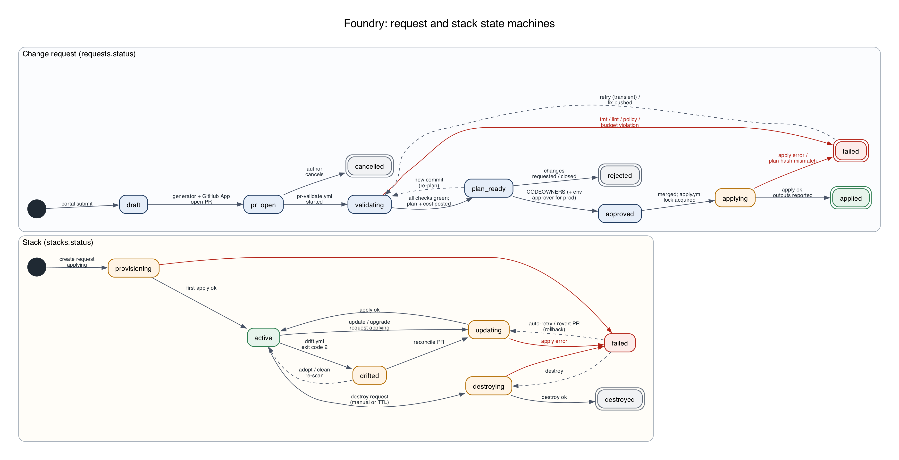
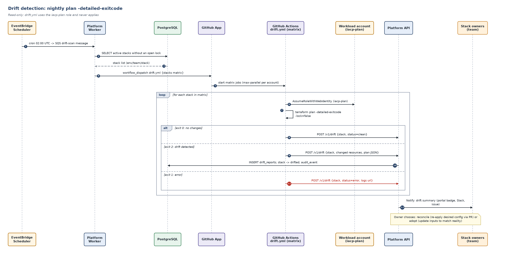
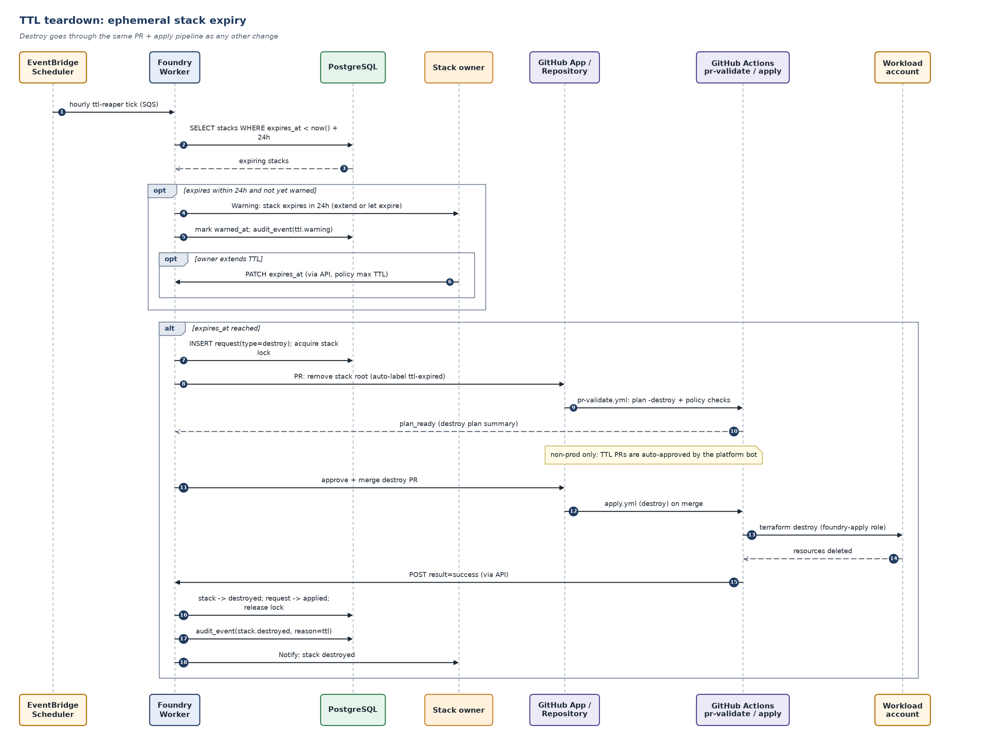

# 06 — Lifecycle Management

> Purpose: describe how the platform manages a stack after it is first provisioned — upgrades, state, locking, drift, recovery, expiry, dependencies, audit, access control and budgets — with the data each feature touches and the operator runbooks.

Related: [03-data-model-and-api.md](03-data-model-and-api.md) · [04-module-registry.md](04-module-registry.md) · [05-automation-pipeline.md](05-automation-pipeline.md) · [07-security-and-policy.md](07-security-and-policy.md) · [ADR-0004](adr/0004-s3-native-locking-plus-platform-lock.md)

## Contents

- [Overview: lifecycle state machines](#overview-lifecycle-state-machines)
1. [Version management](#1-version-management)
2. [State management](#2-state-management)
3. [State locking](#3-state-locking)
4. [Drift detection](#4-drift-detection)
5. [Recovery and rollback](#5-recovery-and-rollback)
6. [TTL and ephemeral environments](#6-ttl-and-ephemeral-environments)
7. [Dependency management](#7-dependency-management)
8. [Audit logging](#8-audit-logging)
9. [RBAC](#9-rbac)
10. [Budget management](#10-budget-management)

---

## Overview: lifecycle state machines



Every lifecycle action is a **request** (`requests.kind` ∈ `create`, `update`, `upgrade`, `destroy`, plus platform-initiated kinds `reconcile` (drift remediation) and `rollback`). Requests are the only way a stack changes; they always produce a PR and pass through the same pipeline ([05-automation-pipeline.md](05-automation-pipeline.md)).

| Request status | Entered when | Exits to |
|---|---|---|
| `draft` | Created in portal/API, inputs validated | `pr_open`, `cancelled` |
| `pr_open` | GitHub App opened PR | `validating`, `cancelled` |
| `validating` | `pr-validate.yml` reported `validating` | `plan_ready`, `failed` |
| `plan_ready` | Checks green, plan hash stored | `approved`, `rejected`, `validating` (new push), `cancelled` |
| `approved` | PR merged | `applying` |
| `applying` | `apply.yml` claimed the stack | `applied`, `failed` |
| `applied` / `failed` / `rejected` / `cancelled` | Terminal | — (`failed` may spawn a retry or rollback request) |

| Stack status | Meaning |
|---|---|
| `provisioning` | First `create` request in flight |
| `active` | Last apply succeeded, no known drift |
| `drifted` | Nightly check found differences |
| `updating` | An `update`/`upgrade`/`rollback` request is `applying` |
| `destroying` | A `destroy` request is `approved` or `applying` |
| `destroyed` | Destroy applied; directory removed; row retained for audit |
| `failed` | Last apply failed; stack is locked to remediation requests only |

The `apply.yml` run reports drive these statuses (docs/03 §4.1, WBS 5.3): the first accepted report of an approved request moves the stack to `provisioning`, `updating` or `destroying`; a succeeded run sets `active` (or `destroyed` after a destroy) and records outputs and the applied commit; a failed or cancelled run sets `failed`. Each move is audited as `stack.status_changed`. A failed post-apply smoke test does not fail the apply: the stack is `active` with `health = degraded` (shown by `GET /v1/stacks/{id}`), the team is told, and nothing is destroyed automatically. The platform lock stays visible on the stack (`lock`): the API releases it when the request ends, and if `apply.yml` reports that its own release failed, that is audited with the lock's current state and never changes the request, so an operator sees whether the stack is still held and until when.

Transitions are implemented in `backend/internal/request/fsm.go` as a table-driven state machine; every transition is a single Postgres transaction that updates the row, writes `audit_events`, and enqueues follow-up work (outbox pattern → SQS).

---

## 1. Version management

**Purpose.** Let teams move stacks to newer module versions safely and predictably, without the platform ever floating a version.

**Design.**

- Stacks pin exact tags (`?ref=modules/s3/v1.2.0`); see [04-module-registry.md](04-module-registry.md#8-how-consumers-pin-versions).
- For every `stack_resources` row the catalog computes an **upgrade path**: the list of released versions newer than the pinned one, grouped by SemVer class.
- An upgrade is an `upgrade` request that changes only the `ref` (and, for majors, inputs) of one module instance. It produces a normal PR whose plan shows the real impact.

**Upgrade-path logic** (`backend/internal/catalog/upgrade.go`):

```text
current = 1.2.0, available = [1.2.1, 1.3.0, 1.4.2, 2.0.0, 2.1.0]

patch  target = highest 1.2.x            -> 1.2.1
minor  target = highest 1.x.y            -> 1.4.2
major  target = highest overall          -> 2.1.0  (path: 1.4.2 -> 2.0.0 -> 2.1.0)
```

| Class | Portal behaviour | Automation | Requirements |
|---|---|---|---|
| Patch | "Update available" badge | Optional team setting `auto_patch=true`: worker opens upgrade requests weekly; dev auto-merges on green | Plan must contain no `delete`/`replace` |
| Minor | **Auto-suggested**: one-click "Upgrade to 1.4.2" with combined CHANGELOG | Worker opens a suggestion (not a PR) and notifies on new minor | Plan must contain no `delete`/`replace`; otherwise request is blocked and the module owners are alerted (SemVer violation) |
| Major | "Major upgrade" panel with migration notes | Never automatic | Must step through each major (`1.x` → latest `1.x` → `2.0.0`); user acknowledges `upgrade_notes`; new required inputs filled in a form; plan reviewed by a team `maintainer` |

Major migrations rely on the module shipping `moved` blocks for any address change so that the plan is an in-place update rather than destroy/create:

```hcl
# modules/sqs/moved.tf (added in v2.0.0 when the DLQ became a separate resource name)
moved {
  from = aws_sqs_queue.dead_letter
  to   = aws_sqs_queue.dlq
}
```

Where a migration cannot be expressed with `moved` (e.g. a resource moves between modules in different stacks), the major's `### Migration` section must describe it, and the upgrade is executed by the platform team using the state-surgery break-glass workflow (§2.3). OPA policy `upgrade.rego` denies any upgrade plan that destroys a stateful resource (`aws_s3_bucket`, `aws_db_instance`, `aws_sqs_queue`, `aws_elasticache_replication_group`, `aws_kms_key`) unless the request carries an approved `allow_replace` exception.

**Data touched.** `module_versions` (read: `upgrade_notes`, `status`), `stack_resources.module_version_id` (updated on apply), `requests` (`kind='upgrade'`, `from_version`, `to_version`), `audit_events`.

**Edge cases.**

- *Pinned version yanked*: the stack is flagged `action_required`; the worker opens an upgrade request to the nearest safe version and assigns it to team maintainers. Plans and destroys on the yanked version still work.
- *Upgrade needs a newer Terraform/provider*: blocked until the environment's pinned versions satisfy the target's compatibility constraint ([04-module-registry.md](04-module-registry.md#6-compatibility-matrix)).
- *Multiple module instances in one stack*: upgrades are per instance; the portal offers "upgrade all instances of s3 in this stack" as a single request.
- *Concurrent update request open*: the platform lock (§3) queues the upgrade.

**Runbook — a minor upgrade shows a replace.**
1. Do not approve. Mark the request `rejected` with reason `semver_violation`.
2. Open an issue against the module with the plan excerpt; module owners yank or patch the version (ship a `moved` block or revert the behaviour in a new patch).
3. Re-run the upgrade against the fixed version.

---

## 2. State management

**Purpose.** Keep Terraform state durable, private, recoverable and isolated per stack.

**Design.** One state file per stack, in the platform account:

| Property | Value |
|---|---|
| Bucket | `iacp-tfstate-<platform-account-id>` |
| Key | `<env>/<team>/<stack>/terraform.tfstate` |
| Encryption | SSE-KMS with CMK `alias/iacp-tfstate`; bucket key enabled |
| Versioning | Enabled; noncurrent versions retained 90 days, then transitioned to Glacier IR, expired after 400 days |
| Access | Public access blocked, TLS-only bucket policy, Object Ownership enforced |
| Who can read | `iacp-plan` roles: `s3:GetObject` on `<env>/*` of their environment only |
| Who can write | `iacp-apply` roles: `s3:GetObject`, `s3:PutObject`, `s3:DeleteObject` on `<env>/*` (lockfiles) |
| Replication | Cross-region replication to `iacp-tfstate-replica-<acct>` (DR) |
| Backup | AWS Backup daily for the bucket (point-in-time restore) |

Generated `backend.tf`:

```hcl
terraform {
  backend "s3" {
    bucket       = "iacp-tfstate-111111111111"
    key          = "development/payments/orders-store/terraform.tfstate"
    region       = "us-east-1"
    encrypt      = true
    kms_key_id   = "arn:aws:kms:us-east-1:111111111111:alias/iacp-tfstate"
    use_lockfile = true
  }
}
```

The backend has no `role_arn`: the job's OIDC session for the workload account's `iacp-plan`/`iacp-apply` role is granted cross-account access to its environment prefix by the state bucket policy and the CMK key policy.

**State and the database.** The database never stores state. After each apply, `apply.yml` reports non-sensitive outputs and the API records `stack_resources.outputs` plus the S3 `VersionId` of the new state object (`pipeline_runs.state_version_id`) — this is the bookmark used by rollback (§5).

### 2.1 Data touched
`stacks.state_key`, `pipeline_runs.state_version_id`, `stack_resources.outputs`, S3 state objects, `audit_events` (`state.read_breakglass`, `state.surgery`).

### 2.2 Edge cases
- *Sensitive values in state*: modules avoid them (Secrets Manager-managed passwords), but state is still treated as secret: no human role reads state outside break-glass.
- *Stack rename*: not supported in place. Renames are a new stack + `terraform state mv` via break-glass, or create/migrate/destroy.
- *Directory deleted with non-empty state*: CI refuses; cleanup PRs are only accepted after a successful destroy recorded by the API.

### 2.3 State surgery policy

State edits are the highest-risk operation on the platform and are never done from laptops.

| Rule | Detail |
|---|---|
| Who | Platform team members in the `iacp-breakglass` GitHub team; **two-person rule** (requester + approver from `@acme/sre`) |
| How | Only via the `state-surgery` workflow (`workflow_dispatch` on a protected `breakglass` GitHub Environment with required reviewers). It assumes `iacp-breakglass-<env>` (session tagged with the requester) |
| Allowed commands | `terraform state list`, `state show`, `state mv`, `state rm`, `import` (via `import` blocks preferred), `state pull` (read-only, artifact encrypted) |
| Forbidden | `state push` of hand-edited JSON; `force-unlock` outside the stale-lock runbook; any `apply` from this workflow |
| Pre-step | Workflow records current state `VersionId` and acquires the platform lock (`kind=breakglass`) |
| Post-step | Runs `terraform plan -detailed-exitcode` and posts the result; stack stays locked until a platform engineer confirms plan matches expectation |
| Audit | `audit_events(type='state.surgery', actor, command, args, before_version, after_version, ticket)`; CloudTrail captures S3 writes |

Prefer config-driven changes (`moved`, `import`, `removed` blocks) shipped through a normal request whenever possible; break-glass is for cases those cannot express.

### 2.4 Runbook — state surgery
1. Open an incident/ticket describing the mismatch and the exact commands.
2. Trigger `state-surgery` with inputs `stack_path`, `commands` (newline-separated, validated against the allow-list), `ticket`.
3. Approver reviews the inputs and the pre-step `state list` output in the job summary, then approves the environment deployment.
4. Verify the post-step plan. If wrong, re-run `state-surgery` with `restore_version=<before_version>` (copies the old S3 object version back as the current version).
5. Release the lock from the portal ("Release break-glass lock") — this writes an audit event.

---

## 3. State locking

**Purpose.** Ensure exactly one actor mutates a stack's infrastructure and its state at a time.

**Design.** Two layers ([ADR-0004](adr/0004-s3-native-locking-plus-platform-lock.md)):

| Layer | Mechanism | Scope | Held for | Protects against |
|---|---|---|---|---|
| Terraform | S3 native lockfile `<key>.tflock` (`use_lockfile = true`, conditional write `If-None-Match`) | One Terraform operation | Duration of `apply` / `state` command | Two Terraform processes writing state concurrently |
| Platform | Row in `locks`, 1:1 with `stacks` (`stack_id` PK, `request_id`, `holder`, `fencing_token`, `acquired_at`, `expires_at`) | One request | From request creation until terminal status | Two requests editing the same stack config, plan-hash invalidation, merge races |
| Workflow | GitHub `concurrency: stack-<id>-apply` | One job | Job duration | Two apply runs for the same stack (e.g. retry + push) |

Acquisition (`backend/internal/locks`; full SQL in [03 §2](03-data-model-and-api.md)): every lock operation first takes `SELECT … FOR UPDATE` on the `stacks` row, so operations on one stack run one at a time. The pure `locks.Decide` then picks one outcome:

| Lock state | Caller | Outcome |
|---|---|---|
| held by the caller (live or expired) | holder | `held`: lease renewed, token kept |
| live lease held by another request | anyone | `queued` behind the holder |
| free, or expired lease | oldest waiter, or nobody is waiting | `granted`: new lease, new `fencing_token` (upsert) |
| free, or expired lease | newcomer while others wait | the oldest waiter is granted first; the caller is `queued` behind it |

A queued request stays `draft` with `requests.queued_behind` set to the current holder (every waiter points at the holder; order is `created_at`, then id); the portal shows "Waiting for req-… to finish", and a queued request cannot open its PR (`409 stack_locked`). `fencing_token` comes from `lock_fencing_seq`, so every grant on a stack has a larger token than all earlier ones. It is recorded on the request, passed to every pipeline callback, and stale tokens are rejected (`409 stale_fencing_token`), so a late callback from a superseded run cannot change stack status. The holder renews its lease with a heartbeat. When a request reaches a terminal status the worker releases the lock with its token; in the same transaction the oldest queued request is granted a new lease and the other waiters are pointed at it (its config is regenerated against the latest `main`).

PR plans run with `-lock=false` (read-only) and drift checks too; only `apply.yml` and break-glass take the S3 lock.

**Data touched.** `locks`, `requests.queued_behind`, `requests.fencing_token`, S3 `*.tflock` objects, `audit_events` (`lock.acquired`, `lock.queued`, `lock.released`, `lock.force_released`).

**Edge cases.**
- *Abandoned PR*: the lock has `expires_at` (7-day lease, renewed by heartbeat). An expired lease can be taken over (oldest waiter first); the old holder's token is then stale. The worker warns the requester at day 5; at expiry it closes the PR, cancels the request and releases the lock.
- *Runner died mid-apply*: the S3 lockfile remains; the `workflow_run` webhook reports the job as failed/cancelled (or the reconciler finds it timed out). The stack is marked `failed` with reason `apply_interrupted`.
- *Human merges a PR out of band*: CODEOWNERS + platform lock check refuses (via `GET /v1/internal/requests/by-path`) to apply a commit not associated with the lock-holding request (HTTP 409); the run fails and alerts.

**Runbook — stale Terraform lock.**
1. Confirm no `apply` job for the stack is running (`gh run list --workflow apply.yml`) and the platform lock shows `apply_interrupted`.
2. Read the lock: `aws s3 cp s3://iacp-tfstate-<acct>/<key>.tflock -` and note the lock `ID` and `Who`.
3. Trigger `state-surgery` with command `force-unlock <ID>` (the only sanctioned use of `force-unlock`; requires break-glass approval).
4. Retry the request from the portal ("Retry apply"), which re-plans: if the interrupted apply partially succeeded, the plan shows the remainder.

---

## 4. Drift detection



**Purpose.** Detect changes made outside the platform (console edits, other automation) and make them visible and actionable.

**Design.**

1. EventBridge Scheduler triggers the worker nightly; the worker shards active stacks (≤ 256 per dispatch) and calls `workflow_dispatch` on `drift.yml` via the GitHub App. A cron in `drift.yml` is the fallback.
2. Nightly at 02:00 UTC, per stack, `terraform plan -refresh-only -lock=false -detailed-exitcode` with `iacp-plan`:
   - exit `0` → no drift; `stacks.last_drift_check_at` updated.
   - exit `2` → drift; `resource_drift` summarised into `drift.json`.
   - exit `1` → error; recorded as `drift_check_failed` (not drift).
3. `drift.yml` reports via `POST /v1/runs`; the API writes a `drift_reports` row (`stack_id`, `run_id`, `drifted_resources` JSONB, `severity`), moves the stack `active → drifted`, and notifies the owning team (Slack/email) with a link to the drift view (`GET /v1/drift`).
4. Severity: `high` if drift touches security attributes (policies, encryption, public access, security group rules) per a list in `policies/opa/drift_severity.rego`; otherwise `medium`.

**Resolution options (portal):**

| Option | What happens | Who |
|---|---|---|
| **Reconcile** (default) | `reconcile` request: normal plan/apply re-asserts Git config | developer (dev/staging), maintainer (prod) |
| **Codify** | `update` request that changes module inputs to match reality (generated from drift diff when the drifted attribute maps to an input); otherwise not offered | maintainer |
| **Ignore** | Suppress notification for this report; stays `drifted` | maintainer, with reason |

High-severity drift in production pages the on-call and auto-opens a `reconcile` request that waits in `plan_ready` for approval.

**Data touched.** `drift_reports`, `stacks.status`, `stacks.last_drift_check_at`, `pipeline_runs`, `audit_events` (`drift.detected`, `drift.resolved`).

**Edge cases.**
- *Stack has unapplied changes on `main`* (e.g. after a failed apply): refresh-only isolates real-world drift from pending config changes; the worker additionally runs a full plan and labels the report `pending_changes`.
- *Provider-side noise* (attributes that always diff): handled in the module with `lifecycle { ignore_changes }` and a module patch release, not by suppressing reports.
- *Stack locked by an in-flight request*: drift check is skipped and rescheduled; plans are read-only but results would be misleading mid-change.
- *Resource deleted out of band*: shown as drift with action `delete`; reconcile recreates it (data-bearing resources are flagged `high`).

**Runbook — mass drift alert (> 10 stacks in one night).**
1. Check CloudTrail for a common principal or a provider upgrade in the pipeline image.
2. If caused by a provider change, pause automatic `reconcile` request creation (admin feature flag `drift_auto_reconcile=false`) and fix the module.
3. Otherwise treat as a security incident: identify the principal via CloudTrail, revoke, then bulk-revert via the platform team.

---

## 5. Recovery and rollback

**Purpose.** Return a stack to a known-good state after a failed or harmful change, preferring Git-native mechanisms over state manipulation.

**Design.**

- A failed apply sets request `failed` and stack `failed`, captures the error and classifies it (`backend/internal/recovery/classify.go`) from the apply log and AWS error codes.
- **Rollback** = a `rollback` request whose PR reverts the stack directory to the config of the last `applied` request (the App creates the revert commit from `pipeline_runs.commit_sha`). It goes through the full pipeline, including OPA and cost.
- **State versions** in S3 are a last resort, only via break-glass (§2.3), when state itself is corrupted.

### Failed-apply recovery decision table

| Failure class | Examples (detected by) | Automatic action | Human action |
|---|---|---|---|
| Transient / throttling | `ThrottlingException`, `RequestLimitExceeded`, 5xx, `i/o timeout`, runner lost | At most 2 retries with exponential backoff (2 min, then 10 min) via `workflow_dispatch apply.yml reason=retry`; the retry re-plans and requires hash match against the original approval only if no resources were changed, otherwise re-approval | None unless retries exhausted |
| Eventual consistency | `InvalidParameterValueException: role cannot be assumed`, `NoSuchEntity` right after create | Treated as transient (counts toward the 2-retry limit); first retry after 60 s | None |
| Quota / capacity | `LimitExceededException`, `InsufficientInstanceCapacity` | None; stack `failed`, team + platform notified | Request quota increase, then "Retry apply" |
| Permission denied | `AccessDenied` from `iacp-apply` / boundary | None; alert platform team (policy gap or intended block) | Fix role/boundary (platform PR) or change request |
| Validation / config error | `InvalidParameterCombination`, name conflicts, `AlreadyExists` | None | Submit `update` request fixing inputs; or `import` if resource pre-exists |
| Partial apply with healthy remainder | Some resources created, later one failed | None | "Retry apply" (re-plan converges) or "Rollback" |
| Harmful but successful change | Apply succeeded, service broken | None | "Rollback" (revert PR) — maintainer approval in prod |
| State corruption / lost lock | Checksum mismatch, `state snapshot was created by a newer version` | None; stack locked | Break-glass: restore prior state `VersionId`, then plan |

**Rollback limitations** are surfaced in the portal before submission: rolling back a module major upgrade may not be reversible if the newer version migrated data/attributes; destroyed data (deleted bucket objects, dropped DB) is not recovered by config rollback — S3 versioning, RDS snapshots and AWS Backup are the data-recovery mechanisms.

**Data touched.** `requests` (`kind='rollback'`, `rollback_of_request_id`), `pipeline_runs` (`failure_class`, `attempt`), `stacks.status`, `audit_events`.

**Runbook — production apply failed.**
1. Portal → stack → failed run: read the classified error and apply log artifact.
2. If transient and retries exhausted: verify AWS health dashboard, then "Retry apply".
3. If config error: decide roll-forward (fix inputs via `update`) vs. "Rollback". Prefer roll-forward when partially created resources are harmless.
4. Rollback PR requires maintainer + SRE environment approval as usual.
5. If plan for rollback shows destroy of data-bearing resources, stop and escalate to platform on-call.

---

## 6. TTL and ephemeral environments



**Purpose.** Automatically clean up short-lived stacks (feature environments, experiments) to control cost and sprawl.

**Design.**

- A stack is ephemeral when created with `"ephemeral": {"ttl_hours": N}` (omit `ttl_hours` for the default). Only non-production: `production` is never ephemeral, whatever its environment row says (a trigger forces `allow_ephemeral = false`, the request service refuses it, and the reaper and teardown re-check it). `stacks.is_ephemeral`, `ttl_hours` (as requested), `expires_at` and `ttl_extended_hours` are set at create time, so the clock runs from the moment the request is created, not from the first apply: a create PR that waits a day for review has a day less to live. Bounds, in hours, come from `IACP_TTL_MIN_HOURS` (1), `IACP_TTL_MAX_HOURS` (720, i.e. 30 days), `IACP_TTL_DEFAULT_HOURS` (72) and the environment's own `max_ttl_hours`; a request outside them is `422 policy_preflight_denied` with a pointer on `/ephemeral/ttl_hours`. The TTL is not rendered into `iacp.stack.json` or tagged on resources yet; the database is the source of truth.
- The pure rules live in `backend/internal/ttl`: `Policy.Resolve` (bounds), `ExpiresAt`, `PhaseAt` (none, warn from 24 h before expiry until warned, teardown from expiry), `Eligible` (ephemeral, not production, not already destroying), `Policy.Extend` and `Classify`.
- **Warning.** `ttl-reaper.yml` ([05 section 4.5](05-automation-pipeline.md#45-ttl-reaperyml)) finds stacks in their 24 h window and calls `POST /v1/internal/ttl/{id}/warn`. In one transaction the API sets `ttl_warned_at`, appends the audit event `ttl.warned`, and (when the publisher can comment, i.e. the GitHub App) enqueues a `ttl.warning` outbox job; the worker then comments on the pull request of the stack's newest request with the expiry and the extend link. The local publisher has no pull request API, so there the warning is audit-only. Email, Slack and a portal banner arrive with notifications. The comment is a convenience: if it fails the job is retried and, when exhausted, dies without affecting the TTL.
- **Teardown.** For each expired stack `POST /v1/internal/ttl/{id}/teardown` opens a `destroy` request owned by the platform bot (`iacp-bot`, justification `ttl expired`, audit `ttl.expired`). Under the stack row lock it re-checks that the stack is ephemeral, not production and past `expires_at`, and that no destroy is already open, so a stale list, a late extension or a second reaper run cannot destroy a live stack or open two requests. The request takes the stack lock or queues behind the holder, then follows the normal path: PR with the emptied root, `pr-validate.yml` runs `plan -destroy`, `apply.yml` destroys. An update or apply in flight (`stack_busy`) makes the reaper skip the stack until the next hour, with a `::warning::` in the run so a stack that stays busy is not skipped silently.
- **Backoff and blocking.** A TTL destroy (bot-opened, justification `ttl expired`) that ends `failed`, `rejected` or `cancelled` is not reopened every hour. `ttl.Policy.Backoff`, a pure rule shared by the due list and the teardown route, leaves the stack alone for `IACP_TTL_RETRY_BACKOFF_HOURS` (24) after the newest unsuccessful attempt (`409 ttl_backoff`, skipped by the reaper). After `IACP_TTL_MAX_ATTEMPTS` (3) unsuccessful attempts in the current cycle the stack is blocked: nothing more is opened, the audit event `ttl.blocked` is recorded once, and it is listed in the `blocked` group of the due answer, apart from the teardowns, so that every run reports it with a `::warning::` without spending the per-run teardown cap (`409 ttl_blocked` if teardown is called anyway) until a person extends the stack (a new expiry starts a new cycle) or fixes the failure and destroys it by hand. Attempts created before the current `expires_at` belong to an earlier cycle and do not count.
- **Auto-approval** of the destroy PR in non-production (`ttl_auto_approve.rego`: `requested_by = system:ttl-reaper` and env is not production) is not part of this change; until it lands a maintainer approves the destroy PR like any other. See [08-mvp-roadmap.md](08-mvp-roadmap.md).
- The hourly reaper is the only driver for now. EventBridge Scheduler one-time schedules (`ttl-warn-<id>`, `ttl-expire-<id>`) are the eventual primary path, with the reaper as backstop; they need a real AWS account and arrive with multi-account support.

**Extend:** `POST /v1/stacks/{id}/ttl/extend` with `{"hours": N}` (developer or higher in the stack's team, the `stack.extend_ttl` matrix action). The hours are added to `expires_at` (or to now if it already passed but no destroy is open). Limits: one extension is within the min/max bounds, a stack's extensions total at most `IACP_TTL_MAX_EXTENSION_HOURS` (168 by default, admins included: the cap is a cost control), and the lifetime stays within the environment's `max_ttl_hours`. It clears `ttl_warned_at`, so the stack is warned again before the new expiry, only when the new expiry lies more than 24 h away; an extension that leaves it inside the window keeps the warning already sent. It appends `ttl.extended`. It changes no generated file: there is no pull request. A stack with an open destroy request cannot be extended (`409 destroy_pending`); cancel the destroy first.

**Data touched.** `stacks.expires_at`, `ttl_hours`, `ttl_extended_hours`, `ttl_warned_at`, `requests (kind='destroy')`, `outbox (ttl.warning)`, `audit_events` (`ttl.warned`, `ttl.extended`, `ttl.expired`, `ttl.blocked`).

**Edge cases.**
- *Destroy blocked by non-empty bucket*: ephemeral stacks set `force_destroy = true` on S3 (permitted outside production). Deletion-protected RDS in ephemeral stacks is disallowed by policy.
- *Other stacks depend on it*: TTL destroy is blocked; owners of dependents are notified and the TTL warning includes the dependent list (see §7).
- *Destroy fails*: stack `failed`; transient errors follow the normal 2-retry policy (§5); a `failed` stack is still eligible for a destroy request, so the next reaper run opens a new one (the failed destroy is terminal, so it no longer counts as open); paging the owning team arrives with notifications; resources keep `iacp:expires-at` so a weekly cost report lists them.
- *Stack in-flight request at expiry*: destroy request is queued behind it via the platform lock.

**Runbook — orphaned ephemeral resources.**
1. Run the weekly orphan report (Resource Groups Tagging API: `iacp:expires-at` < now − 48h).
2. For each, find the stack by `iacp:stack-id` tag; if the stack is `destroyed`, open a platform ticket and remove manually with break-glass, recording resource ARNs in the audit note.

---

## 7. Dependency management

**Purpose.** Let stacks consume other stacks' outputs (e.g. Lambda subscribes to a team's SQS queue in another stack) with correct ordering and without `terraform_remote_state`.

**Design.**

- Within a stack, modules reference each other directly (`module.queue.arn`).
- Across stacks, the user selects an upstream **wireable output** in the portal. The API records an edge in `stack_dependencies (stack_id, depends_on_stack_id, output_bindings)`, where `output_bindings` maps upstream outputs to downstream inputs.
- The generator writes upstream values as literals into `iacp.deps.auto.tfvars.json` of the downstream stack, and `depends_on` into `iacp.stack.json`:

```json
{
  "orders_queue_arn": "arn:aws:sqs:us-east-1:222222222222:payments-development-orders",
  "orders_queue_consumer_policy_json": "{\"Version\":\"2012-10-17\",...}"
}
```

- Why no `terraform_remote_state`: downstream roles would need read access to upstream state (which may contain secrets); values would change silently without review; and the platform could not compute ordering. Injected values are reviewed in the PR diff like any other change.

**DAG ordering.**

- The graph is validated on every edge insert: cycles are rejected (`409 dependency_cycle`); edges must stay within the same environment (cross-environment wiring is denied); cross-team edges require the upstream output to be marked `shareable` by its owning team.
- When an upstream stack's apply reports changed wireable outputs, the worker computes affected downstreams and processes them in **topological order** (Kahn's algorithm over `stack_dependencies`). For each level it opens `update` requests (reason `dependency_propagation`, regenerated tfvars); a level starts only when all requests of the previous level are `applied`.

```go
// backend/internal/deps/order.go
func Levels(nodes []StackID, edges map[StackID][]StackID) ([][]StackID, error) {
    indeg := map[StackID]int{}
    for _, n := range nodes { indeg[n] += 0 }
    for _, tos := range edges { for _, t := range tos { indeg[t]++ } }
    var levels [][]StackID
    for len(indeg) > 0 {
        var lvl []StackID
        for n, d := range indeg { if d == 0 { lvl = append(lvl, n) } }
        if len(lvl) == 0 { return nil, ErrCycle }
        sort.Slice(lvl, func(i, j int) bool { return lvl[i] < lvl[j] })
        for _, n := range lvl { delete(indeg, n); for _, t := range edges[n] { indeg[t]-- } }
        levels = append(levels, lvl)
    }
    return levels, nil
}
```

- Creation order is the same: a request that creates an upstream and a downstream stack is split into two sequential requests. `apply.yml` therefore never applies two dependent stacks in one run (enforced by changed-stack detection, [05-automation-pipeline.md](05-automation-pipeline.md#3-stack-layout-and-changed-stack-detection)).
- **Destroy order is reversed**: a `destroy` of an upstream is blocked while dependents exist unless the user selects "destroy with dependents", which creates destroy requests in reverse topological order.

**Data touched.** `stack_dependencies`, `stack_resources.outputs`, `requests (kind='update')`, `audit_events`.

**Edge cases.**
- *Propagation fails mid-graph*: remaining levels pause; the stack that failed follows §5; downstream levels resume once it is `applied`.
- *Upstream output removed in a module major*: upgrade request is blocked until dependents are rewired (the catalog diff of `outputs` vs. edges is shown in the upgrade panel).
- *Sensitive outputs*: never wireable; consumers receive Secrets Manager ARNs instead.

---

## 8. Audit logging

**Purpose.** Provide a complete, tamper-evident record of who requested, approved and changed what, and why.

**Design.** Three correlated sources:

| Source | Records | Retention | Correlation key |
|---|---|---|---|
| `audit_events` (Postgres, append-only, hash-chained) | Every API action and state transition: request created/approved/cancelled, lock events, break-glass, RBAC changes, budget overrides, module publish/deprecate/yank | 7 years (monthly partitions exported to the log-archive bucket as Parquet with Object Lock) | `request_id`, `stack_id` |
| Git + GitHub | PR diff, reviews, check results, workflow logs, artifacts (plans 30 d, applies 90 d) | Git forever; Actions logs exported nightly to log archive | PR number, commit SHA, run ID |
| CloudTrail (org trail) | Every AWS API call, including role session names `apply-<run_id>-<stack_id>` | Log-archive bucket, Object Lock (compliance mode) 7 years | `run_id` in session name |

Hash chain:

```sql
CREATE TABLE audit_events (
  id          BIGSERIAL PRIMARY KEY,
  occurred_at TIMESTAMPTZ NOT NULL DEFAULT now(),
  actor       TEXT NOT NULL,          -- github:<login> | system:<component> | gha:<run_id>
  action      TEXT NOT NULL,          -- request.approved, lock.force_released, ...
  subject     TEXT NOT NULL,          -- stack:<id> | request:<id> | module:<name>@<v>
  data        JSONB NOT NULL,
  prev_hash   BYTEA NOT NULL,
  hash        BYTEA NOT NULL          -- sha256(prev_hash || canonical_json(row without hash))
);
REVOKE UPDATE, DELETE ON audit_events FROM iacp_app;
```

A single writer (`audit.Writer`, serialised with `pg_advisory_xact_lock`) computes the chain inside the same transaction as the business change. A daily job verifies the chain and anchors the latest hash to the log-archive bucket; a break raises a P1 security alert.

**Data touched.** `audit_events`, log-archive bucket, CloudTrail.

**Edge cases.** Webhook replays are deduplicated by `X-GitHub-Delivery` before auditing; clock skew is irrelevant to ordering (ordered by `id`); PII is limited to GitHub login and email.

**Runbook — "who changed this resource?"** Search portal audit by ARN → resolves `iacp:stack-id` tag → stack timeline (requests, approvers, runs) → CloudTrail query filtered on session name `apply-<run_id>-*`. If CloudTrail shows a principal other than `iacp-apply`, it is out-of-band drift (§4).

### 8.1 Following a request live (status stream and resume)

The request page follows a request's lifecycle through `GET /v1/requests/{id}/events`, a Server-Sent Events feed of its status changes taken from `audit_events`. Every `status` frame's id is the audit seq, so it is also a resume point.

**Server** (`backend/internal/httpapi/events.go`):
- A first connection starts with a `snapshot` of the current status. With `Last-Event-ID: <seq>` the stream replays every change after that seq instead (`0` replays the whole history).
- It reads the audit log every 2 s and sends a `: heartbeat` comment every 15 s.
- It ends with an `end` frame once the request is terminal, also on a resume at the terminal seq. Without `end` it closes after a 5-minute lifetime, on server shutdown, or when the caller's session is revoked, expires or is disabled.
- Access is checked on every poll. Each user may hold 5 open streams and the server 500 (`429 too_many_streams`).

**Portal** (`StatusStream` and `RequestPoller` in `portal/src/lib/events/`):

| Situation | Behaviour |
|---|---|
| First connection | Sends `Last-Event-ID: 0`, builds the history from the replay, then follows live. |
| Stream closes without `end` (lifetime cap, dropped connection) | Reconnects with the id of the last frame received. A connection that delivered something starts the next attempt at least 3 s after it started, so a stream that sends one event per connection cannot loop tightly. |
| No bytes at all (not even a heartbeat) for 45 s | The idle watchdog aborts the connection and reconnects the same way. |
| Counting failures | A connection is a failure if it closed within 10 s without delivering an event (a heartbeat alone does not count, so a proxy that sends one heartbeat and closes ends in the polling fallback), or if the watchdog cut it with nothing received. Failed attempts back off exponentially with equal jitter (1 s base, 30 s cap). A healthy idle stream is followed for as long as the page is open. |
| 5 failures in a row, or a `200` that is not `text/event-stream` (its body is cancelled) | Falls back to polling `GET /v1/requests/{id}` every 5 s. Polling pauses while the tab is hidden, reads at once when it is shown, and stops at a terminal status. |
| `401`, `403`, `404` (stream or poll), `429` (stream) | Stops and says why; retrying cannot help. |
| Oversized frame (over 256 KiB) | Dropped; the parser resynchronises at the next blank line. |
| Repeated frame after a resume | Ignored: changes at or below the highest seq seen are duplicates. |
| Request already terminal when the page loads | No stream and no polling; the page shows the outcome. The audit log keeps the full history. |
| `end` | The stream stops for good. |

---

## 9. RBAC

**Purpose.** Map organisational ownership to what a person can request, approve and see, per team and environment.

**Design.** Identity comes from GitHub OAuth; roles derive from GitHub team membership, synced at every login (a periodic and webhook-driven sync is planned; the implemented mapping and matrix are in docs/07 section 7):

| GitHub team convention | The platform role (per team) |
|---|---|
| `iacp-<team>-viewers` | `viewer` |
| `<team>` (any member) | `developer` |
| `<team>-maintainers` | `maintainer` |
| `iacp-admins` | `admin` (global) |

| Action | viewer | developer | maintainer | admin |
|---|---|---|---|---|
| View stacks, plans, costs, audit for team | yes | yes | yes | yes |
| Create/update/upgrade/destroy request — development | — | yes | yes | yes |
| Same — staging | — | yes (approval by maintainer) | yes | yes |
| Same — production | — | create draft only | yes | yes |
| Approve PR for staging/production stacks (CODEOWNER) | — | — | yes | yes |
| Extend TTL | — | yes | yes | yes |
| Accept/ignore drift | — | dev only | yes | yes |
| Manage team budget | — | — | view / request change | set |
| Budget override | — | — | — | yes (with reason) |
| Deprecate module version | module owners | | | yes |
| Yank module version, break-glass, force-release lock | — | — | — | yes (platform team, two-person) |

Enforcement points: API middleware (`authz.Require(team, env, action)`), CODEOWNERS (approvals), GitHub Environment reviewers (production apply), and OPA (`rbac.rego` receives requester role in the budget-context policy data and denies production plans from requests not authored/approved by a maintainer).

**Data touched.** `users`, `teams`, `memberships (role)`, `audit_events (rbac.*)`.

**Edge cases.** User removed from GitHub team mid-request: approvals already given remain valid, pending actions re-check on use. Last maintainer leaves: team flagged; production requests blocked until a maintainer exists.

---

## 10. Budget management

**Purpose.** Stop cost surprises before apply and keep spend attributable per team.

**Design.**

- `budgets (team_id, environment_id, month, limit_amount, alert_thresholds={50,80,100}, hard_block=true, override_by)` — see [03-data-model-and-api.md](03-data-model-and-api.md).
- In `pr-validate.yml`, Infracost produces the monthly delta for the plan; the API supplies `current_committed_usd` (sum of `cost_estimates` for the team's active stacks) via `GET /v1/internal/budget-context`. OPA `budget.rego`:

```rego
package iacp.budget

import rego.v1

projected := data.team.current_committed_usd + input.diffTotalMonthlyCost

deny contains msg if {
  data.budget.hard_block
  projected > data.budget.monthly_limit_usd
  not data.request.budget_override_approved
  msg := sprintf("Projected monthly cost $%.2f exceeds %s budget $%.2f (delta +$%.2f). Request an admin override.",
    [projected, data.team.slug, data.budget.monthly_limit_usd, to_number(input.diffTotalMonthlyCost)])
}

warn contains msg if {
  projected > data.budget.monthly_limit_usd * data.budget.warn_pct / 100
  msg := sprintf("Projected cost is %.0f%% of budget.", [100 * projected / data.budget.monthly_limit_usd])
}
```

- **Override**: an admin approves in the portal (`POST /v1/requests/{id}/budget-override` with reason, max delta and expiry); the API records the approver (`override_by`) and the override details, sets `budget_override_approved` in the OPA context and re-runs checks (re-run of the `pr-validate` workflow via the App).
- **Actuals**: the worker pulls AWS Cost Explorer daily grouped by `iacp:team` tag, stores actuals per stack, and alerts at the budget's `alert_thresholds`; a mismatch > 25% between Infracost estimate and actuals for a stack is surfaced on the dashboard (usage-based costs).

**Data touched.** `budgets` (incl. `override_by`), `budget_overrides`, `cost_estimates`, CUR/Cost Explorer actuals, `audit_events (budget.override.granted)`.

**Edge cases.** Destroy requests always pass (negative delta). Usage-based services (Lambda, SQS) estimate from `cost.drivers` defaults in `module.yaml` or from an Infracost usage file the team can supply. If Infracost is unavailable, the check fails closed in production and warns in development.

**Runbook — team blocked by budget.** Confirm the estimate in the PR comment; check for orphaned ephemeral stacks (§6) consuming budget; either destroy unused stacks or have the team lead request a budget change (admin edits `budgets`, audited) or a one-off override.
