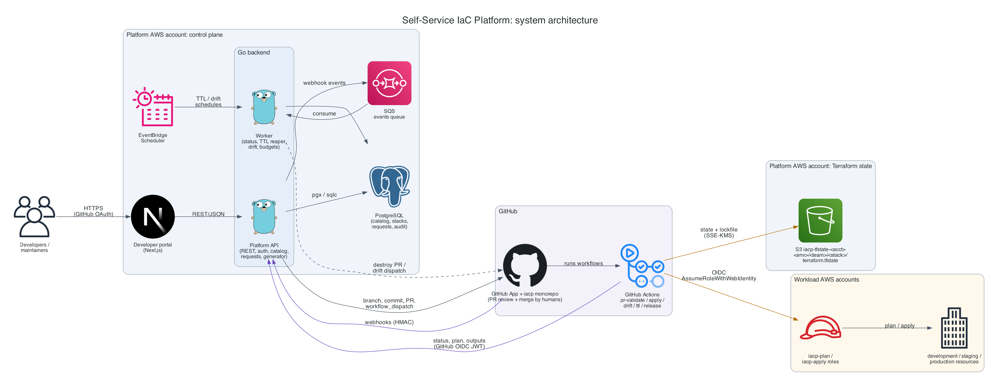

# Self-Service IaC Platform — Design Documentation

The Self-Service IaC Platform is a self-service Infrastructure-as-Code platform: a **package manager for cloud infrastructure** combined with a **secure, PR-driven deployment and lifecycle engine**. Developers pick versioned Terraform modules in a portal, the platform opens a reviewed pull request, and GitHub Actions validates, scans, policy-checks, costs, plans, and applies the change. Every change can be audited.

## Reading order

| # | Document | What it covers |
|---|----------|----------------|
| 00 | [Problem analysis](00-problem-analysis.md) | Problem, goals, personas, requirements, build-vs-buy, risks |
| 01 | [System architecture](01-system-architecture.md) | Components, control plane vs execution plane, end-to-end flows, config generation |
| 02 | [AWS infrastructure](02-aws-infrastructure.md) | Multi-account layout, networking, state backend, OIDC roles, observability, cost |
| 03 | [Data model & API](03-data-model-and-api.md) | PostgreSQL schema, state machines, REST API |
| 04 | [Module registry](04-module-registry.md) | Package contract, `module.yaml`, versioning, catalog |
| 05 | [Automation pipeline](05-automation-pipeline.md) | GitHub Actions workflows, validation/security/policy/cost stages |
| 06 | [Lifecycle management](06-lifecycle-management.md) | Upgrades, state, locking, drift, recovery, TTL, dependencies, audit, RBAC, budgets |
| 07 | [Security & policy](07-security-and-policy.md) | Threat model, IAM, OPA/Checkov policies, RBAC matrix |
| 08 | [MVP roadmap](08-mvp-roadmap.md) | Phased delivery plan, acceptance criteria, metrics |
| — | [Architecture decisions](adr/README.md) | ADRs for the key design choices |
| — | [Diagrams](diagrams/README.md) | Python sources and rendered images |

## Diagrams at a glance

| Diagram | Image |
|---------|-------|
| System architecture | [architecture.png](diagrams/images/architecture.png) |
| AWS infrastructure | [aws-infrastructure.png](diagrams/images/aws-infrastructure.png) |
| CI/CD pipeline | [cicd-pipeline.png](diagrams/images/cicd-pipeline.png) |
| Backend components | [component-backend.png](diagrams/images/component-backend.png) |
| Data model (ERD) | [data-model.png](diagrams/images/data-model.png) |
| Request / stack state machines | [state-machine-request.png](diagrams/images/state-machine-request.png) |
| Sequence: provision request | [seq-provision-request.png](diagrams/images/seq-provision-request.png) |
| Sequence: apply on merge | [seq-apply-on-merge.png](diagrams/images/seq-apply-on-merge.png) |
| Sequence: drift detection | [seq-drift-detection.png](diagrams/images/seq-drift-detection.png) |
| Sequence: TTL teardown | [seq-ttl-teardown.png](diagrams/images/seq-ttl-teardown.png) |
| Sequence: module release | [seq-module-release.png](diagrams/images/seq-module-release.png) |

## Technology stack

| Layer | Choice |
|-------|--------|
| Frontend | Next.js (React) |
| Backend | Go (chi, pgx, sqlc) |
| Database | PostgreSQL (RDS) |
| Infrastructure | Terraform, AWS |
| CI/CD | GitHub Actions + GitHub App |
| Security | OPA/conftest, Checkov, TFLint, IAM, KMS |
| Authentication | GitHub OAuth (users), GitHub OIDC (pipelines to AWS) |
| State storage | S3 (SSE-KMS, versioned, native lockfile) |
| Cost | Infracost |
| Testing | Terratest, LocalStack, Docker |
| Observability | CloudWatch |
| Diagrams | Python (`diagrams`, matplotlib, graphviz) |
