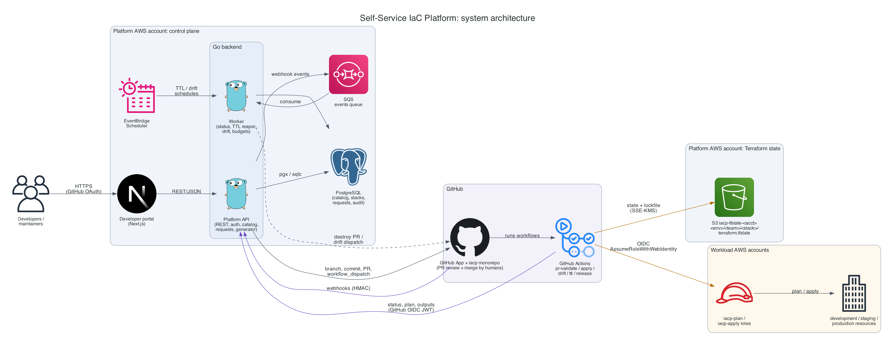

# Case study: a self-service IaC platform

## The problem

In many teams, getting a queue or a bucket means filing a ticket or copying Terraform from another repository. Tickets are slow, copied code drifts from the secure baseline, and afterwards nobody can say who changed what. The goal was self-service that keeps review, policy and an audit trail.

## Goals

- Request standard infrastructure in minutes, without writing Terraform.
- Every change goes through a pull request, automated checks and a human review.
- No static cloud credentials, and least privilege for each pipeline.
- Manage the stack after it exists: drift, expiry, cost, upgrades and recovery.
- Record every state change in a log where tampering can be detected.

## Architecture

A **module registry** holds versioned Terraform modules with secure defaults and a `module.yaml` manifest whose JSON Schema describes the inputs. A **Go control plane** with PostgreSQL checks requests against the catalog, takes a stack lock, renders a stack root and opens a PR. **GitHub Actions** validates, scans and plans the PR, and applies on merge. Workflows report back over OIDC-authenticated endpoints, and those reports drive request and stack status ([ADR-0012](adr/0012-apply-reports-drive-lifecycle.md)). A Next.js portal sits in front of the API.

## Key design decisions

**Terraform runs only in Actions** ([ADR-0001](adr/0001-pr-based-gitops-provisioning.md), [ADR-0002](adr/0002-terraform-executes-in-github-actions.md)). The backend holds no cloud credentials and never runs `terraform`, and the PR is the one place a change is reviewed. The cost is that every change waits for a workflow run.

**Stack roots are generated.** `backend/internal/generator` is a pure function from a request spec to files. Its output is deterministic, `fmt`-clean and checked against golden files. User strings are escaped so `${` cannot inject an expression, and module sources are always pinned to `?ref=modules/<name>/vX.Y.Z`. Reviewers read a small diff from a known template.

**Locks with fencing tokens** ([ADR-0004](adr/0004-s3-native-locking-plus-platform-lock.md)). Terraform's state lock covers one run. The platform lock covers a request from PR to apply, with an increasing token, an expiring lease and a FIFO queue. Run reports must carry the current token, so a stale workflow cannot move a stack it no longer owns.

**OIDC route classes** ([ADR-0005](adr/0005-github-oidc-for-aws-access.md)). Each internal route names the workflow, ref and event allowed to call it. A pull-request token reaches only `/v1/runs`. Lock routes need `apply.yml` or `ttl-reaper.yml` on `main`. Token ids are stored, so a replayed token is refused.

**An append-only audit hash chain** ([ADR-0010](adr/0010-audit-hash-chain-computed-in-go.md)). Each row's hash is `sha256(prev_hash || canonical JSON)`, computed in Go in the same transaction as the change. PostgreSQL triggers enforce the linkage and reject `UPDATE`, `DELETE` and `TRUNCATE`, and the API's role can only insert and select. `GET /v1/audit/verify` recomputes any range.

**Policy as code** ([ADR-0006](adr/0006-opa-conftest-and-checkov.md)). Checkov and TFLint check the code. OPA runs through conftest on the plan JSON, where values are resolved, and covers tags, KMS encryption, public access, IAM wildcards, pinning, yanked versions, placement and budgets.

**The budget gate's trust boundary, and the stack guard** ([ADR-0014](adr/0014-budget-gate-inputs-and-deferrals.md)). A PR controls its own stack root, so the gate runs the base commit's tools and policy, takes the estimate only from an isolated cost job, and reads the budget from the API. Before `terraform init`, the stack guard (`check-stack`, also from the base commit) refuses anything the generator would not write: `resource` or `data` blocks, provisioners, providers outside an allow-list, unknown lock hashes, symlinks or a `.terraform` directory. No PR-authored program runs at plan time.

## Security hardening found in review

Every feature was reviewed before merge, and several reviews found real holes:

- **Code execution at plan time.** The first budget gate priced whatever plan the PR produced, so PR code could shape both the plan and the estimate. That finding produced the stack guard.
- **IAM escalation through wildcards.** `modules/lambda` and `modules/ecs-service` accept extra policy JSON, and `iam:Pass?ole` or `i?m:PassRole` slipped past a literal `iam:PassRole` check. Both modules now reject every wildcard spelling and `iam:` actions on `Resource "*"`. The fix shipped as a breaking 2.0.0 with upgrade notes.
- **Over-broad pipeline tokens.** A genuine OIDC token proves the repository, not the right to call a route, and a workflow file edited in a PR can mint one. Review added the route classes, event allow-lists, matching of the token's own run and commit, and `jti` replay protection.

## Testing strategy

Pure logic is tested without mocks: state machines, SemVer, lock decisions, the failure classifier and the generator, the latter pinned by golden files. Repositories have integration tests against real PostgreSQL, including a concurrency test that proves one lock winner. Modules have `terraform test` suites, run again on their minimum provider versions, plus Terratest against LocalStack. OPA policies have positive and negative tests with rule coverage above 90 percent. The tooling has pytest and the portal has Vitest. Go and Python share redaction test vectors.

## Trade-offs

- **Local-first** ([ADR-0009](adr/0009-local-first-localstack-and-local-backend.md)). LocalStack and a `local` backend cost nothing and keep credentials out of the picture. In return, state is throw-away per CI job, and some AWS behaviour cannot be tested.
- **A Postgres outbox instead of SQS** means fewer moving parts, behind one swappable interface.
- **PRs as the interface** give review and history for free, at the cost of minutes of latency.
- **The budget is per stack** until committed cost is recorded on apply.

## What's next

Deploy the real AWS foundation (state bucket, KMS, OIDC roles, permission boundary). Register the GitHub App and apply the rulesets. Enable production behind a pre-apply approval gate, and record committed cost on apply. After that come cross-stack dependencies and multi-account vending.
